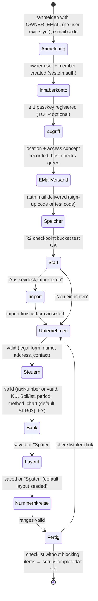

# F01 — Setup Wizard and Company Settings
> **Status:** v1.1 · 2026-10-12 (platform update: owner account with passkey, `BASE_DOMAIN` + tailnet access concept, Cloudflare auth e-mail, R2 storage; SMTP, IMAP and payment-provider steps removed; Enable Banking connection) · **Phases:** P0 (wizard incl. owner account, access concept, auth e-mail and R2 checkpoint storage, company profile, tax settings, bank accounts, number ranges, layouts, text templates, lookups, server location, system page basics), P1 (rule overrides, external-services/AVV list, integrity status, letterhead PDF, number register viewer), P2 (R2 receipt-inbox bucket, Claude OCR, Enable Banking connection) · **sevdesk parity:** [00 §2.2, §2.3, §5](../../research/00-sevdesk-feature-inventory.md#22-settings-tree), [08 §5](../../research/08-sevdesk-invoicing.md#5-numbering-text-templates-layouts-email), [09 §8](../../research/09-sevdesk-contacts-products-reports.md#8-integrations-sevi-settings-navigation-onboarding-migration), [02 #12, #22, #35](../../research/02-competitor-gap-features.md) · **Compliance:** MAIL-03, UST-04, UST-06, UST-13, KU-01, KU-02, KU-03, KU-04, KU-05, UVA-01, UVA-06, AO-01, AO-04, AO-06, AO-07, ER-03, ER-10, MISC-01, MISC-02, DATEV-01, DATEV-02, DATEV-04, GOBD-02, GOBD-06, GOBD-09, GOBD-10, GOBD-20, GOBD-22, UST-03, UST-05, UST-08, UST-15, UST-20, UST-21, UST-30, UST-34, UVA-05, MISC-04, MISC-08, MISC-09, MAHN-02, DSGVO-04, DSGVO-05, SEC-01, SEC-02, SEC-04, SEC-06, SEC-07

## 1. Scope (in / out, and what we do better than sevdesk)

**In scope**

- First-run **setup wizard** (resumable) that collects everything needed before the first document can be finalised.
- **Company profile** (`companyProfile`, versioned): legal form, name, address, contact, register data, representatives, capital, tax IDs, electronic address (BT-34), DATEV keys, SEPA creditor ID, logo, document defaults.
- **Tax settings**: Kleinunternehmer history (date-effective), Soll/Ist history, UStVA period per year, EÜR/Bilanz, chart of accounts (**SKR03 default**, SKR04 selectable), shareholder clearing accounts for corporations, fiscal year, founding date, prior-year turnover figures.
- **Owner account** (first sign-up with `OWNER_EMAIL`, mandatory passkey enrolment, optional TOTP) as the first wizard step (02 §4.2–4.3).
- **Server location** and **access concept** record: `BASE_DOMAIN`, the five tailnet hostnames, login + tailnet (AO-06, SEC-07).
- **Bank accounts for invoices** (`bankAccounts`; invoice-relevant fields only). **Owner decision: bank sync via Enable Banking** (licensed PSD2 AISP, read-only; ADR-011) with CAMT.053/CSV statement import as fallback. One connection yields all accounts the owner shares in the bank's consent screen (for Revolut Business: one per currency pocket); manual (unsynced) accounts can still be printed on invoices.
- **Number ranges** (`numberRanges`, `numberCounters`, `numberRegister` viewer): format tokens, preview, reset policy, gap report.
- **Layouts** (`layouts`, `layoutVersions`): template, colour, font, logo, letterhead PDF, print options, versioning.
- **Text templates** (`textTemplates`) and the full **placeholder dictionary**.
- Lookups: **units** (UN/ECE Rec 20), **payment methods**, **tags**, **custom fields**, **cost centres**.
- **Auth e-mail** status (Cloudflare Email Sending: sender, test code). **The app never e-mails customers** — there are no SMTP mail identities (02 §9).
- **Integrations**: R2 checkpoint bucket, R2 receipt-inbox bucket (P2, replaces IMAP), Claude OCR (opt-in, AVV confirmation); external-services overview (DSGVO-04).
- **Rule overrides** (`ruleOverrides`) on top of the code-shipped date-effective rule tables (e.g. Basiszinssatz).
- **System page**: versions, health, integrity status, cron status.

**Out of scope (owned elsewhere)**

| Topic | Where |
|---|---|
| Enable Banking sync (consent, 6-hourly polling, re-consent, booking), statement import, matching rules | F07 Banking (P2). This spec covers the **connection settings UI** (SET-049) and the invoice-relevant fields of each account |
| API keys, webhook endpoints, MCP settings pages (`/einstellungen/api`, `/webhooks`, `/mcp`) | API/MCP feature spec |
| sevdesk/CSV import (`/einstellungen/import`) | Import feature spec. The wizard links to it |
| Audit-log viewer (`/einstellungen/audit`) | Platform feature spec |
| DSGVO request handling (`dsgvoRequests`) | DSGVO feature spec (P3). This spec only covers the external-services/AVV list |
| Dunning policies, recurring settings, per-document behaviour toggles | Dunning, recurring and invoice feature specs |
| Verfahrensdokumentation content | GOBD-10 doc spec. This spec supplies the settings it is generated from |
| Members, roles, invites, sign-in pages | 02 §4.2–4.3 (Better Auth, `members`, `invites`), 04 §4.9–4.10 (UI). This spec covers only the owner account created in the wizard (SET-009) |
| Several companies in one instance | None. One instance = one company. Run a second deployment for a second company (sevdesk is not multi-tenant either) |

**What we do better than sevdesk**

1. The **legal form drives the mandatory Geschäftsbrief data** (MAIL-03). Missing items block finalisation and link straight to the field. sevdesk only shows free-text fields.
2. **Date-effective tax history.** Kleinunternehmer, Soll/Ist and UStVA period are stored with validity dates, so old documents can be reproduced and the KU waiver lock (KU-04) is enforced. sevdesk has one global toggle.
3. **Number ranges** with real tokens, a yearly/monthly reset, any number of ranges per document type, a live preview, collision checks and a number register with a gap report. sevdesk has one range per type and hand-written leading zeros.
4. **Versioned layouts.** Every finalised document points to the exact layout version it was rendered with (GOBD-06). sevdesk changes all drafts silently and old PDFs cannot be rebuilt.
5. **Several bank accounts** on invoices (a sevdesk complaint, research 02).
6. **Custom fields with types** (text, number, date, select, boolean) on contacts, products and documents, printable and usable as placeholders. sevdesk only has name/description contact fields.
7. **No tier gating.** Cost centres, all layouts, unlimited letterheads and text templates are included.
8. A **system page** that shows validator versions, rule-table freshness and the integrity status of the hash chain.

## 2. User stories

**As the owner**
- US-01: On first start I am guided through a short wizard. I can stop at any step and continue later, and I cannot accidentally issue an invoice with incomplete company data.
- US-02: When I pick "GmbH", the form asks for exactly what a GmbH must print (Registergericht, HRB, Geschäftsführer), and I see a preview of the resulting footer.
- US-03: I am a Kleinunternehmer today. When I cross the threshold or waive the regulation, I record the date, and the system applies the right rules to every document by its supply date.
- US-04: I define the invoice number format `RE-{YYYY}-{####}` with a yearly reset and see the next numbers before saving.
- US-05: I upload my letterhead PDF, choose colours and print options, and see a live preview with a sample invoice.
- US-06: I write a reminder template with `{{contact.letterSalutation}}` and `{{document.number}}`, and the editor shows me which placeholders exist.
- US-07: During setup I register a passkey for my account, and I see that sign-in codes from the Cloudflare sender reach me, with a clear German error if they don't.
- US-08: I can enable Claude OCR only after confirming that I have an AVV with the provider, and I am warned if the endpoint is outside the EU.
- US-09: On 1 January the Basiszinssatz changes before a release ships. I add an override with its source so my dunning interest stays correct.
- US-10: On the system page I can see at a glance that backups, the integrity check and the validators are healthy and current.

**As Claude via MCP**
- US-11: I read the company profile, number ranges, units, payment methods and text templates so I can draft correct documents without asking the owner.
- US-12: I can propose a change to the company profile (e.g. a new phone number). The change only applies after the owner approves it in the client.
- US-13: I can create tags, units and text templates for the owner. I can never change tax status, server location or secrets.

**As my website via API**
- US-14: I fetch the list of units, payment methods and the public company data (name, address, VAT ID) to show them on the checkout page.
- US-15: I can read the system health endpoint to monitor the instance.

## 3. Functional requirements

### 3.1 Setup wizard

| ID | Requirement | Priority | Phase | Compliance refs |
|---|---|---|---|---|
| SET-001 | On first start (no `companyProfile.setupCompletedAt`), every signed-in route except `/einstellungen/**`, `/einrichtung/**`, `/kontakte/**`, `/produkte/**`, `/konto` and `/einstellungen/import` redirects to `/einrichtung`. Contacts, products and imports may be created before setup is complete. Only the owner can open the wizard; before the owner exists, `/anmelden` accepts only `OWNER_EMAIL` (02 §4.3) | MUST | P0 | — |
| SET-002 | The wizard has the steps from 04-ui-ux §4.8 in this order: 1 Inhaberkonto (SET-009), 2 Adressen & Zugriff (SET-007), 3 E-Mail-Versand (SET-009a), 4 Speicher (SET-009b), 5 Start (choice "Neu einrichten" / "Aus sevdesk importieren" → link to import, then return), 6 Unternehmen, 7 Steuern, 8 Bank, 9 Layout, 10 Nummernkreise, 11 Fertig. Steps 8 and 9 can be skipped ("Später"). Steps 1–4, 6, 7 and 10 cannot. There are no SMTP, IMAP or payment-provider steps | MUST | P0 | MAIL-03, UST-04, AO-06, SEC-04 |
| SET-003 | Each step saves on "Weiter" (partial profile allowed). The wizard resumes at the first incomplete step. Progress is derived from data, not stored separately | MUST | P0 | — |
| SET-004 | Step 8 shows a **compliance checklist** produced by the same domain validator that guards finalisation (`validateCompanyForDocuments`), with links to the fields that fix each item. "Einrichtung abschließen" is enabled only when there are no blocking items. It sets `setupCompletedAt` and writes an audit entry | MUST | P0 | MAIL-03, UST-04, GOBD-06 |
| SET-005 | Until setup is complete, every finalise action (UI, REST, MCP) is refused with `SETUP_INCOMPLETE` (HTTP 409). Drafts may be created | MUST | P0 | MAIL-03 |
| SET-006 | Step 10 seeds the default number ranges (§3.5 SET-053) and lets the owner edit the format and the next value of each (e.g. to continue the sevdesk sequence) | MUST | P0 | UST-06 |
| SET-007 | Step 2 "Adressen & Zugriff" records the server location (SET-046) and the **access concept** (`companyProfile.accessConcept`): `BASE_DOMAIN` (read from the deployment, shown with the five hostnames `app.`, `api.`, `convex.`, `convex-site.`, `convex-dash.`), network = tailnet only, optional tailnet name. It runs live checks and shows each result: every host resolves and serves a valid certificate for `*.<BASE_DOMAIN>`; `api.` returns 404 for a UI path; `convex-dash.` demands basic auth; the current request carries a valid session; passkey RP ID = `BASE_DOMAIN`. The owner confirms "Die Anwendung ist nur im Tailnet erreichbar" | MUST | P0 | AO-06, SEC-01, SEC-07 |
| SET-009 | Step 1 "Inhaberkonto": the owner, signed in by e-mail code as the bootstrap user, **must register a passkey** (WebAuthn on `app.<BASE_DOMAIN>`, RP ID `BASE_DOMAIN`) before continuing; optional TOTP setup; shows name and e-mail (= `OWNER_EMAIL`, read-only). A second passkey (e.g. phone) is recommended ("Weiteren Passkey hinzufügen"). Completion is derived from data (owner has ≥ 1 passkey) | MUST | P0 | SEC-01, SEC-02 |
| SET-009a | Step 3 "E-Mail-Versand" shows the Cloudflare sender (`AUTH_MAIL_FROM`), the account ID and whether the API token is configured (never its value), and the owner's notification address (default `OWNER_EMAIL`). The step is complete when an auth mail was delivered successfully (the bootstrap sign-in code counts) or after "Test-Code senden" succeeds; failures show the mapped German error (§5.9). It states "Diese Anwendung versendet keine E-Mails an Kunden." | MUST | P0 | DSGVO-04 |
| SET-009b | Step 4 "Speicher" tests the R2 checkpoint bucket (SET-115: write + read + delete of a probe object, jurisdiction, bucket-lock rule present → ✓, absent → warning "empfohlen") and shows whether Dokploy backups exist in the R2 backup bucket (latest `postgres/` object; "noch keine Sicherung" is a warning, not a blocker). A failing checkpoint-bucket test blocks the step | MUST | P0 | SEC-04, SEC-05 |
| SET-008 | After completion the wizard is no longer shown. Every setting stays editable in `/einstellungen/**`. A "Einrichtung erneut prüfen" button reruns the checklist | MUST | P0 | — |

### 3.2 Company profile and Geschäftsbrief data

| ID | Requirement | Priority | Phase | Compliance refs |
|---|---|---|---|---|
| SET-010 | Store the company profile as the singleton `companyProfile`. Every change increments `version` and appends the full previous state to `companyProfileVersions` (with actor, channel, timestamp). Finalised documents snapshot the company data they used (03 §4 `documentSnapshots`) | MUST | P0 | GOBD-06, UST-03 |
| SET-011 | The legal form is chosen first. The form then shows exactly the fields required by the **Geschäftsbrief matrix** (§5.2) and marks them as mandatory | MUST | P0 | MAIL-03 |
| SET-012 | `validateCompanyForDocuments(profile, docType, date)` is a pure domain function returning blocking errors and warnings. It runs in the wizard, on the settings page, in the editor compliance panel and in the finalisation guard. Missing mandatory items for the legal form block finalisation of every document type that is a Geschäftsbrief (quote, order confirmation, delivery note, all invoice types, reminder) | MUST | P0 (function), P1 (finalisation guard) | MAIL-03, UST-03, UST-04 |
| SET-013 | The **footer preview** shows the computed Geschäftsbrief footer (3 columns: company and contact · register, representatives and tax IDs · bank accounts). When the legal form changes, the page shows the delta, e.g. "Pflichtangaben im Fußtext: + Registergericht, + HRB, + Geschäftsführer" | MUST | P0 | MAIL-03 |
| SET-014 | The footer cannot be switched off in the layout. The only exception is SET-075 ("Pflichtangaben im Briefpapier enthalten") | MUST | P0 | MAIL-03 |
| SET-015 | Fields: legal form, `name` (Firma or full owner name), `tradeName`, `address` (street, street2, postal code, city, country, P.O. box), `seat` (Sitz, defaults to the address city), `contact` (name, phone, e-mail, website), `register` (court, type, number), `representatives` (`{ name, role?: "chair" }[]`, label depends on legal form: Geschäftsführer / Vorstand / Gesellschafter), `supervisoryBoardChair`, `generalPartner` (GmbH & Co. KG), `shareCapital`, `taxNumber`, `vatId`, `taxOffice`, `electronicAddress`, `creditorId`, `datev`, `logoStorageId`, `defaults` | MUST | P0 | MAIL-03, UST-03, ER-10 |
| SET-016 | `contact.name`, `contact.phone` and `contact.email` are mandatory because XRechnung requires seller contact BT-41/42/43 | MUST | P0 | ER-10 |
| SET-017 | `electronicAddress` (BT-34) defaults to scheme `EM` with `contact.email`. The owner may choose `9930` (USt-IdNr) instead. `0204` (Leitweg-ID) is only allowed if the company itself is a public body (warning) | MUST | P0 | ER-10 |
| SET-018 | Logo upload: PNG, JPEG or SVG, ≤ 2 MB, ≥ 300 px wide (raster). SVG is sanitised (no scripts, no external references) and rasterised to PNG at 600 dpi for PDF/A. The original upload is kept | MUST | P0 | ER-11 |
| SET-019 | Document defaults (`defaults`): payment terms (default 14 days, no Skonto), price mode (`net`), language (`de`), backdate window (default 10 days, 0–60), quote validity (default 30 days, 1–365) | MUST | P0 | UST-05, MAHN-04 |
| SET-020 | Changes to the company profile never alter finalised documents. The settings page says so ("Bereits fertiggestellte Dokumente bleiben unverändert.") and shows how many drafts will pick up the change | MUST | P0 | UST-03, GOBD-06 |
| SET-022 | **Seller data for follow-up documents.** New documents use the company data current at finalisation. A Storno (`cancellation`) or Rechnungskorrektur (`correction`) copies the seller block (name, legal form, address, tax IDs, register data) from the **original invoice's snapshot**, because it must come from the same issuer as the original. If the current data differ, the editor shows both and the owner may switch to the current data only after confirming "Gleiches Unternehmen, nur Namens-/Adressänderung (keine Umwandlung)". Reminders and other new Geschäftsbriefe always use current data | MUST | P1 | UST-03, UST-30, MAIL-03 |
| SET-023 | Files referenced by a snapshot (logo, letterhead, layout version) are never deleted while any referencing document is within its retention period. Replacing the logo uploads a new file; the old one stays | MUST | P0 | GOBD-06, GOBD-20 |
| SET-024 | Each finalised document stores the tax regime it was issued under in `documentSnapshots.ruleVersions` (KU status row, taxation-method row, rule rows used). Later history changes never re-evaluate it | MUST | P1 | GOBD-06, UVA-06, KU-01 |
| SET-021 | `GET /api/v1/settings/company/public` returns only the public subset (name, trade name, address, contact, VAT ID, register, representatives, website) so websites can show it without `settings:read` on secrets | SHOULD | P1 | — |

### 3.3 Tax settings

| ID | Requirement | Priority | Phase | Compliance refs |
|---|---|---|---|---|
| SET-030 | Store `taxNumber` normalised to the 13-digit ELSTER format plus the regional display format. Input accepts the regional 10/11-digit format (with the Bundesland chosen from a list) or the 13-digit format. At least one of `taxNumber` / `vatId` is mandatory | MUST | P0 | UST-04 |
| SET-031 | Validate `vatId` as `DE` + 9 digits with the MOD 11,10 check digit. An optional button "Über VIES prüfen" runs a simple VIES check of our own ID and stores the result in `vatIdChecks` (without `contactId`) | MUST (format), COULD (VIES) | P0 | UST-04, MISC-04 |
| SET-032 | **Kleinunternehmer history** `kleinunternehmer[]` (`validFrom`, `isKU`, `waiverDate?`). The status for a document is resolved by the **supply date**. The UI shows the history as a timeline and the current status as a badge | MUST | P0 | KU-01, KU-02, KU-04 |
| SET-033 | Adding a KU entry follows the rules in §4.2 and §5.3: entering KU only on 1 January or on `foundedOn` and only if the prior-year turnover is ≤ 25,000 €. A waiver (`waiverDate`) starts on 1 January and locks KU for 5 calendar years. A switch back within the lock is blocked unless overridden with a reason (audit entry) | MUST | P0 | KU-01, KU-04 |
| SET-034 | Entries whose effective range contains a finalised document are immutable. Corrections are made by appending a new entry. A retroactive entry (validFrom ≤ the latest finalised document date) requires a reason and shows the list of affected documents with the hint to correct them (Rechnungsberichtigung or Storno) | MUST | P0 | KU-03, GOBD-06, UST-30 |
| SET-035 | When the KU monitor (KU-01, invoice spec) detects that an invoice crosses 100,000 €, the confirmation dialog appends `{ validFrom: <supply date>, isKU: false }` as `system:ku-monitor` with the owner's confirmation | MUST | P1 | KU-01 |
| SET-036 | The KU note text is a rule row (`noteText`, rowId `ku_note_19`) with the default from KU-02. The owner may override the wording through a rule override (§3.13); the settings page links there | MUST | P1 | KU-02 |
| SET-037 | **Soll/Ist history** `taxationMethod[]` (`validFrom`, `method`). `validFrom` must be **1 January**; another first day of a UStVA period is accepted only with the confirmation "Das Finanzamt hat den abweichenden Wechselzeitpunkt genehmigt" (stored as audit reason). Choosing `ist` additionally shows the eligibility hints (§5.3) and requires confirming "Genehmigung des Finanzamts liegt vor". The method is shown on the UST-13 preview ("ab 01.01.2028 Pflichthinweis auf Rechnungen"). The switch dialog lists open receivables and how they are treated (SET-E13) | MUST | P0 | UVA-06, UST-13 |
| SET-038 | **UStVA period** per calendar year `ustvaPeriod[]` (`monthly` / `quarterly` / `annual_only`, `dauerfrist`). Years under KU default to `annual_only` and UStVA is disabled (KU-05). From P3, the system suggests next year's period from the prior-year VAT liability (UVA-01) on 1 December via `deadlines.notify` | MUST (storage), SHOULD (suggestion, P3) | P0/P3 | UVA-01, KU-05 |
| SET-039 | **Profit method** `profitMethod` (`euer` / `bilanz`). EÜR is blocked for `ohg`, `kg`, `gmbh_co_kg`, `gmbh`, `ug`, `ag`. For `ek` it is allowed only after confirming the §241a HGB exemption. Bilanz shows the notice that the app acts as invoicing plus subledger with DATEV handover | MUST | P0 | AO-01, AO-07 |
| SET-040 | Threshold monitor (800,000 € turnover / 80,000 € profit) on the settings page and dashboard: turnover from P1 data, profit from P3 EÜR. Warning, never blocking | SHOULD | P1 (turnover), P3 (profit) | AO-01 |
| SET-041 | **Chart of accounts** `chartOfAccounts` (`SKR03` / `SKR04`), **default `SKR03`** (preselected in the wizard). Freely changeable until the first journal entry exists. Afterwards a switch is only possible **effective from the start of the next fiscal year**, before any journal entry exists in that year, and requires a complete account mapping table (old → new, pre-filled from the bundled SKR03↔SKR04 mapping, every used account mapped). Earlier years keep their chart; DATEV exports use the chart of the exported year. Otherwise `CHART_LOCKED` | MUST | P0 (lock), P3 (switch with mapping) | DATEV-02 |
| SET-042 | **Fiscal year** `fiscalYearStartMonth`. Must be 1 (January) unless the legal form is HR-registered (`ek`, `ohg`, `kg`, `gmbh_co_kg`, `gmbh`, `ug`, `ag`) and `profitMethod = bilanz`. Locked after the first journal entry | MUST | P0 | AO-01, DATEV-01 |
| SET-043 | `foundedOn` and `priorYearTotalTurnoverCents[]` (manual figures per year with source note in the audit reason). Once the app holds a complete calendar year of data, it computes the figure (excluding sales of fixed assets, EC-065) and shows any difference to the manual value. Both feed ER-03 (800k test for 2027) and KU-01 | MUST | P0 | ER-03, KU-01, UVA-01 |
| SET-044 | DATEV keys `datev.consultantNumber` (1001–9999999), `datev.clientNumber` (1–99999), `datev.accountLength` (4–9, default 4) plus the debtor/creditor ranges derived from the account length (§5.3) | MUST | P0 | DATEV-01, DATEV-02 |
| SET-045 | SEPA creditor ID `creditorId` (format and check digit validation) | SHOULD | P0 (field), deferred with F10 (use) | MISC-02 |
| SET-045a | **Shareholder clearing account (Verrechnungskonto Gesellschafter)** for corporations (`gmbh`, `ug`, `ag`, `gmbh_co_kg`): the tax step asks for the shareholders and creates one custom ledger account „Verrechnungskonto Gesellschafter {Name}" each (SKR03 default range proposed, UNSURE accounts confirmed by the owner) and maps the role `shareholder.clearing` (F08 ACC-028, roles table). `private.*` roles are blocked for corporations; postings that need `shareholder.clearing` (voucher „privat bezahlt", private cash withdrawal, private bank transfers) are blocked while it is unmapped (F08 E-ACC-30). Sole proprietors and partnerships use `private.withdrawal`/`private.deposit` and see no such step | MUST | P2 | AO-01, DATEV-02 |

### 3.4 Server location and access

| ID | Requirement | Priority | Phase | Compliance refs |
|---|---|---|---|---|
| SET-046 | `serverLocation` (country, provider, `confirmedAt`). A country outside the EU/EEA shows a red warning citing §146 Abs. 2b AO and requires the confirmation "Genehmigung des Finanzamts zur Buchführung außerhalb der EU liegt vor" | MUST | P0 | AO-06 |
| SET-047 | The access concept recorded in SET-007 (login with passkey/e-mail code + roles, tailnet-only hosts under `BASE_DOMAIN`, API keys, auditor procedure) is stored and printed in the generated Verfahrensdokumentation "Zugriffskonzept" | MUST | P0 | SEC-01, SEC-07, GOBD-10 |
| SET-048 | Every external endpoint configured anywhere in settings or the deployment (Cloudflare Email, R2 buckets, Claude, Enable Banking) is checked against the EU list (by declared region or a bundled provider-region table). Non-EU endpoints raise a warning on save and on the external-services page | MUST | P1 | AO-06, DSGVO-04 |

### 3.5 Bank accounts for invoices

| ID | Requirement | Priority | Phase | Compliance refs |
|---|---|---|---|---|
| SET-049 | **Bank connection settings** (`bankConnections`, `/einstellungen/bank/verbindung`, owner only, fresh session): "Bank verbinden" lists the banks offered by **Enable Banking** (`GET /aspsps`, Germany + Lithuania entries for Revolut Business), starts the consent with `psu_type: business`, `valid_until` = the bank's maximum (Revolut EU: 180 days) and the redirect URL **`https://app.<BASE_DOMAIN>/einstellungen/bank/callback`** (HTTPS on the tailnet host; it must be whitelisted in the Enable Banking application and need not be public; shown with a copy button). The callback creates the session, stores the session ID encrypted, imports the shared accounts and runs the history backfill immediately (F07). Credentials (`ENABLE_BANKING_APP_ID`, private key) come from the Convex env and are never shown. Sync, re-consent logic and booking: F07 | MUST | P2 | DSGVO-04, SEC-06, AO-06 |
| SET-049a | Connection card shows status (`pending_consent`, `active`, `reauth_required`, `error` with `lastError`), consent valid until (warning 14 days before, `bank.consentExpiryReminder`), last and next sync (every 6 h), and actions "Erneut autorisieren", "Jetzt abrufen" (owner present, F07 BNK-107), "Verbindung trennen". Disconnecting stops sync and keeps all accounts and transactions (archived accounts stay readable) | MUST | P2 | GOBD-06 |
| SET-050 | Manage `bankAccounts` with `name`, `iban`, `bic`, `accountHolder`, `ledgerAccount`, `showOnInvoices`, `isDefaultForInvoices`, top-level `currency` (03; there is no separate `revolut.currency`, and "foreign currency" is derived from `currency ≠ "EUR"`). Kinds relevant here (enum in 03, owned by F07): synced accounts (created by the Enable Banking connection, one per shared account/currency pocket; currency, **IBAN and holder name taken from the account data Enable Banking returns** — never hard-coded, the Revolut IBAN may be LT or DE — and read-only) and `import` (entered by hand, no sync; e.g. before P2 or for another bank that is only printed on invoices or imported from files). Bank data comes only from Enable Banking or file imports (owner decision, ADR-011) | MUST | P0 (import), P2 (synced) | MISC-01 |
| SET-050a | A connection lists all accounts shared in the consent (for Revolut Business one per currency pocket, e.g. EUR, USD, GBP; a new pocket needs a re-consent). The owner chooses which to show on invoices. Accounts whose data contains no IBAN (e.g. only a local account number/sort code or routing number for GBP/USD schemes) are stored with these details in the account name/notes and `iban` empty; they cannot be `showOnInvoices` until an IBAN exists. `ledgerAccount` defaults to the next free Finanzkonto (SKR03 1200ff / SKR04 1800ff) per pocket; foreign-currency pockets are flagged as Fremdwährungskonten | MUST | P2 | MISC-01 |
| SET-050b | **Currency rule:** the default invoice account is per currency (`isDefaultForInvoices` is unique per `currency`). A new draft picks the default account whose currency equals the document currency; if none exists, the EUR default is used and the editor warns "Kein Konto in {currency} — Zahlung erfolgt auf das EUR-Konto (Bank rechnet um)." The EPC QR code (MISC-01) is only printed for EUR documents on an EUR account with a SEPA IBAN | MUST | P1 | MISC-01, MISC-08 |
| SET-050c | When the bank sync reports a changed IBAN, holder name or a closed account, the account record is updated (with audit diff) for **future** documents only. Finalised documents keep the bank data in their snapshot. A closed account (`state: inactive`) is archived automatically and removed as default; if it was the only invoice account in a currency, the owner is notified. For **open invoices that print the closed account**, the notification offers to create Rechnungsberichtigung drafts with the new account (EC-114) | MUST | P2 | UST-03, UST-31, GOBD-06, MISC-01 |
| SET-051 | Per currency, exactly one account with `showOnInvoices = true` is `isDefaultForInvoices` (EUR default mandatory once any account is shown). The default account fills `salesDocuments.bankAccountId` on new drafts and the EPC QR code. All `showOnInvoices` accounts may be printed in the footer (layout option) | MUST | P0 | MISC-01 |
| SET-052 | `accountHolder` is mandatory. If it differs from the company name, show the Verification of Payee hint: "Der Kontoinhaber muss exakt dem bei der Bank hinterlegten Namen entsprechen, sonst warnt die Bank des Kunden bei der Überweisung." | MUST | P0 | MISC-01 |
| SET-053 | `ledgerAccount` defaults to 1200 (SKR03, the default chart) / 1800 (SKR04), the next free account for further accounts | MUST | P0 | DATEV-02 |
| SET-054 | Archiving an account sets `archivedAt`. The default invoice account cannot be archived while it is the only `showOnInvoices` account | MUST | P0 | — |

### 3.6 Number ranges

| ID | Requirement | Priority | Phase | Compliance refs |
|---|---|---|---|---|
| SET-055 | `numberRanges` hold `name`, document type(s), `format`, `resetPolicy`, `startValue`, `active`, and a default flag per document type. Any number of ranges per document type; exactly one active default per numbered type | MUST | P0 | UST-06 |
| SET-056 | Format tokens (§5.5): `{YYYY}`, `{YY}`, `{MM}`, and exactly one counter token `{#…#}` (1–10 `#` = minimum digits, zero-padded; longer numbers are never truncated). Literal characters must be from `[A-Za-z0-9$%&*+\-/]` | MUST | P0 | UST-06, DATEV-04 |
| SET-057 | `resetPolicy`: `never`, `yearly` (requires `{YYYY}` or `{YY}`), `monthly` (requires a year token **and** `{MM}`). The period key comes from the document date in Europe/Berlin | MUST | P0 | UST-06, GOBD-22 |
| SET-058 | **Preview** shows the next 3 numbers for today, the first number after the next reset, and the longest possible number (counter at 10^digits). An error is shown if any rendered number exceeds 36 characters | MUST | P0 | UST-06 |
| SET-059 | "Nächste Nummer" can only be **raised**, never lowered below max(issued in this period) + 1. Raising creates a documented gap: the audit entry carries the mandatory reason, and the gap report lists it | MUST | P0 | UST-06, GOBD-02 |
| SET-060 | Saving a format (new or changed) simulates the next **10,000** numbers of the current and the next period (EC-008) and rejects the save if any collides with `numberRegister.normalized` | MUST | P0 | UST-06 |
| SET-061 | Numbers are assigned only in the finalisation transaction (02 §6 step 2b), idempotently per draft ID + version (EC-002). Draft UIs show "wird bei Fertigstellung vergeben" plus the preview, never a reserved number | MUST | P1 | UST-06 |
| SET-062 | A range that has issued numbers cannot be deleted, only deactivated. A deactivated range cannot be the default | MUST | P0 | UST-06, GOBD-02 |
| SET-063 | **Number register viewer** (`/einstellungen/nummernkreise/register`): all issued numbers with status, document link, assignment time; filter by range, period and status; CSV export; **gap report** per range and period listing missing counter values with their audit reason (or "unerklärt") | MUST | P1 | GOBD-02, UST-06 |
| SET-064 | Contact, product, asset and internal-voucher numbers use the same mechanism (document types `contact`, `product`, `asset`, `voucherInternal`), unique per type. Contact, product and asset numbers are assigned on creation. The internal voucher number (Belegnummer, `voucherInternal`) is assigned **at booking** (finalisation of the voucher, F06 VOU-007, 03 `vouchers.internalNumber`), so deleted voucher drafts leave no gaps (GOBD-05) | MUST | P0 | GOBD-05 |
| SET-065 | Historical numbers from the **sevdesk file exports** (F09 B4: invoice list CSV, DATEV export, PDFs; no API) enter `numberRegister` at the import commit with the flag `imported: true` (their `status` keeps the issued/cancelled meaning, 03; F09 IMP-004). The import preview proposes per document type a range format and `next = max + 1` of the detected pattern (F09 IMP-005, §4.3.6); the owner confirms it at commit, and the commit sets the range's next value accordingly (audit reason "Import"). Later format changes run the SET-060 collision simulation against imported numbers too; collisions with existing numbers block the affected records in the preview (EC-014) | MUST | P1 | UST-06 |

### 3.7 Layouts, letterhead, print options

| ID | Requirement | Priority | Phase | Compliance refs |
|---|---|---|---|---|
| SET-070 | `layouts` with immutable `layoutVersions`. Each save creates a new version and moves `currentVersionId`. Drafts render with the current version. Finalisation stores the `layoutVersionId` in the snapshot | MUST | P0 | GOBD-06 |
| SET-071 | Config fields: `template` (`classic` / `modern` / `minimal`), `accentColor` (hex), `font` (`inter` / `noto` / `source-serif`), `logoPosition` (`left` / `right`), letterhead page 1 and page 2, print options (§6.6) | MUST | P0 | — |
| SET-072 | Letterhead: PDF, A4 portrait, 1–2 pages, ≤ 5 MB, no JavaScript, no encryption. Page 1 is the background of the first page; page 2 (or page 1 if only one page) the background of all later pages. Fonts in the letterhead must be embedded. A non-conforming letterhead is converted to a 300 dpi image background, with the notice "Briefpapier wurde für PDF/A in ein Bild umgewandelt." | MUST | P1 | ER-11 |
| SET-073 | Layout preview: server-rendered PDF of a sample document. The owner picks the sample type (Rechnung, Angebot, Mahnung, Lieferschein), B2B/B2C and KU/regular | MUST | P0 | — |
| SET-074 | Default layout per document type; a document can choose another layout while it is a draft | MUST | P0 | — |
| SET-075 | Option "Pflichtangaben im Briefpapier enthalten" hides the generated footer. It requires ticking every item of the legal-form checklist ("Im Briefpapier sind enthalten: Firma, Sitz, Registergericht, HRB, Geschäftsführer …"). The confirmation is stored in the layout version and repeated in the editor compliance panel as a warning | SHOULD | P1 | MAIL-03 |
| SET-076 | Version history: list of versions with date and diff summary. "Diese Version wiederherstellen" creates a new version with the old config. Old versions are never deleted while referenced | MUST | P1 | GOBD-06 |
| SET-077 | Accent colour contrast check against white (≥ 3:1 for headings/lines; warning) | SHOULD | P0 | MISC-10 |

### 3.8 Text templates and placeholders

| ID | Requirement | Priority | Phase | Compliance refs |
|---|---|---|---|---|
| SET-080 | `textTemplates` of kind `document_head`, `document_foot` and `message_text` (subject + body the owner copies into their own mail program, „E-Mail-Text kopieren", F04 SND-19), for one or more document types and one language. The former `email_subject/email_body/email_signature` kinds were removed: the app never e-mails customers (02 §9). At most one default per (kind, document type, language) | MUST | P0 | — |
| SET-081 | Body is sanitised rich text: `p`, `br`, `strong`, `em`, `u`, `ul`, `ol`, `li`, `a` (http/https/mailto), simple `table`/`tr`/`td`. Max 20,000 characters | MUST | P0 | — |
| SET-082 | Placeholders `{{namespace.key}}` from the dictionary (§5.6), plus sections `{{#key}}…{{/key}}` (if set/true) and `{{^key}}…{{/key}}` (if not set/false). `\{{` writes a literal `{{`. Unknown placeholders are rejected on save | MUST | P0 | — |
| SET-083 | Placeholders are allowed in subject, head and foot texts, line names and descriptions, and `message_text` templates (resolved when the text is copied; not stored). They are not allowed in system-generated legal notes | MUST | P1 | KU-02, UST-20 |
| SET-084 | Document placeholders are resolved **at finalisation** and the resolved text is frozen in the snapshot | MUST | P1 | GOBD-06 |
| SET-085 | A placeholder without a value renders as an empty string. In documents the compliance panel shows the warning "Platzhalter {{contact.custom.projekt}} ist leer." | MUST | P1 | — |
| SET-086 | Seeded German and English default templates for every numbered document type (head, foot, message text) | MUST | P0 | — |
| SET-087 | Picker in the editor: searchable list grouped by namespace with German labels and a live sample value | MUST | P0 | — |
| SET-088 | Standard attachments per document type (e.g. AGB PDF), offered next to the document in the dispatch dialog (F04) | COULD | P1 | — |

### 3.9 Units, payment methods, tags, custom fields, cost centres

| ID | Requirement | Priority | Phase | Compliance refs |
|---|---|---|---|---|
| SET-090 | `units`: seeded with the list in §5.7. Custom units can only use a valid UN/ECE Rec 20 (or Rec 21 `X…`) code from the bundled XRechnung code list; the owner sets the German and English print labels | MUST | P0 | UST-07 |
| SET-091 | A unit used by any product or document line cannot be deleted, only archived (hidden from pickers) | MUST | P0 | — |
| SET-092 | `paymentMethods` seeded: Überweisung (transfer, default), SEPA-Lastschrift (sepa_debit, inactive until a creditor ID exists), Barzahlung (cash), PayPal, Kartenzahlung (card), Sonstige. Each has a printed `text` (placeholders allowed). The EN 16931 payment means code (BT-81) is derived from `kind` (§5.8) | MUST | P0 | ER-10, AO-04 |
| SET-093 | The cash payment method text never implies a till receipt. Its settings help text says: "Barzahlung wird als Zahlung auf eine Rechnung gebucht. Diese Software ist keine Kasse." | MUST | P0 | AO-04 |
| SET-094 | `tags`: name (1–40 chars, unique case-insensitive), colour from the theme palette. Shared by contacts, products, documents and vouchers. Deleting a tag removes it everywhere (tags stay mutable on finalised documents, 03 §11) | MUST | P0 | — |
| SET-095 | `customFieldDefs` per entity (`contact`, `product`, `document`): key (immutable), label, type, options (select), `printOnDocuments`. Max 30 definitions per entity. Values are validated by type on every write path | MUST | P0 | GOBD-03 |
| SET-096 | Changing a field type is allowed only while no value exists. Deleting a definition hides existing values; finalised documents keep their frozen values | MUST | P0 | GOBD-06 |
| SET-097 | `costCenters`: number, name, default flag, archive. Used on documents, lines and vouchers; exported as DATEV KOST1 | MUST | P0 | DATEV-02 |

### 3.10 Auth e-mail (Cloudflare Email Sending)

SET-100 – SET-105 (SMTP mail identities) were **removed** with the platform update 2026-10-12: the app never e-mails customers (02 §9).

| ID | Requirement | Priority | Phase | Compliance refs |
|---|---|---|---|---|
| SET-106 | `/einstellungen/integrationen` card "E-Mail-Versand (Anmeldung)": sender (`AUTH_MAIL_FROM`), Cloudflare account ID, token configured yes/no (value never shown), last delivery result and time, purpose list (sign-in codes, invitations, owner notifications). Configuration comes from the Convex env (08 §5.2); the card is read-only | MUST | P0 | DSGVO-04, SEC-06 |
| SET-107 | "Test-Code senden" sends a test mail to the signed-in owner and records `integrations[cloudflare_email].lastTestAt/lastTestOk/lastTestDetail`; Cloudflare error codes are mapped to German messages (§5.9) | MUST | P0 | — |
| SET-108 | Optional DNS check of the sender domain (SPF on `cf-bounce.`, DKIM, DMARC present) with a hint, never blocking | COULD | P1 | — |
| SET-109 | Cloudflare (Email Sending, R2) appears on the external-services page with region and AVV status (Cloudflare DPA); a missing AVV confirmation is a warning only, because sign-in must keep working | MUST | P1 | DSGVO-04 |

### 3.11 Integrations and external services

| ID | Requirement | Priority | Phase | Compliance refs |
|---|---|---|---|---|
| SET-110 | **R2 receipt-inbox bucket** (replaces IMAP): shows the receiving address (e.g. `belege@in.example.de`, Cloudflare Email Routing → Email Worker → R2, F06), bucket name and endpoint (from the Convex env), optional sender allowlist, poll interval (5 min, `inbox.pollR2`); "Verbindung testen" lists the bucket (object count, oldest unprocessed object) with the inbox token. Worker deployment instructions link to F06 | MUST | P2 | DSGVO-04 |
| SET-111 | **Claude OCR** integration: disabled by default. Fields: API key (encrypted), endpoint (Anthropic API or custom base URL for an EU-hosted endpoint), model (default `claude-sonnet-5-5`), region (declared), monthly request cap (optional). Enabling requires ticking "Ich habe einen Auftragsverarbeitungsvertrag (AVV) mit dem Anbieter abgeschlossen" (sets `dpaConfirmedAt`). A non-EU region shows the warning from §5.10 | MUST | P2 | DSGVO-04, AO-06 |
| SET-112 | "Verbindung testen" for Claude sends a minimal request without business data and shows model and latency | MUST | P2 | DSGVO-04 |
| SET-113 | Disabling OCR takes effect immediately; queued OCR jobs are cancelled and their inbox items move to manual review | MUST | P2 | DSGVO-04 |
| SET-114 | **External services page** (`/einstellungen/datenschutz`, section "Externe Dienste"): every configured processor (Cloudflare Email Sending, Cloudflare R2 backups/checkpoints/inbox, Claude, Enable Banking, ntfy) with region, AVV status (date or "fehlt"), link to the provider's DPA. Public authorities (BZSt eVatR, EU VIES) are listed as "keine Auftragsverarbeitung" | MUST | P1 | DSGVO-04 |
| SET-115 | `r2_checkpoint` integration: bucket name, endpoint/jurisdiction (from the Convex env, credentials never stored in the DB); "Verbindung testen" writes, reads and deletes a probe object and checks whether an R2 bucket-lock retention rule exists (absent → warning `R2_NO_BUCKET_LOCK`, recommended not required) | MUST | P0 | SEC-04, SEC-05 |
| SET-116 | Stripe, Mollie, PayPal (F10, deferred while tailnet-only) and Peppol integration slots exist in the schema but are hidden | COULD | P4 | — |

### 3.12 Rule overrides

| ID | Requirement | Priority | Phase | Compliance refs |
|---|---|---|---|---|
| SET-120 | `/einstellungen/regeln` shows the effective date-effective rule tables (tax rates, Basiszinssatz, note texts, KU thresholds, UStVA mapping version) with source (`code` release or `override`) and validity | MUST | P1 | MAHN-02, UST-15 |
| SET-121 | The owner can add a `ruleOverrides` row for `basiszinssatz`, `noteText`, `taxRate` (existing keys only) and `ustvaMapping` with `validFrom`, optional `validTo`, value and a mandatory `source` (URL or reference) | MUST | P1 | MAHN-02 |
| SET-122 | Precedence: an override wins over the shipped row for overlapping validity. Every document stores the rule row IDs it used (02 §5), whether shipped or override | MUST | P1 | GOBD-06, MISC-09 |
| SET-123 | An override referenced by a finalised document is immutable; correct it by adding a new row. Unreferenced overrides may be deleted (audited) | MUST | P1 | GOBD-06 |
| SET-124 | `rules.freshness` (weekly) flags overrides that now duplicate a shipped row ("Ihre Überschreibung entspricht der ausgelieferten Regel — entfernen?") and stale tables (e.g. no Basiszinssatz row for the current half-year) | SHOULD | P1 | MAHN-02 |

### 3.13 System page

| ID | Requirement | Priority | Phase | Compliance refs |
|---|---|---|---|---|
| SET-130 | `/einstellungen/system` shows: app version (semver, git SHA, build date), Next.js, Convex backend image SHA, Node; einvoice-tools versions (KoSIT validator, XRechnung config bundle date, Mustang); rule-table release date | MUST | P0 | ER-12, GOBD-23 |
| SET-131 | Health checks (from `GET /api/health`, cached 60 s): Convex, einvoice-tools, Cloudflare Email API (token verify, no send), R2 checkpoint/backup/inbox buckets, Enable Banking connection (consent status, no data fetch), **access** (hosts resolve to the Caddy tailnet service, wildcard certificate valid > 14 days, `api.` serves no UI paths; otherwise "Zugriffskonfiguration fehlerhaft", EC-185), **clock skew** vs NTP (warning > 2 s; > 60 s blocks finalisation, EC-027). Each shows status, latency and last error | MUST | P0 | GOBD-09, SEC-01, GOBD-22 |
| SET-132 | Integrity status: last `integrity.verify` run (ok/findings), last signed checkpoint (date, `lastSeq`, export target), audit chain head (`seq`, short hash). A failed run shows a red banner app-wide (02 §4.5) | MUST | P1 | SEC-04, GOBD-06 |
| SET-133 | "Integritätsprüfung jetzt ausführen" triggers `integrity.verify` on demand (rate-limited to 1 per 10 min) | SHOULD | P1 | SEC-04 |
| SET-134 | Cron status table: each job from 02 §7 with last run, duration, result and next run | SHOULD | P1 | GOBD-09 |
| SET-135 | Server location, access concept and backup/restore-drill reminders (last restore drill date entered by the owner; reminder after 31 days) | MUST | P0 | SEC-05, AO-06 |
| SET-136 | "Systeminfo kopieren" copies a redacted JSON (versions, health, no secrets, no personal data) for support | COULD | P1 | DSGVO-05 |
| SET-137 | Link to generate the Verfahrensdokumentation (v1) from the current settings and software version | MUST | P1 | GOBD-10 |

### 3.14 Cross-cutting

| ID | Requirement | Priority | Phase | Compliance refs |
|---|---|---|---|---|
| SET-140 | Every settings mutation writes an audit entry with actor, channel and a JSON diff. Secrets are redacted (`"***"`) | MUST | P0 | GOBD-06, SEC-02 |
| SET-141 | Settings writes use optimistic concurrency (`version`). A stale write returns `VERSION_CONFLICT` (HTTP 409) and the UI offers "Neu laden" | MUST | P0 | — |
| SET-142 | **Owner-only settings** cannot be changed via REST or MCP (HTTP 403 `OWNER_ONLY`): tax status (KU, Soll/Ist, UStVA period, profit method, chart, fiscal year), server location, access concept, members and invites, all secrets, integration enablement and AVV confirmations, rule overrides. In the UI these are also owner-only (role check, 02 §4.3) | MUST | P0 | KU-03, DSGVO-04, AO-06 |
| SET-143 | All settings forms use the shared zod schemas from `src/domain/schemas/settings.ts` for UI, Convex, REST and MCP | MUST | P0 | GOBD-03 |

## 4. Workflows and state machines

### 4.1 Setup wizard



- The wizard is a view over `companyProfile` and the lookup tables. Closing the browser keeps all saved steps.
- If the import (step 5) brought company data from sevdesk, steps 6 to 8 are prefilled and only need confirmation.
- Steps 1–4 come first because everything else needs a signed-in owner and working recovery (e-mail code) and tamper evidence (checkpoint storage).
- Skipping "Bank" is allowed, but the checklist shows the warning "Keine Bankverbindung — Rechnungen enthalten keine Zahlungsinformationen und keinen GiroCode."

### 4.2 Kleinunternehmer history

```
                  enter KU (1 Jan or foundedOn, prior year ≤ 25k)
   ┌──────────────┐ ───────────────────────────────────────────▶ ┌─────────────┐
   │ Regelbesteu- │                                               │ Kleinunter- │
   │ erung        │ ◀─────────────────────────────────────────── │ nehmer      │
   └──────────────┘   a) automatic: invoice crosses 100k          └─────────────┘
          ▲              (validFrom = that supply date, KU-01)
          │           b) prior-year test fails (validFrom = 1 Jan)
          │           c) waiver (validFrom = 1 Jan, waiverDate set)
          │              → lock: re-entry blocked until 1 Jan of validFrom.year + 5 (KU-04)
```

Resolution: `kuStatusAt(date) = last entry with validFrom ≤ date` (default regular taxation if no entry). Documents resolve by supply date. A period (BG-14) spanning a switch is **blocked** at finalisation (`supply_period_crosses_ku_change`, SET-E11, 10 EC-025): "Leistungszeitraum überschreitet den Wechsel der Kleinunternehmerregelung am {date} — bitte Rechnung aufteilen." It is never resolved silently by the period end date.

### 4.3 Number ranges

```
draft ──finalize──▶ commitFinalization (single Convex transaction)
                      1. range = document.numberRangeId ?? default range for document type
                      2. periodKey = resetPolicy(never:"", yearly:"YYYY", monthly:"YYYY-MM") of documentDate
                      3. counter = numberCounters[range, periodKey] (create with startValue if missing)
                      4. number = render(format, documentDate, counter.next); normalized = upper(trim(number))
                      5. assert len ≤ 36 and charset (UST-06); assert no numberRegister.by_normalized hit
                         → hit: abort with NUMBER_COLLISION (nothing committed)
                      6. counter.next += 1; insert numberRegister{status:"issued"}; continue finalisation
```

Convex serialisable transactions make step 3–6 race-free: concurrent finalisations on the same counter conflict and retry (UST-06 test with 1,000 parallel finalisations).

### 4.4 Layout versioning

```
edit config ──save──▶ insert layoutVersions{version n+1} ──▶ layouts.currentVersionId = v(n+1)
drafts render with currentVersionId · finalisation copies currentVersionId into documentSnapshots.layoutVersionId
"Kopie" re-renders (UST-34) use the snapshot's layoutVersionId, never the current one
```

### 4.5 Enabling an integration (DSGVO-04)

```
configure fields ─▶ test connection ─▶ [region outside EU?] ─yes─▶ warning + explicit "Trotzdem verwenden" ─┐
                                              │ no                                                        │
                                              ▼                                                           ▼
                                 AVV checkbox ticked? ──no──▶ "Aktivieren" disabled (Claude)              │
                                              │ yes                                                       │
                                              ▼                                                           │
                         enabled = true, dpaConfirmedAt = now, audit entry ◀───────────────────────────────┘
```

For Cloudflare (Email Sending, R2) the AVV is a warning only (SET-109), because sign-in, recovery and checkpoints must not be blocked by a missing checkbox.

### 4.6 Auth e-mail test

```
"Test-Code senden" → action authMail.sendTest() (owner only)
  POST https://api.cloudflare.com/client/v4/accounts/{CLOUDFLARE_ACCOUNT_ID}/email/sending/send
       from AUTH_MAIL_FROM to the owner's address, subject "Testnachricht von <company>"
  → store integrations[cloudflare_email].lastTestAt/lastTestOk/lastTestDetail (errors[] truncated 500 chars)
  → toast with German result (§5.9)
```

## 5. Validation rules and edge cases

All user-facing errors use the structured format `{ code, message, field? }`. `message` is German and is shown verbatim.

### 5.1 Company profile

| Field | Rule | Error code · message |
|---|---|---|
| `name` | 2–160 chars, trimmed | `REQUIRED` · "Bitte den Namen des Unternehmens angeben." |
| `address.street` or `address.poBox` | one is required | `ADDRESS_INCOMPLETE` · "Straße oder Postfach fehlt." |
| `address.postalCode` | DE: 5 digits; other countries: 2–10 chars `[A-Z0-9 -]` | `POSTAL_CODE_INVALID` · "Die Postleitzahl ist ungültig." |
| `address.countryCode` | ISO 3166-1 alpha-2 | `COUNTRY_INVALID` · "Bitte ein Land auswählen." |
| `contact.email` | RFC 5322 (practical subset), ≤ 254 chars | `EMAIL_INVALID` · "Die E-Mail-Adresse ist ungültig." |
| `contact.phone` | 6–30 chars, digits, spaces, `+ / ( ) -` | `PHONE_INVALID` · "Die Telefonnummer ist ungültig." |
| `contact.website` | `https?://` URL | `URL_INVALID` · "Bitte eine vollständige Adresse mit https:// angeben." |
| `register.number` | `HRA`/`HRB`: digits plus optional suffix letter (e.g. `12345 B`); `PR`, `GnR`, `VR`, `GsR`: digits | `REGISTER_NUMBER_INVALID` · "Die Registernummer ist ungültig." |
| `register.court` | from the bundled list of German Registergerichte (free text allowed with warning) | warning `REGISTER_COURT_UNKNOWN` · "Registergericht nicht in der Liste — bitte Schreibweise prüfen." |
| `representatives[i].name` | at least two words; the first given name is not abbreviated (no single letter + "."), ≤ 100 chars | `REPRESENTATIVE_NAME_INVALID` · "Bitte Vor- und Nachnamen ausschreiben (z. B. „Max Mustermann“)." |
| `shareCapital.outstandingCents` | ≤ `amountCents` | `CAPITAL_INVALID` · "Ausstehende Einlagen können nicht höher als das Stammkapital sein." |
| `taxNumber` | regional format for the chosen Bundesland or 13 digits | `TAX_NUMBER_INVALID` · "Die Steuernummer passt nicht zum Format des gewählten Bundeslandes." |
| `taxNumber`/`vatId` | at least one | `TAX_ID_MISSING` · "Steuernummer oder USt-IdNr fehlt (Pflichtangabe auf Rechnungen)." |
| `vatId` | `^DE\d{9}$` + MOD 11,10 | `VAT_ID_INVALID` · "Die USt-IdNr ist ungültig (Prüfziffer stimmt nicht)." |
| `creditorId` | `^DE\d{2}[A-Z0-9]{3}\d{11}$`, ISO 7064 check over country + national ID (business code ignored) | `CREDITOR_ID_INVALID` · "Die Gläubiger-Identifikationsnummer ist ungültig." |
| `datev.consultantNumber` | 1001–9999999 | `DATEV_CONSULTANT_INVALID` · "Beraternummer muss zwischen 1001 und 9999999 liegen." |
| `datev.clientNumber` | 1–99999 | `DATEV_CLIENT_INVALID` · "Mandantennummer muss zwischen 1 und 99999 liegen." |
| `datev.accountLength` | 4–9; locked after the first DATEV export | `DATEV_ACCOUNT_LENGTH_LOCKED` · "Die Sachkontenlänge kann nach dem ersten DATEV-Export nicht mehr geändert werden." |
| `defaults.backdateWindowDays` | 0–60 | `OUT_OF_RANGE` · "Wert muss zwischen 0 und 60 liegen." |
| `defaults.paymentTerms.dueDays` | 0–365; > 60 shows MAHN-04 warning | warning · "Zahlungsziele über 60 Tage sind im B2B-Verkehr nur eingeschränkt zulässig (§ 271a BGB)." |
| `defaults.paymentTerms.skontoDays` | < `dueDays`; `skontoPercentBp` 1–1000 | `SKONTO_INVALID` · "Die Skontofrist muss kürzer als das Zahlungsziel sein." |
| logo | type/size per SET-018 | `LOGO_INVALID` · "Logo muss PNG, JPG oder SVG sein, höchstens 2 MB, mindestens 300 px breit." |

### 5.2 Geschäftsbrief matrix (MAIL-03)

"Block" = blocking error in `validateCompanyForDocuments`; "Warn" = warning only.

| `legalForm` | Name must contain (Block) | Register (Block) | Representatives (Block) | Other | Printed in footer |
|---|---|---|---|---|---|
| `einzelunternehmen` | Owner's full first and last name (Warn if `name` has fewer than two words). A trade name goes into `tradeName` | — | — | — | Name, trade name, address, tax ID |
| `freiberufler` | as above | — | — | — | as above |
| `ek` | `e.K.`, `e.Kfm.`, `e.Kfr.`, `eingetragener Kaufmann` or `eingetragene Kauffrau` | `HRA` + court + number | — | Seat | Firma, Sitz, Registergericht, HRA |
| `gbr` | — | — | Gesellschafter (Warn if empty) | — | Name, Gesellschafter, tax ID |
| `egbr` | `eGbR` (Block) | `GsR` + court + number (Block, README A15; `// LEGAL-OPEN: MAIL-03`) | Gesellschafter (Warn) | Seat | Name, Sitz, Registergericht, GsR |
| `ohg` | `OHG` or `offene Handelsgesellschaft` | `HRA` | Gesellschafter (Warn) | Seat; if "keine natürliche Person haftet unbeschränkt" is ticked, `generalPartner` data (Block) | Rechtsform, Sitz, Registergericht, HRA (+ partner data) |
| `kg` | `KG` or `Kommanditgesellschaft` | `HRA` | Persönlich haftende Gesellschafter (Warn) | as `ohg` | as `ohg` |
| `gmbh_co_kg` | `GmbH & Co. KG` | `HRA` | — | `generalPartner`: name, seat, court, HRB, ≥ 1 Geschäftsführer (all Block) | KG data + Komplementär: Firma, Sitz, Registergericht, HRB, Geschäftsführer |
| `gmbh` | `GmbH` or `Gesellschaft mit beschränkter Haftung` | `HRB` | ≥ 1 Geschäftsführer | Seat. If "Aufsichtsrat vorhanden": `supervisoryBoardChair` (Block). If `shareCapital` is entered, it is printed with outstanding contributions | Rechtsform, Sitz, Registergericht, HRB, alle Geschäftsführer, (AR-Vorsitz), (Stammkapital) |
| `ug` | `UG (haftungsbeschränkt)` or `Unternehmergesellschaft (haftungsbeschränkt)` exactly | `HRB` | ≥ 1 Geschäftsführer | as `gmbh` | as `gmbh` |
| `ag` | `AG` or `Aktiengesellschaft` | `HRB` | ≥ 1 Vorstand, one marked "Vorsitz" if more than one | `supervisoryBoardChair` (Block) | Rechtsform, Sitz, Registergericht, HRB, Vorstand (Vorsitz), AR-Vorsitz |
| `partg` | `Partnerschaft`, `und Partner` or `& Partner` (optional `mbB`) | `PR` | Partner (Warn) | Seat | Rechtsform, Sitz, Registergericht, PR |
| `other` | — | — | — | Warn "Für diese Rechtsform prüft die Software die Pflichtangaben nicht automatisch." | everything that is filled |

Name-suffix checks are case-sensitive for abbreviations and case-insensitive for spelled-out forms. Error text: `LEGAL_FORM_SUFFIX_MISSING` · "Die Firma muss den Rechtsformzusatz „{suffix}“ enthalten." Missing register: `REGISTER_MISSING` · "Registergericht und {type}-Nummer fehlen (Pflichtangabe auf Geschäftsbriefen)." Missing representatives: `REPRESENTATIVES_MISSING` · "Mindestens ein Geschäftsführer muss angegeben werden (§ 35a GmbHG)." (text varies by legal form).

Edge cases:
- Changing the legal form (e.g. Einzelunternehmen → GmbH after a conversion) never touches finalised documents. The UI recommends a new number range prefix if the company identity changes (warning only).
- A legal-form change while drafts exist: the drafts show the new compliance state on next open.

### 5.3 Tax settings

| Rule | Error code · message |
|---|---|
| KU entry `isKU=true` with `validFrom` not 1 January and not `foundedOn` | `KU_START_INVALID` · "Die Kleinunternehmerregelung kann nur ab 1. Januar oder ab Gründung beginnen." |
| KU entry `isKU=true` but `priorYearTotalTurnoverCents[year-1] > 2,500,000` | `KU_PRIOR_YEAR_EXCEEDED` · "Kleinunternehmerregelung nicht möglich: Der Vorjahresumsatz von {amount} liegt über 25.000 €." |
| KU entry `isKU=true` with missing prior-year figure (and not founding year) | warning · "Vorjahresumsatz fehlt — bitte unter Steuern › Umsätze eintragen, damit die Grenze geprüft werden kann." |
| KU entry `isKU=true` inside a waiver lock | `KU_WAIVER_LOCKED` · "Der Verzicht auf die Kleinunternehmerregelung vom {waiverDate} bindet bis {lockEnd} (§ 19 Abs. 3 UStG). Wechsel nur mit Begründung möglich." (override with reason allowed) |
| Waiver entry with `validFrom` not 1 January | `KU_WAIVER_START_INVALID` · "Ein Verzicht wirkt immer ab Beginn eines Kalenderjahres." |
| Waiver with `waiverDate` later than end of February of `validFrom.year + 2` | `KU_WAIVER_TOO_LATE` · "Der Verzicht für {year} kann nur bis 28./29.02.{year+2} erklärt werden." |
| Two entries with the same `validFrom` | `DUPLICATE_VALID_FROM` · "Für dieses Datum existiert bereits ein Eintrag." |
| Editing/deleting an entry whose range contains a finalised document | `HISTORY_ENTRY_LOCKED` · "Dieser Eintrag wurde bereits für fertiggestellte Dokumente verwendet und kann nicht geändert werden. Bitte einen neuen Eintrag hinzufügen." |
| Soll/Ist `validFrom` not 1 January and no Finanzamt confirmation, or not the first day of a UStVA period at all | `TAX_METHOD_START_INVALID` · "Der Wechsel zwischen Soll- und Ist-Versteuerung ist nur zum 1. Januar möglich (abweichender Zeitpunkt nur mit Genehmigung des Finanzamts, dann zum Beginn eines Voranmeldungszeitraums)." |
| Ist chosen and prior-year turnover > 800,000 € and legal form not `freiberufler`/`partg` | warning · "Ist-Versteuerung ist nur bis 800.000 € Vorjahresumsatz, für Freiberufler oder auf Antrag zulässig (§ 20 UStG)." |
| UStVA period missing for the current year | warning on dashboard · "Voranmeldungszeitraum für {year} fehlt." |
| `profitMethod=euer` for `ohg/kg/gmbh_co_kg/gmbh/ug/ag` | `EUER_NOT_ALLOWED` · "Für die Rechtsform {legalForm} ist die Bilanzierung Pflicht; eine Einnahmenüberschussrechnung ist nicht zulässig." |
| `profitMethod=euer` for `ek` without the §241a confirmation | `EUER_CONFIRMATION_REQUIRED` · "Bitte bestätigen, dass die Befreiung nach § 241a HGB vorliegt (Umsatz ≤ 800.000 €, Gewinn ≤ 80.000 €)." |
| Change of `profitMethod` after journal entries exist in the current fiscal year | `PROFIT_METHOD_LOCKED` · "Die Gewinnermittlungsart kann nur zum Beginn eines neuen Wirtschaftsjahres gewechselt werden." |
| `chartOfAccounts` change after the first journal entry, other than effective from the next fiscal-year start | `CHART_LOCKED` · "Der Kontenrahmen kann nur zum Beginn eines neuen Wirtschaftsjahres gewechselt werden, bevor dort gebucht wurde." |
| Chart switch with unmapped used accounts | `CHART_MAPPING_INCOMPLETE` · "Für {n} verwendete Konten fehlt die Zuordnung zum neuen Kontenrahmen." |
| `fiscalYearStartMonth ≠ 1` with a non-HR legal form or EÜR | `FISCAL_YEAR_INVALID` · "Ein abweichendes Wirtschaftsjahr ist nur für im Handelsregister eingetragene, bilanzierende Unternehmen möglich." |
| `foundedOn` in the future | `DATE_IN_FUTURE` · "Das Gründungsdatum darf nicht in der Zukunft liegen." |

DATEV personal-account ranges derived from `datev.accountLength` L: debtors 10^L … 7·10^L − 1, creditors 7·10^L … 10^(L+1) − 1 (L=4: 10000–69999 / 70000–99999).

Edge cases:
- **Founding year** (`foundedOn` in the current year): KU entry allowed with `validFrom = foundedOn`. The hard cap 25,000 € applies for that year (KU-01, invoice spec monitor).
- **KU and §13b purchases**: `annual_only` is not forced if the owner ticks "§13b-Leistungen bezogen" (KU-05); then UStVA stays enabled for those periods (P3).
- **Prior-year figures across the system start**: when only part of the prior year is in the system, the computed value is labelled "unvollständig" and the manual value is used.
- **Time zones**: every date comparison uses business dates (`YYYY-MM-DD`) in Europe/Berlin (GOBD-22). An invoice finalised at 00:30 on 1 January Berlin time belongs to the new year.

### 5.4 Bank accounts

| Rule | Error code · message |
|---|---|
| `iban` fails ISO 13616 mod-97 (via `ibantools`) | `IBAN_INVALID` · "Die IBAN ist ungültig." |
| `bic` not 8 or 11 chars `[A-Z0-9]` | `BIC_INVALID` · "Die BIC ist ungültig." |
| `bic` empty for a non-EEA IBAN | `BIC_REQUIRED` · "Für Konten außerhalb des SEPA-Raums ist die BIC erforderlich." |
| `accountHolder` empty or > 70 chars (EPC limit) | `ACCOUNT_HOLDER_INVALID` · "Kontoinhaber fehlt oder ist länger als 70 Zeichen." |
| `ledgerAccount` not an asset account of the current chart | `LEDGER_ACCOUNT_INVALID` · "Das Sachkonto {account} ist kein Bank-/Geldkonto im {chart}." |
| Same IBAN twice | `IBAN_DUPLICATE` · "Diese IBAN ist bereits angelegt." |
| Archiving the only invoice account | `LAST_INVOICE_ACCOUNT` · "Mindestens ein Konto muss auf Rechnungen angezeigt werden. Bitte zuerst ein anderes Konto als Standard festlegen." |
| `currency` not ISO 4217 | `CURRENCY_INVALID` · "Die Währung ist ungültig." |
| Editing IBAN/BIC/holder/currency of a synced (bank-managed) account | `FIELD_MANAGED_BY_BANK` · "Dieses Feld wird aus der Bankanbindung übernommen und kann hier nicht geändert werden." |
| `showOnInvoices` on an account without IBAN | `IBAN_REQUIRED_FOR_INVOICES` · "Konten ohne eigene IBAN können nicht auf Rechnungen angegeben werden." |
| Second default in the same currency | handled automatically: the previous default loses the flag (toast "Standardkonto für {currency} geändert") |
| `epcQr` print option with a non-EUR account | warning · "GiroCode ist nur für Euro-Zahlungen auf ein SEPA-Konto möglich und wird für dieses Dokument weggelassen." |

### 5.5 Number ranges

Token grammar (`src/domain/numbering/format.ts`):

| Token | Meaning | Example (2026-10-12, counter 42) |
|---|---|---|
| `{YYYY}` | 4-digit year of the document date | `2026` |
| `{YY}` | 2-digit year | `26` |
| `{MM}` | 2-digit month | `10` |
| `{#}` … `{##########}` | counter, zero-padded to the number of `#` | `{####}` → `0042` |
| anything else | literal, must be in `[A-Za-z0-9$%&*+\-/]` | `RE-` |

| Rule | Error code · message |
|---|---|
| No counter token or more than one | `FORMAT_COUNTER_TOKEN` · "Das Format muss genau einen Zähler wie {####} enthalten." |
| Unknown `{…}` token | `FORMAT_UNKNOWN_TOKEN` · "Unbekannter Platzhalter {token}. Erlaubt sind {YYYY}, {YY}, {MM} und {#…#}." |
| Illegal literal character (space, `_`, `.`, umlauts …) | `FORMAT_ILLEGAL_CHAR` · "Das Zeichen „{char}“ ist nicht erlaubt (DATEV Belegfeld 1). Erlaubt: A–Z, a–z, 0–9 und $ % & * + - /." |
| Longest rendered number > 36 chars | `FORMAT_TOO_LONG` · "Die Nummer kann bis zu {n} Zeichen lang werden; erlaubt sind höchstens 36." |
| `yearly` without year token | `RESET_REQUIRES_YEAR` · "Ein jährlicher Neustart ist nur möglich, wenn das Format {YYYY} oder {YY} enthält." |
| `monthly` without year and month token | `RESET_REQUIRES_MONTH` · "Ein monatlicher Neustart ist nur möglich, wenn das Format ein Jahr und {MM} enthält." |
| Simulated collision with an issued number | `FORMAT_COLLISION` · "Das Format erzeugt die bereits vergebene Nummer {number}. Bitte Präfix oder Startwert ändern." |
| Lowering "Nächste Nummer" | `COUNTER_DECREASE` · "Die nächste Nummer kann nicht unter {min} gesetzt werden, weil Nummern nie doppelt vergeben werden dürfen." |
| Raising without reason | `REASON_REQUIRED` · "Bitte begründen, warum Nummern übersprungen werden (Lückenprotokoll)." |
| `startValue` < 1 or > 10^10 | `OUT_OF_RANGE` · "Startwert muss zwischen 1 und 10.000.000.000 liegen." |
| Deleting a used range | `RANGE_IN_USE` · "Aus diesem Nummernkreis wurden bereits Nummern vergeben. Er kann nur deaktiviert werden." |
| Deactivating the only active default of a type | `RANGE_DEFAULT_REQUIRED` · "Für {docType} muss ein aktiver Standard-Nummernkreis existieren." |
| Counter exceeds padding capacity | warning at 90 % · "Der Zähler erreicht bald {max}; danach werden die Nummern eine Stelle länger." |

Seeded ranges (editable in wizard step 5):

| Name | Document types | Format | Reset | Start |
|---|---|---|---|---|
| Rechnungen | invoice, advance_invoice, partial_invoice, final_invoice, cancellation | `RE-{YYYY}-{####}` | yearly | 1 |
| Rechnungskorrekturen | correction | `RK-{YYYY}-{####}` | yearly | 1 |
| Angebote | quote | `AN-{YYYY}-{####}` | yearly | 1 |
| Auftragsbestätigungen | order_confirmation | `AB-{YYYY}-{####}` | yearly | 1 |
| Lieferscheine | delivery_note | `LS-{YYYY}-{####}` | yearly | 1 |
| Proforma | proforma | `PF-{YYYY}-{####}` | yearly | 1 |
| Mahnungen | reminder | `MA-{YYYY}-{####}` | yearly | 1 |
| Gutschriften (P3) | self_billing | `GS-{YYYY}-{####}` | yearly | 1 |
| Kontakte | contact | `{#####}` | never | 10000 |
| Produkte | product | `ART-{#####}` | never | 1 |
| Anlagen | asset | `AV-{#####}` | never | 1 |
| Belege (intern) | voucherInternal | `BE-{YYYY}-{#####}` | yearly | 1 |

Edge cases:
- **Backdated invoice across a year boundary** (finalised 2026-01-05, document date 2025-12-30, within the backdate window): uses period key `2025` and the next 2025 counter. Unique, in sequence for 2025.
- **Format change mid-year** (e.g. `RE-{####}` → `RE-{YYYY}-{####}`): allowed after the collision check. Both formats appear in the register; the gap report treats each format as its own sequence.
- **Continuing from sevdesk**: owner sets format `RE-{YY}{###}` (sevdesk `RE-%YY00%NUMBER` style) and next value = last sevdesk number + 1. Imported historical numbers are inserted into `numberRegister` by the import (import spec), so collisions are detected.
- **Storno uses the invoice range** by default (sevdesk parity). The owner may assign a separate range to `cancellation`.
- **Normalisation**: `re-2026-0001` and `RE-2026-0001` collide (uppercase normalisation).

### 5.6 Placeholder dictionary

Values are formatted for the document language (`de`: `12.10.2026`, `1.234,56 €`; `en`: `12 Oct 2026`, `€1,234.56`). Booleans can only be used in sections. "Doc" = available in document texts, "Mail" = available in `message_text` templates (copyable e-mail text, F04 SND-19; the app sends no e-mail, 02 §9).

**`company.*`** (Doc, Mail)

| Key | Label (de) | Example |
|---|---|---|
| `company.name` | Firma | Muster Design GmbH |
| `company.tradeName` | Geschäftsbezeichnung | Muster Design |
| `company.legalForm` | Rechtsform | GmbH |
| `company.street` / `company.postalCode` / `company.city` / `company.country` | Straße / PLZ / Ort / Land | Hauptstr. 1 / 10115 / Berlin / Deutschland |
| `company.addressLine` | Adresse einzeilig | Muster Design GmbH · Hauptstr. 1 · 10115 Berlin |
| `company.contactName` / `company.phone` / `company.email` / `company.website` | Ansprechpartner / Telefon / E-Mail / Website | |
| `company.taxNumber` / `company.vatId` / `company.taxOffice` | Steuernummer / USt-IdNr / Finanzamt | |
| `company.registerCourt` / `company.registerNumber` | Registergericht / Registernummer | Amtsgericht Charlottenburg / HRB 123456 B |
| `company.representatives` | Vertretungsberechtigte, Bezeichnung je Rechtsform (kommagetrennt) | Max Mustermann, Erika Musterfrau |
| `company.iban` / `company.bic` / `company.bankName` / `company.accountHolder` | Default invoice account | |
| `company.creditorId` | Gläubiger-ID | |

**`contact.*`** (Doc, Mail) — the document recipient; for a person under an organisation, the person fields come from the addressed person.

| Key | Label (de) | Example |
|---|---|---|
| `contact.number` | Kundennummer | 10042 |
| `contact.name` | Anzeigename | Müller GmbH / Dr. Anna Müller |
| `contact.organizationName` | Firma | Müller GmbH |
| `contact.salutation` | Anrede | Frau |
| `contact.academicTitle` / `contact.firstName` / `contact.lastName` / `contact.fullName` / `contact.position` | Titel / Vorname / Nachname / Voller Name / Position | |
| `contact.letterSalutation` | Briefanrede | "Sehr geehrte Frau Dr. Müller," · "Sehr geehrter Herr Schmidt," · "Guten Tag Alex Kim," (divers/none) · "Sehr geehrte Damen und Herren," (organisation without person). English: "Dear Dr Müller," / "Dear Sir or Madam," |
| `contact.email` | Rechnungs-E-Mail | |
| `contact.phone` | Telefon (primär) | |
| `contact.street` / `contact.postalCode` / `contact.city` / `contact.country` | billing address | |
| `contact.vatId` / `contact.taxNumber` | USt-IdNr / Steuernummer | |
| `contact.buyerReference` | Käuferreferenz / Leitweg-ID | |
| `contact.custom.<key>` | Eigene Felder (Kontakt) | |
| `contact.isConsumer` / `contact.isPublicAuthority` | (sections only) | |

**`document.*`** (Doc; Mail for the document being sent)

| Key | Label (de) | Notes |
|---|---|---|
| `document.typeLabel` | Dokumentart | Rechnung, Angebot, Mahnung … |
| `document.number` | Nummer | empty in drafts; preview shows "[wird vergeben]" |
| `document.date` | Datum | |
| `document.supplyDate` | Leistungsdatum/-zeitraum | "12.10.2026" · "01.10.2026 – 31.10.2026" · "Oktober 2026" |
| `document.subject` | Betreff | |
| `document.dueDate` / `document.dueDays` | Fälligkeitsdatum / Zahlungsziel in Tagen | |
| `document.validUntil` | Gültig bis | quotes |
| `document.netTotal` / `document.vatTotal` / `document.grossTotal` | Summen | |
| `document.payableAmount` | Zahlbetrag | after advances |
| `document.openAmount` | Offener Betrag | Mail only, at send time |
| `document.currency` | Währung | EUR |
| `document.skontoPercent` / `document.skontoDays` / `document.skontoDate` / `document.skontoAmount` | Skonto | `skontoAmount` = payable × percent |
| `document.paymentTermsText` | Zahlungsbedingungen | generated sentence, e.g. "Zahlbar bis 26.10.2026 ohne Abzug. Bei Zahlung bis 19.10.2026 2 % Skonto (23,80 €)." |
| `document.paymentMethod` | Zahlungsart | text of the payment method |
| `document.orderReference` / `document.buyerReference` / `document.contractReference` | Bestellnummer / Käuferreferenz / Vertragsnummer | BT-13 / BT-10 / BT-12 |
| `document.originNumber` / `document.originDate` | Bezugsdokument (z. B. Angebot) | |
| `document.correctedNumber` / `document.correctedDate` | Ursprüngliche Rechnung | corrections and Storno |
| `document.portalLink` | Online-Link | F10 deferred; always empty while tailnet-only |
| `document.custom.<key>` | Eigene Felder (Dokument) | |
| `document.hasSkonto` / `document.isKleinunternehmer` / `document.hasPortal` (always false while F10 is deferred) | (sections only) | |

**`reminder.*`** (Doc, Mail; reminders only): `reminder.level`, `reminder.title`, `reminder.invoiceNumber`, `reminder.invoiceDate`, `reminder.invoiceDueDate`, `reminder.openAmount`, `reminder.feeAmount`, `reminder.interestAmount`, `reminder.totalDue`, `reminder.newDueDate`.

**`recurring.*`** (Doc, Mail; recurring invoices only): `recurring.periodFrom`, `recurring.periodTo`, `recurring.periodText` ("Berechnung für den Zeitraum vom 01.10.2026 bis 31.10.2026").

**`date.*`** (Doc, Mail; resolved at finalisation or send time): `date.today`, `date.year`, `date.month` (`10`), `date.monthName` (Oktober), `date.quarter` (Q4), `date.previousMonthName`, `date.nextMonthName`.


Rules: placeholder names are case-sensitive; whitespace inside braces is allowed (`{{ contact.name }}`); sections cannot be nested deeper than 3 levels; values are HTML-escaped. Error on save: `PLACEHOLDER_UNKNOWN` · "Unbekannter Platzhalter {{name}}." · `PLACEHOLDER_SECTION_UNCLOSED` · "Der Abschnitt {{#name}} wird nicht geschlossen." · `PLACEHOLDER_NOT_ALLOWED` · "Der Platzhalter {{reminder.level}} ist in Vorlagen für {docType} nicht verfügbar." · `PLACEHOLDER_SECTION_UNOPENED` · "Der Abschnitt {{/name}} wurde nicht geöffnet." · `PLACEHOLDER_SECTION_DEPTH` · "Abschnitte können höchstens 3 Ebenen tief verschachtelt werden." · `PLACEHOLDER_SECTION_ONLY` (booleans used as values) · "Der Platzhalter {{name}} kann nur als Abschnitt verwendet werden ({{#name}}…{{/name}})." · mail-only keys (`document.openAmount`) in head/foot texts: `PLACEHOLDER_NOT_ALLOWED` · "Der Platzhalter {{name}} ist nur in E-Mail-Texten verfügbar." · body over 20,000 characters after sanitising: `TEMPLATE_TOO_LONG` · "Höchstens 20.000 Zeichen." (codes added in P0 with the parser; the original three are unchanged)

### 5.7 Units (seed list)

Seeded system units (`units`, not deletable; labels editable). The full Rec 20/21 list from the XRechnung code list is bundled for custom units.

| Code | de (print) | en (print) | Typical use |
|---|---|---|---|
| `C62` | Stk. | pc | Stück / Einheit (default for goods) |
| `H87` | Stück | piece | piece (alternative) |
| `LS` | pauschal | lump sum | Pauschale |
| `E48` | Leistung | service | service unit |
| `HUR` | Std. | h | hour (default for services) |
| `MIN` | Min. | min | minute |
| `DAY` | Tag(e) | day(s) | day |
| `E49` | Arbeitstag(e) | working day(s) | Personentag |
| `WEE` | Woche(n) | week(s) | |
| `MON` | Monat(e) | month(s) | subscriptions, rent |
| `QAN` | Quartal(e) | quarter(s) | |
| `ANN` | Jahr(e) | year(s) | |
| `KGM` | kg | kg | |
| `GRM` | g | g | |
| `TNE` | t | t | |
| `MTR` | m | m | |
| `CMT` | cm | cm | |
| `MMT` | mm | mm | |
| `KMT` | km | km | travel |
| `MTK` | m² | m² | |
| `MTQ` | m³ | m³ | |
| `LTR` | l | l | |
| `MLT` | ml | ml | |
| `KWH` | kWh | kWh | energy |
| `KWT` | kW | kW | |
| `SET` | Satz | set | |
| `PR` | Paar | pair | |
| `DZN` | Dutzend | dozen | |
| `P1` | % | % | percentage-based items |
| `XPK` | Packung | pack | |
| `XBX` | Karton | box | |
| `XPX` | Palette | pallet | |
| `XRO` | Rolle | roll | |
| `XBO` | Flasche | bottle | |
| `XSA` | Sack | sack | |

Rules: `code` unique; label 1–20 chars per language. `UNIT_CODE_INVALID` · "„{code}“ ist kein gültiger Einheitencode nach UN/ECE Rec 20/21." · `UNIT_IN_USE` · "Die Einheit wird verwendet und kann nur archiviert werden."

### 5.8 Payment methods

| `kind` | BT-81 code | Notes |
|---|---|---|
| `transfer` | `58` (SEPA credit transfer) if the bank account IBAN is SEPA, else `30` | bank account required on the document |
| `sepa_debit` | `59` | requires `creditorId` and a mandate (P4) |
| `cash` | `10` | AO-04 note |
| `card` | `48` | |
| `paypal` | `68` | |
| `other` | `ZZZ` | |

Rules: name 1–60 chars unique; text ≤ 500 chars; exactly one default. Activating `sepa_debit` without `creditorId`: `CREDITOR_ID_REQUIRED` · "Für SEPA-Lastschrift wird eine Gläubiger-ID benötigt."

### 5.9 Auth e-mail (Cloudflare) errors

| Condition | Error code · message |
|---|---|
| Token missing in the Convex env | `EMAIL_NOT_CONFIGURED` · "E-Mail-Versand ist nicht eingerichtet (Cloudflare-Zugang fehlt)." |
| `10102 forbidden` / 401 | `EMAIL_TOKEN_REJECTED` · "Cloudflare lehnt den API-Token ab (Berechtigung „Email Sending“ prüfen)." |
| `10105 not_entitled` | `EMAIL_PLAN_REQUIRED` · "Ihr Cloudflare-Tarif erlaubt keinen Versand an diese Adresse (Workers Paid erforderlich oder Adresse verifizieren)." |
| `10203 sending_disabled` | `EMAIL_SENDING_DISABLED` · "Der Versand ist für die Absenderdomain deaktiviert. Bitte Cloudflare Email Service prüfen." |
| `10004 throttled` / 429 | `EMAIL_THROTTLED` · "Cloudflare drosselt den Versand. Bitte in einigen Minuten erneut versuchen." |
| Sender domain not onboarded | `EMAIL_SENDER_NOT_ONBOARDED` · "Die Absenderdomain {domain} ist bei Cloudflare Email Service nicht eingerichtet." |
| Network error / timeout (15 s) | `EMAIL_UNREACHABLE` · "Cloudflare ist nicht erreichbar. Ausgehende Verbindung des Servers prüfen." |
| Other | `EMAIL_ERROR` · "Versand fehlgeschlagen: {detail}" |

### 5.10 Integrations

| Condition | Message |
|---|---|
| Enable Claude without AVV checkbox | `DPA_REQUIRED` · "Bitte bestätigen, dass ein Auftragsverarbeitungsvertrag (AVV) mit dem Anbieter besteht." |
| Region outside EU/EEA | warning `NON_EU_ENDPOINT` · "Achtung: Der Dienst verarbeitet Daten außerhalb der EU ({region}). Prüfen Sie Standardvertragsklauseln bzw. das EU-US Data Privacy Framework (Art. 44 ff. DSGVO)." |
| Claude key test 401 | `INTEGRATION_AUTH_FAILED` · "Der API-Schlüssel wurde abgelehnt." |
| R2 access denied | `R2_ACCESS_DENIED` · "Zugriff auf den R2-Bucket {bucket} verweigert. Token und Bucket-Berechtigung prüfen." |
| R2 bucket missing | `R2_BUCKET_MISSING` · "Der R2-Bucket {bucket} existiert nicht." |
| Checkpoint bucket without bucket lock | warning `R2_NO_BUCKET_LOCK` · "Für den Prüfpunkt-Bucket ist keine Aufbewahrungssperre (Bucket Lock) eingerichtet. Empfohlen, damit Prüfpunkte nicht gelöscht werden können (SEC-04)." |
| R2 bucket outside the EU jurisdiction | warning `NON_EU_ENDPOINT` (above) |

### 5.11 Rule overrides

| Condition | Message |
|---|---|
| `source` empty | `SOURCE_REQUIRED` · "Bitte eine Quelle angeben (z. B. Link zur Bundesbank-Mitteilung)." |
| Basiszinssatz not in −10.00 % … +20.00 % | `OUT_OF_RANGE` · "Basiszinssatz außerhalb des plausiblen Bereichs." |
| Basiszinssatz `validFrom` not 1 Jan / 1 Jul | warning · "Der Basiszinssatz ändert sich üblicherweise zum 1. Januar und 1. Juli (§ 247 BGB)." |
| `taxRate` override for an unknown key | `RULE_KEY_UNKNOWN` · "Unbekannter Steuersatz-Schlüssel {key}." |
| Editing a referenced override | `RULE_ROW_LOCKED` · "Diese Regel wurde bereits in fertiggestellten Dokumenten verwendet. Bitte eine neue Zeile mit neuem Gültigkeitsdatum anlegen." |
| `validTo` < `validFrom` | `DATE_RANGE_INVALID` · "Das Enddatum liegt vor dem Startdatum." |
| `noteText` override that removes the § reference | warning · "Der Hinweistext sollte die Rechtsgrundlage nennen (z. B. „§ 19 Abs. 1 UStG“)." |

### 5.12 Tags, custom fields, cost centres

| Condition | Message |
|---|---|
| Tag name duplicate (case-insensitive) | `TAG_DUPLICATE` · "Ein Tag mit diesem Namen existiert bereits." |
| Custom field key not `^[a-z][a-z0-9_]{0,39}$` | `CUSTOM_FIELD_KEY_INVALID` · "Schlüssel: Kleinbuchstaben, Ziffern und _, beginnend mit einem Buchstaben." |
| Custom field key duplicate per entity | `CUSTOM_FIELD_DUPLICATE` · "Dieses Feld existiert bereits." |
| Select without options or > 50 options | `CUSTOM_FIELD_OPTIONS` · "Auswahlfelder brauchen 1 bis 50 Optionen." |
| Type change with values | `CUSTOM_FIELD_TYPE_LOCKED` · "Der Typ kann nicht geändert werden, weil bereits Werte gespeichert sind." |
| More than 30 definitions | `CUSTOM_FIELD_LIMIT` · "Höchstens 30 eigene Felder pro Bereich." |
| Value does not match type | `CUSTOM_FIELD_VALUE_INVALID` · "„{label}“: ungültiger Wert." |
| Cost centre number not `^[A-Za-z0-9]{1,36}$` or duplicate | `COST_CENTER_INVALID` · "Kostenstellennummer: 1–36 Buchstaben/Ziffern, eindeutig." (warning if > 8 chars: "Ältere DATEV-Versionen akzeptieren nur 8 Zeichen.") |

### 5.13 Regulatory edge cases (exhaustive)

Common principle (GOBD-06, UST-03): a settings change affects **only documents finalised after the change**. Finalised documents, their snapshots, artifacts and hashes never change. Drafts are re-validated against the current settings the next time they are opened or finalised. Every edge case below has an acceptance test in §8. Local IDs `SET-Enn` map to the global catalog in [10-edge-cases.md](../10-edge-cases.md) (EC-*/RI-*), cited in the compliance column and in the tests.

| ID | Situation | Required behaviour | Compliance · 10-edge-cases | Test |
|---|---|---|---|---|
| SET-E01 | **Company name changes** (Umfirmierung, same legal entity) after invoices exist | New version in `companyProfileVersions`. Finalised documents keep the old name in their snapshot and PDF/XML. Drafts show the new name. Number ranges continue. Storno/correction of an old invoice defaults to the old seller block (SET-022) | UST-03, GOBD-06, MAIL-03 · EC-110 | T-SET-069 |
| SET-E02 | **Legal form changes** (e.g. Einzelunternehmen → GmbH via Umwandlung) | Dialog before saving: "Eine Umwandlung kann ein neues Unternehmen mit neuer Steuernummer bedeuten. Bisherige Rechnungen bleiben unverändert; Stornos und Korrekturen alter Rechnungen werden weiterhin im Namen des ursprünglichen Rechnungsstellers erstellt." Recommends a new number range prefix and, for a new legal entity, a separate instance from the transfer date. The new Geschäftsbrief matrix applies immediately; drafts missing the new mandatory items are blocked at finalisation. `profitMethod`/`fiscalYearStartMonth` re-validated (e.g. GmbH + EÜR → `EUER_NOT_ALLOWED` must be fixed before saving) | MAIL-03, AO-01, UST-03, UST-30 · EC-110 | T-SET-070 |
| SET-E03 | **Address/seat changes** (Sitzverlegung) | Future documents only. If the city changes, the dialog asks "Hat sich auch das Finanzamt bzw. die Steuernummer geändert?" and links to the tax tab. Seat in the footer follows `seat` (defaults to the new city) | UST-03, MAIL-03, UST-04 · EC-110 | T-SET-071 |
| SET-E04 | **Tax number changes** (new Finanzamt) | Old number stays in `companyProfileVersions` with the change timestamp. Every invoice finalised after the change prints the new number, even if its supply date is earlier (the number at issue date counts). Storno/correction of older invoices uses the original snapshot's number (SET-022) | UST-04, UST-30 · EC-110 | T-SET-072 |
| SET-E05 | **USt-IdNr removed** while EU invoices exist or drafts need it | Allowed only if `taxNumber` exists (`TAX_ID_MISSING` otherwise). Drafts with tax case `eu_b2b_service` or `intra_community_supply` become blocked ("Für innergemeinschaftliche Umsätze ist die eigene USt-IdNr Pflicht (§ 14a UStG)."). Qualified eVatR checks become impossible (they need our own ID) and fall back to VIES with a warning. Issued EU invoices unchanged | UST-20, UST-21, MISC-04 · EC-110, RI-16 | T-SET-073 |
| SET-E06 | **USt-IdNr changes** to a different number | Treated as a new ID: format check, history kept. Future invoices print the new ID; ZM (P3) uses the ID valid at each invoice's finalisation | UST-04, UVA-05 · EC-110 | T-SET-072 |
| SET-E07 | **KU ends mid-year by crossing 100,000 €** | KU monitor dialog (invoice spec) appends `{validFrom: supply date of the crossing invoice, isKU:false}`. The crossing invoice and every later supply are taxed normally. Already issued KU invoices stay unchanged (they were correct when issued). Drafts with supply date ≥ the switch date that still contain KU lines are blocked with "Seit {date} gilt die Regelbesteuerung — bitte Steuersätze auswählen." | KU-01, KU-02, KU-03 · EC-060, RI-17 | T-SET-074 |
| SET-E08 | **Prior-year turnover > 25,000 €** but the history still says KU for the new year | On 1 January (`deadlines.notify`, based on stored totals excluding fixed-asset sales, EC-065) the system appends `{validFrom: 01.01., isKU: false}` as `system:ku-monitor` and notifies the owner; drafts are re-evaluated (EC-061). If the owner proves the figure wrong (reason, e.g. excluded asset sales) and no document used the new entry yet, the entry can be removed. Finalising a KU invoice while the computed prior-year figure exceeds 25,000 € without such a correction is blocked with `KU_STATUS_OUTDATED` · "Der Vorjahresumsatz liegt über 25.000 € — die Kleinunternehmerregelung gilt ab 01.01.{year} nicht mehr." | KU-01 · EC-061, EC-065 | T-SET-075 |
| SET-E09 | **Voluntary waiver declared retroactively** (e.g. on 2027-02-10 for 2026) | Entry `{validFrom: 2026-01-01, isKU:false, waiverDate: 2027-02-10}` requires a reason. The app lists every KU invoice with supply date in 2026 and offers to create Rechnungsberichtigung drafts that add VAT (invoice spec). Originals are never altered. The 5-year lock runs from 2026-01-01 to 2030-12-31 | KU-04, UST-30, KU-03 · RI-17 (new case, proposed for 10) | T-SET-076 |
| SET-E10 | **Return to KU** | Allowed only from 1 January, only if the prior-year turnover ≤ 25,000 € **and** no waiver lock is active. Within the lock: `KU_WAIVER_LOCKED` (override with reason only, audited, and a red warning that §19 Abs. 3 UStG binds the waiver) | KU-01, KU-04 · EC-064 | T-SET-014, T-SET-077 |
| SET-E11 | **Supply period spans a KU switch** | Finalisation blocked: "Leistungszeitraum überschreitet den Wechsel der Kleinunternehmerregelung am {date} — bitte Rechnung aufteilen." | KU-01, UST-08 · EC-025 | T-SET-078 |
| SET-E12 | **Backdated invoice** (within the backdate window) whose supply date lies before a KU or Soll/Ist switch | Status resolved by supply date (KU) or by invoice date (taxation-method note UST-13), independent of the finalisation date | KU-01, UST-13, UST-05 · EC-022, EC-028 | T-SET-079 |
| SET-E13 | **Soll → Ist switch** with open invoices issued under Soll | Each invoice keeps the method it was issued under (SET-024). P3 reports must not declare the VAT of those invoices a second time on payment. Ist → Soll: invoices issued under Ist and paid after the switch are still taxed on receipt. The switch dialog shows the number and sum of affected open invoices | UVA-06, GOBD-06 · EC-115 | T-SET-080 |
| SET-E14 | **Ist company from 2028** | The UST-13 note is chosen by invoice date and the method valid on that date; a method switch on 2028-01-01 shows the note on invoices dated from then | UST-13 · EC-028 | T-SET-020, T-SET-081 |
| SET-E15 | **UStVA period changed** for a year in which a filing exists (P3) | Blocked: `USTVA_PERIOD_LOCKED` · "Für {year} wurde bereits eine Voranmeldung abgegeben; der Zeitraum kann nur zum nächsten Jahr geändert werden." Without filings: allowed with reason | UVA-01, GOBD-06 · RI-23 (new case, proposed for 10) | T-SET-082 |
| SET-E16 | **Number range format changed** after numbers were issued | Allowed after the collision simulation (SET-060). The register keeps every issued number as text; nothing is renumbered. Collision simulation covers 10,000 values (EC-008). Changing `resetPolicy` from `yearly` to `never` requires setting the next value ≥ max issued + 1 of the range when the new format can produce old numbers | UST-06, GOBD-02 · EC-008 | T-SET-033, T-SET-083 |
| SET-E17 | **Document type moved to another range** (e.g. Storno gets its own range) | Future finalisations only; existing register rows keep their `rangeId` | UST-06 · EC-008, RI-02 | T-SET-084 |
| SET-E18 | **Mandatory Geschäftsbrief data removed later** (e.g. a managing director leaves and is deleted) | Saving is allowed (the register changed), but if no representative remains, every new Geschäftsbrief is blocked at finalisation; issued documents keep the old name | MAIL-03 · EC-110, RI-26 | T-SET-085 |
| SET-E19 | **Bank account closed or IBAN changed** (bank sync or manual) | Future documents only (SET-050c). Open invoices keep the old IBAN on their PDF; if the old account is closed, the owner is warned and offered Rechnungsberichtigung drafts (EC-114). Reminders for old invoices print the current default account, not the closed one. EPC QR on re-downloads ("Kopie") shows the original snapshot data plus the stamp | MISC-01, UST-34, GOBD-06 · EC-114 | T-SET-086 |
| SET-E20 | **Logo/letterhead/layout replaced** | New file or new layout version; old documents and their "Kopie" re-renders use the original version and file (SET-023, SET-070) | GOBD-06 · EC-110, RI-01 | T-SET-039, T-SET-087 |
| SET-E21 | **Chart of accounts or fiscal year** change after bookings | Chart: only effective from the next fiscal-year start with a complete mapping (SET-041, EC-116); otherwise `CHART_LOCKED`. Fiscal year: locked | DATEV-01, DATEV-02 · EC-116 | T-SET-022 |
| SET-E22 | **DATEV consultant/client number** changed after exports (new Steuerberater) | Allowed with warning "Frühere Exporte enthalten die alte Berater-/Mandantennummer." `accountLength` stays locked | DATEV-01 · (new case, proposed for 10) | T-SET-088 |
| SET-E23 | **Server location set or moved to a non-EU country** | Red warning, explicit confirmation of the Finanzamt approval (§146 Abs. 2b AO), audit entry, dashboard warning that persists until the location is EU again. Same check when an R2 bucket jurisdiction or an integration endpoint is non-EU | AO-06, DSGVO-04 · (new case, proposed for 10) | T-SET-024, T-SET-089 |
| SET-E24 | **Rule override overlaps another override** for the same rule row | Blocked: `RULE_OVERLAP` · "Für diesen Zeitraum existiert bereits eine eigene Regel ({validFrom}–{validTo})." | MISC-09, GOBD-06 · EC-117 | T-SET-090 |
| SET-E25 | **Rule override with a past `validFrom`** where finalised documents exist in that range | Allowed only with a reason; the dialog lists affected documents. They keep the rule rows they were finalised with (no recalculation). For Basiszinssatz the app offers to review open dunning cases | GOBD-06, MAHN-02, MISC-09 · EC-117 | T-SET-091 |
| SET-E26 | **Shipped release later contains a different value** for a period covered by an override | The override still wins (owner decision), and `rules.freshness` raises a notification listing documents finalised with the override, so the owner can decide on corrections (e.g. interest on a sent reminder). Removing the override affects future documents only | MAHN-02, GOBD-06 · EC-117 | T-SET-092 |
| SET-E27 | **Tax-rate override** for a past date or an unknown key | Unknown key → `RULE_KEY_UNKNOWN`. Past `validFrom` with finalised documents → SET-E25 behaviour; a rate override can never change the category (S/Z/E…) of a key | UST-15, MISC-09 · EC-117, RI-22 | T-SET-093 |
| SET-E28 | **Founding date changed** after a KU decision | Re-runs the KU validation for the founding-year entry; if the KU entry becomes invalid, it is shown as a blocking item ("KU-Eintrag passt nicht zum Gründungsdatum") but stays in history if used by finalised documents | KU-01 · EC-066 | T-SET-094 |
| SET-E29 | **Setup completed, data later invalid** | The wizard is not shown again; finalisation is blocked by SET-012 with the same checklist links | MAIL-03 · EC-004, RI-26 | T-SET-085 |

## 6. UI (screens, fields, desktop vs mobile specifics)

All pages follow 04-ui-ux §4.8 (grouped navigation, validate on save, downstream-effect hints) and §1.5 (errors link to the fixing field).

### 6.1 Routes

| Route | Content |
|---|---|
| `/einrichtung` | Setup wizard (steps as query param `?schritt=steuern`) |
| `/einstellungen/unternehmen` | Tabs: Allgemein · Rechtliches (register, representatives, capital) · Kontakt & E-Rechnung · Logo · Standards |
| `/einstellungen/steuern` | Tabs: Steuernummern · Kleinunternehmer · Versteuerung & Voranmeldung · Gewinnermittlung & Kontenrahmen · Umsätze (prior-year figures) · DATEV |
| `/einstellungen/bank` | Invoice accounts list + detail drawer; bank connection card |
| `/einstellungen/bank/verbindung` | Enable Banking connection (SET-049); `/einstellungen/bank/callback` is the consent redirect target (HTTPS on `app.<BASE_DOMAIN>`) |
| `/einstellungen/nummernkreise` | Ranges list; `/register` sub-page (SET-063) |
| `/einstellungen/layouts` | Layout list; `/[id]` editor with live preview and version history |
| `/einstellungen/textvorlagen` | Template list (filter by kind, type, language); editor with placeholder picker |
| `/einstellungen/stammdaten` | Tabs: Einheiten · Zahlungsarten · Tags · Eigene Felder · Kostenstellen |
| `/einstellungen/integrationen` | E-Mail-Versand (Cloudflare, SET-106), R2 checkpoint bucket, R2 receipt inbox (P2), Claude OCR |
| `/einstellungen/mitglieder` | Members, roles, invites, auditor access (04 §4.10; not specified here) |
| `/einstellungen/datenschutz` | External services and AVV status (DSGVO tools from P3 in the DSGVO spec) |
| `/einstellungen/regeln` | Rule tables and overrides |
| `/einstellungen/system` | Versions, health, integrity, crons, server and access |

`stammdaten`, `integrationen`, `mitglieder` and `regeln` are included in the route list in 04-ui-ux §3.4; the former `/einstellungen/email` route was removed.

### 6.2 Setup wizard

- Desktop: centred card (max 720 px) with a vertical stepper on the left showing ✓ / current / pending and a "Später fortsetzen" link. Mobile: full-screen steps, progress bar at the top, sticky bottom action bar `[Zurück] [Weiter]`.
- Step 1 Inhaberkonto: e-mail (read-only), "Passkey einrichten" (browser WebAuthn dialog; list of registered passkeys with device names), "Weiteren Passkey hinzufügen", optional "Zwei-Faktor (TOTP) aktivieren" (QR + code). "Weiter" is disabled until one passkey exists.
- Step 2 Adressen & Zugriff: country select (EU first), provider text (default "Eigener Server (Proxmox), Deutschland"); `BASE_DOMAIN` and the five hosts with live check results (✓/✗ + remedy text); confirmation checkbox "nur im Tailnet erreichbar".
- Step 3 E-Mail-Versand: sender, status of the last delivery, "Test-Code senden", notification address, note that customers never receive mail from the app.
- Step 4 Speicher: checkpoint bucket test result, bucket-lock status (recommended), latest backup object seen.
- Step 5 Start: "Neu einrichten" / "Aus sevdesk importieren".
- Step 6 Unternehmen: legal-form select with short explanations ("GmbH — im Handelsregister eingetragen, Geschäftsführer Pflicht"), then the dynamic fields and a **live footer preview** card below the form.
- Step 7 Steuern: Steuernummer (with Bundesland select) and USt-IdNr; "Kleinunternehmer (§ 19 UStG)?" yes/no with start date; Soll/Ist radio with an explanation; UStVA period for the current year; EÜR/Bilanz (disabled options greyed with the reason); SKR03 (preselected default) / SKR04 with the note "SKR03 ist bei Einzelunternehmen verbreitet und voreingestellt"; fiscal year start; founding date; prior-year turnover; for corporations the shareholder list with the proposed „Verrechnungskonto Gesellschafter" accounts (SET-045a).
- Step 8 Bank: before P2 a manual account (IBAN, BIC, holder, currency EUR). From P2 a "Bank verbinden" button (Enable Banking, SET-049) imports the shared accounts; the owner ticks which appear on invoices and picks the default per currency.
- Step 9 Layout: logo upload, template thumbnails, colour picker, live PDF preview.
- Step 10 Nummernkreise: table of seeded ranges with inline format/next-value editing and a preview column.
- Step 11 Fertig: checklist grouped "Pflicht" / "Empfohlen", each item a link.

### 6.3 Company profile

- "Rechtliches" tab: fields appear and disappear with the legal form; representatives as a repeatable list (drag to reorder, "Vorsitz" toggle for AG); "Aufsichtsrat vorhanden" switch; GmbH & Co. KG shows a nested "Komplementär-GmbH" card.
- A right-hand (desktop) or bottom (mobile) **footer preview** updates live and lists missing mandatory items in red.
- Every save shows the toast "Gespeichert · {n} Entwürfe übernehmen die Änderung".

### 6.4 Tax settings

- Kleinunternehmer tab: timeline (vertical on mobile) of entries with badges "Kleinunternehmer" / "Regelbesteuerung" / "Verzicht (bindend bis 31.12.2030)"; "Änderung eintragen" opens a dialog that explains the consequences before saving (04 §1.3 irreversible actions).
- Locked entries show a 🔒 with the tooltip "Für fertiggestellte Dokumente verwendet".
- Umsätze tab: table year → manual figure, computed figure, difference, source.

### 6.5 Number ranges

- Desktop table: Name · Dokumentarten · Format · Neustart · Nächste Nummer · Vorschau · Standard · Aktiv. Row click opens a side sheet editor with a token toolbar (buttons insert `{YYYY}`, `{MM}`, `{####}`), live preview list and validation messages.
- Raising "Nächste Nummer" opens a dialog requiring the reason.
- Register sub-page: virtualised list, status chips, gap report panel per range and period.

### 6.6 Layout editor

- Desktop: two panes (settings left, PDF preview right, re-rendered 600 ms after the last change). Mobile: settings full-width, "Vorschau" button opens the PDF sheet.
- Print options (switches): Falz- und Lochmarken · Seitenzahlen · Absenderzeile · USt-Satz pro Position · Artikelnummern · Positionsbeschreibungen · Positionssummen bei Bruttorechnungen · GiroCode (EPC-QR) · Online-Link-QR (P4) · alle Rechnungskonten im Fuß · Pflichtangaben im Briefpapier enthalten (SET-075). The footer itself has no switch.
- Version history drawer: version number, date, actor, changed fields, "Vorschau" and "Wiederherstellen".

### 6.7 Text template editor

- Rich-text editor (bold, italic, underline, lists, links, simple table). Toolbar button "Platzhalter einfügen" opens a command-style picker (search, grouped by namespace, shows the sample value). Inserted placeholders are rendered as chips; the raw `{{…}}` is visible in a "Quelltext" toggle.
- Preview panel resolves placeholders against a chosen sample contact and document.

### 6.8 Stammdaten

- Each tab is a compact list with inline add/edit. Units show code + labels and a "System" badge; the code field is a searchable combobox over the bundled Rec 20/21 list. Tags show a colour swatch and usage count. Custom fields show entity, type, "druckt auf Dokumenten" and value count.

### 6.9 E-Mail, integrations, data protection, rules, system

- E-Mail-Versand card: status dot (green = last delivery OK, red = failed, grey = untested) with text, "Test-Code senden", last Cloudflare response in a collapsible.
- Integration cards: enable switch disabled until the AVV checkbox is ticked; region badge (EU / Nicht-EU in destructive colour).
- External services table: Dienst · Zweck · Region · AVV seit · Link.
- Rules page: tabs per rule set; each row shows validity, value, source, origin badge ("Release 1.4.0" / "Eigene Überschreibung"), "Überschreibung hinzufügen".
- System page: status tiles (Datenbank, E-Rechnung-Validator, E-Mail-Versand, Prüfpunkt-Speicher (R2), Posteingang (R2), Bankanbindung, Zugriff/Zertifikat) with ✓/⚠/✗ and text (never colour alone, 04 §6), integrity panel, versions table, cron table.

## 7. API and MCP exposure

### 7.1 REST (`/api/v1`, scopes `settings:read`, `settings:write`)

| Method & path | Scope | Notes |
|---|---|---|
| `GET /settings/company` | settings:read | Full profile without secrets |
| `PATCH /settings/company` | settings:write | Partial update; `version` required (SET-141). Legal form, name, address, register and representatives only; tax fields → `/settings/tax` |
| `GET /settings/company/public` | settings:read *or* public key with `company:public` | SET-021 |
| `GET /settings/company/versions` | settings:read | Paginated history |
| `GET /settings/company/compliance?docType=invoice&date=2026-10-12` | settings:read | Result of `validateCompanyForDocuments` |
| `GET /settings/tax` | settings:read | KU history, Soll/Ist history, UStVA periods, method, chart, FY, turnover figures, resolved current status |
| `PATCH /settings/tax` …, `POST /settings/tax/kleinunternehmer-periods`, `POST /settings/tax/taxation-method-periods`, `PUT /settings/tax/ustva-periods/{year}` | — | **Owner-only** (UI); REST returns 403 `OWNER_ONLY` (SET-142) |
| `GET /settings/setup` | settings:read | `{ completed, completedAt, steps: [{ key, done, blocking[] }] }` |
| `GET/POST /bank-accounts`, `GET/PATCH /bank-accounts/{id}`, `POST /bank-accounts/{id}/archive` | settings:read / settings:write (connection status: `GET /bank-connections`, 05 §4.6) | IDs `bac_…`; bank-sourced fields are read-only (409 `FIELD_MANAGED_BY_BANK`). The Enable Banking connection is **owner-only** (UI; needs the owner's bank login and consent) |
| `GET/POST /settings/number-ranges`, `GET/PATCH /settings/number-ranges/{id}` | settings:read / settings:write | IDs `nrg_…`; raising the counter needs `reason` |
| `POST /settings/number-ranges/{id}/preview` | settings:read | Body: optional draft format/reset/start; returns preview list and validation errors without saving |
| `POST /settings/number-ranges/{id}/deactivate` | settings:write | |
| `GET /settings/number-register?rangeId=&period=&status=&limit=&cursor=` | settings:read | |
| `GET /settings/number-register/gaps?rangeId=&period=` | settings:read | Gap report |
| `GET/POST /settings/layouts`, `GET/PATCH /settings/layouts/{id}` | settings:read / settings:write | IDs `lay_…`; PATCH creates a new version |
| `GET /settings/layouts/{id}/versions`, `POST /settings/layouts/{id}/versions/{versionId}/restore` | settings:read / settings:write | IDs `lyv_…` |
| `POST /settings/layouts/{id}/letterhead` | settings:write | multipart PDF |
| `POST /settings/layouts/{id}/preview` | settings:read | Returns `application/pdf` |
| `GET/POST /settings/text-templates`, `GET/PATCH/DELETE /settings/text-templates/{id}` | settings:read / settings:write | IDs `tpl_…` |
| `GET /settings/placeholders?docType=invoice&context=document` | settings:read | Dictionary with labels, types, examples |
| `POST /settings/text-templates/render` | settings:read | Renders a body against `{ contactId?, documentId? }` (preview only) |
| `GET/POST /settings/units`, `PATCH /settings/units/{code}`, `POST /settings/units/{code}/archive` | settings:read / settings:write | |
| `GET/POST /settings/payment-methods`, `PATCH/DELETE /settings/payment-methods/{id}` | settings:read / settings:write | IDs `pmt_…` |
| `GET/POST /settings/tags`, `PATCH/DELETE /settings/tags/{id}` | settings:read / settings:write | IDs `tag_…` |
| `GET/POST /settings/custom-fields`, `PATCH/DELETE /settings/custom-fields/{id}` | settings:read / settings:write | IDs `cfd_…` |
| `GET/POST /settings/cost-centers`, `PATCH /settings/cost-centers/{id}`, `POST …/{id}/archive` | settings:read / settings:write | IDs `cc_…` |
| `GET /settings/integrations`, `GET /settings/external-services` | settings:read | Secrets omitted; `dpaConfirmedAt`, region, enabled, last test result |
| `POST /settings/integrations/{id}/test` | — | **Owner-only** (UI): tests use deployment credentials (Cloudflare, R2) |
| `GET /settings/rules?ruleSet=basiszinssatz&date=2026-10-12` | settings:read | Effective rows incl. overrides |
| `GET /settings/rule-overrides` | settings:read | Writes owner-only |
| `GET /settings/system` | settings:read | Versions, health, integrity summary (no secrets, no personal data) |
| `POST /settings/system/integrity-check` | settings:write | Rate-limited (SET-133) |

All POSTs accept `Idempotency-Key`. Errors use the codes from §5. Webhook events (Standard Webhooks): `settings.company.updated`, `settings.tax.updated`, `settings.number_range.updated`, `integrity.check_failed` (05 §5.3).

### 7.2 MCP tools

| Tool | Hints | Scope | Behaviour |
|---|---|---|---|
| `settings_get_company` | readOnlyHint | settings:read | Profile + compliance result (missing mandatory items) |
| `settings_update_company` | `requiresUserInteraction` | settings:write | Same fields as `PATCH /settings/company`; returns the diff for the approval prompt |
| `settings_get_tax` | readOnlyHint | settings:read | Resolved KU / Soll-Ist / period / method for a given date (default today) |
| `settings_list_number_ranges` | readOnlyHint | settings:read | With preview of the next number |
| `settings_preview_number` | readOnlyHint | settings:read | `{ rangeId?, docType, date }` → next number (not reserved) |
| `settings_list_bank_accounts` | readOnlyHint | settings:read | Invoice accounts only |
| `settings_list_layouts` | readOnlyHint | settings:read | |
| `settings_list_text_templates` | readOnlyHint | settings:read | |
| `settings_get_placeholders` | readOnlyHint | settings:read | Dictionary filtered by docType/context |
| `settings_upsert_text_template` | — | settings:write | Validates placeholders |
| `settings_list_units` / `settings_list_payment_methods` / `settings_list_tags` / `settings_list_custom_fields` / `settings_list_cost_centers` | readOnlyHint | settings:read | |
| `settings_upsert_unit` / `settings_upsert_tag` / `settings_upsert_cost_center` | — | settings:write | No deletes via MCP |
| `system_get_status` | readOnlyHint | settings:read | Versions, health, integrity summary |

MCP cannot change owner-only settings (SET-142); the tools are simply not offered. Server instructions tell Claude to call `settings_get_company` first and to report missing mandatory items instead of guessing values.

## 8. Acceptance tests

| Test ID | Given / When / Then | Type | Covers req IDs |
|---|---|---|---|
| T-SET-001 | Given a fresh instance / When the owner opens `/rechnungen` / Then they are redirected to `/einrichtung`; `/kontakte` is reachable | E | SET-001 |
| T-SET-002 | Given setup incomplete / When `POST /api/v1/invoices/{id}/finalize` / Then 409 `SETUP_INCOMPLETE` and nothing is committed | C | SET-005 |
| T-SET-003 | Given the wizard was left after step 2 / When reopened / Then it resumes at step 3 with saved values | E | SET-003 |
| T-SET-004 | MAIL-03: Given legal form `gmbh` without managing directors / When the checklist runs / Then the blocking item "Mindestens ein Geschäftsführer …" is shown and "Einrichtung abschließen" is disabled | U,E | SET-004, SET-012 |
| T-SET-005 | MAIL-03: Given legal form `gmbh` with "Max Mustermann" / When the footer is rendered / Then it contains "Geschäftsführer: Max Mustermann", court and HRB | G | SET-013 |
| T-SET-006 | MAIL-03: table-driven — each legal form in §5.2 with missing/complete data yields exactly the listed blocks and warnings | U | SET-011, SET-012 |
| T-SET-007 | MAIL-03: `ug` named "Muster UG" → `LEGAL_FORM_SUFFIX_MISSING`; "Muster UG (haftungsbeschränkt)" → OK | U | SET-012 |
| T-SET-008 | MAIL-03: managing director "M. Mustermann" → `REPRESENTATIVE_NAME_INVALID` | U | SET-012 |
| T-SET-009 | MAIL-03: `gmbh_co_kg` without general-partner managing director → blocking; footer with data prints the Komplementär block | U,G | SET-012, SET-013 |
| T-SET-010 | GOBD-06: Given a finalised invoice / When the company address changes / Then the invoice snapshot, PDF hash and XML are unchanged and `companyProfileVersions` has a new row | C | SET-010, SET-020 |
| T-SET-011 | UST-04: `DE123456789` rejected, `DE123456788` accepted; neither taxNumber nor vatId → `TAX_ID_MISSING` | U | SET-030, SET-031 |
| T-SET-012 | UST-04: Steuernummer "181/815/08155" with Bundesland Bayern normalises to "9181081508155" | U | SET-030 |
| T-SET-013 | KU-01: KU entry from 2026-01-01 with prior-year turnover 25,000.01 € → `KU_PRIOR_YEAR_EXCEEDED`; 25,000.00 € → OK | U | SET-033 |
| T-SET-014 | EC-064: KU-04: waiver validFrom 2025-01-01 → KU entry 2027-01-01 → `KU_WAIVER_LOCKED`; with override reason → saved and audit entry has the reason; 2030-01-01 → OK | U,C | SET-033 |
| T-SET-015 | KU-04: waiver for 2025 declared on 2027-03-01 → `KU_WAIVER_TOO_LATE`; on 2027-02-28 → OK | U | SET-033 |
| T-SET-016 | EC-110: KU-03/GOBD-06: KU entry used by a finalised invoice → edit returns `HISTORY_ENTRY_LOCKED`; a new retroactive entry requires a reason and lists the affected documents | C | SET-034 |
| T-SET-017 | EC-060: KU-01: status resolution — KU until 2026-08-14, regular from 2026-08-15 (crossing invoice) → supply 2026-08-14 resolves KU, 2026-08-15 regular | U | SET-032, SET-035 |
| T-SET-018 | EC-066: KU-01: founding year — foundedOn 2026-03-01, KU validFrom 2026-03-01 accepted without prior-year figure | U | SET-033 |
| T-SET-019 | UVA-06 · EC-115: Soll→Ist with validFrom 2026-04-01 without confirmation → `TAX_METHOD_START_INVALID`; with the Finanzamt confirmation → OK; 2026-02-15 → always rejected; 2027-01-01 → OK | U | SET-037 |
| T-SET-020 | UST-13: Ist company preview shows the 2028 note hint; Soll company does not | U | SET-037 |
| T-SET-021 | AO-01: `gmbh` + `euer` → `EUER_NOT_ALLOWED`; `ek` + `euer` without §241a confirmation → `EUER_CONFIRMATION_REQUIRED` | U | SET-039 |
| T-SET-022 | DATEV-02 · EC-116: chart change after the first journal entry effective immediately → `CHART_LOCKED`; effective from next fiscal-year start with an incomplete mapping → `CHART_MAPPING_INCOMPLETE`; with a complete mapping → saved, prior-year DATEV export still uses SKR03 | C | SET-041 |
| T-SET-023 | AO-01: `fiscalYearStartMonth = 7` for `einzelunternehmen` → `FISCAL_YEAR_INVALID`; for `gmbh` + `bilanz` → OK | U | SET-042 |
| T-SET-024 | AO-06: server location "US" → red warning and confirmation required; "DE" → no warning | E | SET-046 |
| T-SET-025 | SEC-07/GOBD-10: the recorded access concept (`BASE_DOMAIN`, tailnet only, login methods, roles) appears in the generated Verfahrensdokumentation "Zugriffskonzept" | G | SET-047, SET-137 |
| T-SET-026 | MISC-01: invalid IBAN → `IBAN_INVALID`; account holder 71 chars → `ACCOUNT_HOLDER_INVALID`; only one default invoice account possible | U,C | SET-050, SET-051, SET-052 |
| T-SET-027 | UST-06: format `RE {YYYY}-{####}` (space) → `FORMAT_ILLEGAL_CHAR`; `RE-{YYYY}` → `FORMAT_COUNTER_TOKEN`; `RE-{YYYY}-{####}{##}` → `FORMAT_COUNTER_TOKEN` | U | SET-056 |
| T-SET-028 | EC-009: UST-06: `yearly` with `RE-{####}` → `RESET_REQUIRES_YEAR`; `monthly` with `RE-{MM}-{####}` → `RESET_REQUIRES_MONTH` | U | SET-057 |
| T-SET-029 | EC-012: UST-06/DATEV-04: format with 30 literal chars + `{##########}` → `FORMAT_TOO_LONG` | U | SET-058 |
| T-SET-030 | UST-06: preview for `RE-{YYYY}-{####}`, next 42, 2026-10-12 → `RE-2026-0042`, `RE-2026-0043`, `RE-2026-0044`; after reset `RE-2027-0001`; longest `RE-2026-10000` | U | SET-058 |
| T-SET-031 | EC-001: UST-06: 1,000 parallel finalisations on one range → 1,000 distinct consecutive numbers, register has 1,000 rows | C | SET-061 |
| T-SET-032 | EC-013: UST-06: deleting a draft consumes no number; the next finalisation takes the next counter | C | SET-061 |
| T-SET-033 | UST-06 · EC-008: changing the prefix so the next numbers collide with issued `RE-2026-0001…0040` → `FORMAT_COLLISION` | C | SET-060 |
| T-SET-034 | UST-06/GOBD-02: lowering next value → `COUNTER_DECREASE`; raising 42→50 without reason → `REASON_REQUIRED`; with reason → gap report lists 42–49 with the reason | C | SET-059, SET-063 |
| T-SET-035 | EC-010: UST-06: backdated invoice 2025-12-30 finalised 2026-01-05 uses the 2025 counter | C | SET-057 |
| T-SET-036 | GOBD-22: invoice finalised 2026-12-31T23:30Z (= 2027-01-01 00:30 Berlin) gets period key 2027 | U | SET-057 |
| T-SET-037 | UST-06: `re-2026-0001` collides with `RE-2026-0001` (normalisation) | C | SET-060 |
| T-SET-038 | GOBD-02: deleting a used range → `RANGE_IN_USE`; deactivating the only default → `RANGE_DEFAULT_REQUIRED` | C | SET-062 |
| T-SET-039 | GOBD-06: layout saved twice → 3 versions; invoice finalised at v2 re-rendered as "Kopie" after v3 uses v2 (pixel diff to original = only the "Kopie" stamp) | C,G | SET-070, SET-076 |
| T-SET-040 | ER-11: letterhead with non-embedded fonts is converted to an image background; output passes veraPDF PDF/A-3b | V | SET-072 |
| T-SET-041 | MAIL-03: layout options offer no footer switch; with SET-075 checked and all items confirmed the footer is hidden and the compliance panel shows the warning | E | SET-014, SET-075 |
| T-SET-042 | Placeholder `{{contact.letterSalutation}}` renders "Sehr geehrte Frau Dr. Müller," / "Sehr geehrte Damen und Herren," / "Guten Tag Alex Kim," per salutation; English variants | U | SET-082 |
| T-SET-043 | Template with `{{contact.foo}}` → `PLACEHOLDER_UNKNOWN`; unclosed `{{#document.hasSkonto}}` → `PLACEHOLDER_SECTION_UNCLOSED`; `{{reminder.level}}` in an invoice template → `PLACEHOLDER_NOT_ALLOWED` | U | SET-082 |
| T-SET-044 | GOBD-06: head text with `{{contact.name}}` is frozen at finalisation; renaming the contact afterwards does not change the snapshot | C | SET-084 |
| T-SET-045 | Empty custom field placeholder renders empty and produces the compliance warning | U | SET-085 |
| T-SET-046 | `<script>` and `onclick` in a template body are stripped on save | U | SET-081 |
| T-SET-047 | UST-07: custom unit code "STK" → `UNIT_CODE_INVALID`; "XBX" → OK; a used unit cannot be deleted | U,C | SET-090, SET-091 |
| T-SET-048 | ER-10: payment method `transfer` with a German IBAN maps to BT-81 `58`; `cash` → `10` | U | SET-092 |
| T-SET-049 | AO-04: no code path creates a sale from the cash payment method without an invoice (route/mutation inventory review) | M | SET-093 |
| T-SET-050 | Custom field type change with values → `CUSTOM_FIELD_TYPE_LOCKED`; invalid date value via REST → `CUSTOM_FIELD_VALUE_INVALID` | C | SET-095, SET-096 |
| T-SET-051 | Cloudflare Email mock: test code succeeds → `lastTestOk = true`; `10105` → `EMAIL_PLAN_REQUIRED`, `10102` → `EMAIL_TOKEN_REJECTED`, timeout → `EMAIL_UNREACHABLE` (German messages) | C | SET-107 |
| T-SET-052 | SEC-06: no API, page or audit diff ever contains `CLOUDFLARE_EMAIL_API_TOKEN` or R2 secrets; the card shows only "konfiguriert" | C | SET-106, SET-140 |
| T-SET-053 | Wizard step 3 is complete without a test when the bootstrap sign-in code was delivered; otherwise it stays incomplete until a test succeeds | C,E | SET-009a |
| T-SET-054 | DSGVO-04: Claude integration cannot be enabled without the AVV checkbox; region "us" shows `NON_EU_ENDPOINT` | E | SET-111 |
| T-SET-055 | DSGVO-04: Cloudflare (Email Sending, R2) and, once connected, Enable Banking appear on the external-services list with region and AVV status "fehlt" until confirmed; sign-in still works without the confirmation | E | SET-109, SET-114 |
| T-SET-056 | Disabling OCR moves queued jobs' inbox items to `needs_review` | C | SET-113 |
| T-SET-057 | MAHN-02: Basiszinssatz override 1.27 % from 2027-01-01 with source → interest for a 2027 period uses it; document stores the override row ID | U,C | SET-121, SET-122 |
| T-SET-058 | GOBD-06: editing an override referenced by a finalised reminder → `RULE_ROW_LOCKED` | C | SET-123 |
| T-SET-059 | SEC-04: tampered audit entry → system page shows a failed integrity run and the app-wide red banner | C,E | SET-132 |
| T-SET-060 | System page shows KoSIT config bundle date equal to the sidecar `/health` response | E | SET-130 |
| T-SET-061 | KU-03/DSGVO-04/AO-06: `POST /settings/tax/kleinunternehmer-periods` via API key → 403 `OWNER_ONLY`; MCP tool list contains no tax write tool | C | SET-142 |
| T-SET-062 | Stale `version` on `PATCH /settings/company` → 409 `VERSION_CONFLICT` | C | SET-141 |
| T-SET-063 | MCP `settings_update_company` is annotated `requiresUserInteraction` and returns the diff | C | SET-142 |
| T-SET-064 | SEC-02: a settings change via MCP is attributed `mcp:<keyId>` with channel `mcp` in the audit log | C | SET-140 |
| T-SET-065 | MISC-10: axe finds no violations on every wizard step and settings page (desktop + mobile) | E | SET-002 |
| T-SET-066 | Visual baselines: Einstellungen › Unternehmen and every wizard step × {desktop, iPhone 15, Pixel 7} × {light, dark} | E | SET-002, SET-011 |
| T-SET-067 | KU-05: KU year without §13b → UStVA period forced `annual_only`; with "§13b-Leistungen bezogen" → selectable | U | SET-038 |
| T-SET-068 | ER-03: `priorYearTotalTurnoverCents` for 2026 = 900,000 € → ER-03 returns `MUST_E` for a 2027 domestic B2B supply | U | SET-043 |
| T-SET-069 | UST-03/GOBD-06 (SET-E01; EC-110): invoice finalised as "Muster Design GmbH"; name changed to "Muster Studio GmbH" / Then the old invoice snapshot, PDF hash and XML still show the old name; a new draft shows the new name; a Storno of the old invoice defaults to the old seller block | C,G | SET-010, SET-020, SET-022 |
| T-SET-070 | MAIL-03/AO-01 (SET-E02; EC-110): legal form `einzelunternehmen` with EÜR changed to `gmbh` / Then save is refused until `profitMethod = bilanz`; afterwards drafts without HRB/Geschäftsführer are blocked at finalisation; issued invoices unchanged | U,C | SET-011, SET-039, SET-022 |
| T-SET-071 | UST-03 (SET-E03; EC-110): city changes / Then the dialog asks about the tax number; footer seat follows the new city on new documents only | E | SET-020 |
| T-SET-072 | UST-04 (SET-E04/06; EC-110): tax number changed on 2026-10-12 / When an invoice with supply date 2026-09-30 is finalised on 2026-10-13 / Then it prints the new number; a Storno of an invoice issued on 2026-10-01 prints the old number | C | SET-022 |
| T-SET-073 | UST-20/UST-21/MISC-04 (SET-E05; EC-110, RI-16): removing the own USt-IdNr blocks a draft with tax case `intra_community_supply`; without `taxNumber` the removal itself is refused (`TAX_ID_MISSING`) | C | SET-030, SET-031 |
| T-SET-074 | KU-01/KU-03 (SET-E07; EC-060, RI-17): KU until crossing invoice on 2026-08-15 / Then a draft with supply date 2026-08-20 still containing KU lines is blocked; a KU invoice issued 2026-08-01 is unchanged | C | SET-035, SET-024 |
| T-SET-075 | KU-01 (SET-E08; EC-061, EC-065): KU for 2026, stored prior-year figure 2026 = 26,000 € / When `deadlines.notify` runs on 2027-01-01 / Then a regular-taxation entry from 2027-01-01 is appended by `system:ku-monitor`, the owner is notified, and a draft dated 2027-01-05 resolves to standard VAT; after the owner corrects the figure to 24,500 € (reason: asset sale excluded) the unused entry is removed and KU applies again; a manual KU invoice while the uncorrected figure is > 25,000 € → `KU_STATUS_OUTDATED` | C | SET-033, SET-043 |
| T-SET-076 | KU-04/UST-30 (SET-E09; RI-17): waiver for 2026 declared 2027-02-10 / Then a reason is required, the 2026 KU invoices are listed, correction drafts can be generated, originals unchanged, lock until 2030-12-31 | C,E | SET-033, SET-034 |
| T-SET-077 | KU-01 (SET-E10; EC-064): return to KU on 2031-01-01 with prior-year turnover 30,000 € → `KU_PRIOR_YEAR_EXCEEDED` even though the lock has ended | U | SET-033 |
| T-SET-078 | KU-01/UST-08 (SET-E11; EC-025): supply period 2026-08-01..2026-08-31 with KU ending 2026-08-15 → finalisation blocked with the split message | U | SET-032 |
| T-SET-079 | KU-01/UST-05 (SET-E12; EC-022, EC-028): KU ends 2027-01-01; invoice finalised 2027-01-05, backdated to 2026-12-30, supply 2026-12-20 → KU applies | U | SET-032 |
| T-SET-080 | UVA-06 (SET-E13; EC-115): Soll→Ist from 2027-01-01 with an open Soll invoice from 2026 / Then its snapshot keeps the Soll row; the switch dialog shows 1 affected open invoice and its amount | C | SET-024, SET-037 |
| T-SET-081 | UST-13 (SET-E14; EC-028): Soll until 2027-12-31, Ist from 2028-01-01 → invoice dated 2027-12-31 without note, dated 2028-01-02 with note | U | SET-037 |
| T-SET-082 | UVA-01 (SET-E15; RI-23): UStVA period change for 2027 after a submitted 2027 filing → `USTVA_PERIOD_LOCKED` | C | SET-038 |
| T-SET-083 | UST-06 (SET-E16; EC-008): range `RE-{####}` yearly→never with next value 1 while `RE-0001…0040` exist → `FORMAT_COLLISION`; with next 41 → saved; register rows unchanged | C | SET-057, SET-060 |
| T-SET-084 | UST-06 (SET-E17; EC-008, RI-02): `cancellation` moved to a new range `ST-{YYYY}-{####}` / Then the next Storno gets `ST-2026-0001`; earlier Stornos keep their `RE-…` numbers and `rangeId` | C | SET-055 |
| T-SET-085 | MAIL-03 (SET-E18/29; EC-110, RI-26, EC-004): after setup, the only managing director is deleted / Then save succeeds with a warning, the wizard is not shown, finalising a quote is blocked with the checklist link | C,E | SET-008, SET-012 |
| T-SET-086 | MISC-01/UST-34 (SET-E19; EC-114): the bank sync reports a closed EUR account / Then it is archived, the next EUR default is used for new documents and reminders; the "Kopie" of an old invoice shows the original IBAN and QR | C,G | SET-050c, SET-051 |
| T-SET-087 | GOBD-06 (SET-E20; EC-110, RI-01): logo replaced / Then the old logo file is still retrievable and a re-rendered "Kopie" of an older invoice uses it | C | SET-023 |
| T-SET-088 | DATEV-01 (SET-E22; ): consultant number changed after an export → warning shown, save allowed; `accountLength` change → `DATEV_ACCOUNT_LENGTH_LOCKED` | C | SET-044 |
| T-SET-089 | AO-06/DSGVO-04 (SET-E23; ): R2 checkpoint bucket without EU jurisdiction (declared region `us`) → `NON_EU_ENDPOINT` warning and persistent dashboard warning | E | SET-048, SET-115 |
| T-SET-090 | MISC-09 (SET-E24; EC-117): second Basiszinssatz override overlapping 2027-01-01..2027-06-30 → `RULE_OVERLAP` | U | SET-121 |
| T-SET-091 | MAHN-02/GOBD-06 (SET-E25; EC-117): override with validFrom 2026-07-01 while a reminder finalised 2026-08-01 used the shipped row / Then a reason is required, the reminder is listed and keeps its row ID and interest | C | SET-122, SET-123 |
| T-SET-092 | MAHN-02 (SET-E26; EC-117): shipped release adds a Basiszinssatz row differing from an existing override → override still effective; notification lists documents finalised with the override | C | SET-124 |
| T-SET-093 | UST-15/MISC-09 (SET-E27; EC-117, RI-22): tax-rate override `standard` 2000 bp from 2027-07-01 → supply 2027-06-30 gets 19 %, 2027-07-01 gets 20 % (Stichtag simulation); override for key `luxury` → `RULE_KEY_UNKNOWN` | U | SET-121, SET-122 |
| T-SET-094 | KU-01 (SET-E28; EC-066): founding date moved from 2026-03-01 to 2026-05-01 with a KU entry validFrom 2026-03-01 used by an invoice → blocking checklist item, entry kept | C | SET-033, SET-034 |
| T-SET-095 | UST-06 · EC-011: `{###}` at counter 999 → next number uses 1000 (no truncation), warning shown from 900 | U | SET-056 |
| T-SET-096 | UST-06 · EC-014: sevdesk import brings `RE-2026-0001…0120` into the register with `imported: true`; the range's next value is raised to 121 with audit reason "Import"; a colliding non-pattern number blocks the import with a report | C | SET-065 |
| T-SET-097 | UST-06 · EC-002: the same draft finalised twice (API retry with same version) → one number, identical response | C | SET-061 |
| T-SET-098 | UST-06/UST-05 · EC-010: draft created 2026-12-31, finalised 2027-01-02 with yearly reset → `RE-2027-0001`; backdated to 2026-12-31 within the window → next 2026 number | C | SET-057 |
| T-SET-099 | SEC-01 · EC-185: request on `app.` without a session → redirect to `/anmelden`; a Server Action without a session → 401; `api.` serving a UI path → health page shows "Zugriffskonfiguration fehlerhaft" | E | SET-131 |
| T-SET-100 | GOBD-22 · EC-027: mocked clock skew 3 s → warning; 61 s → finalisation refused with a German message | C | SET-131 |
| T-SET-101 | DSGVO-04/SEC-06: Enable Banking mock — "Bank verbinden" builds `POST /auth` with `psu_type: business`, the bank's maximum `valid_until` and the redirect `https://app.<BASE_DOMAIN>/einstellungen/bank/callback`; the callback stores the session ID encrypted and never returns it via any API; the private key never leaves the Convex env | C,E | SET-049 |
| T-SET-102 | MISC-01: Enable Banking mock returns accounts EUR (IBAN `LT…`) and USD (no IBAN, only a local account number) → EUR account gets the returned IBAN (not hard-coded), USD account has no IBAN and cannot be `showOnInvoices` (`IBAN_REQUIRED_FOR_INVOICES`) | C | SET-050, SET-050a |
| T-SET-103 | MISC-01/MISC-08: USD document picks the USD default account if it has an IBAN, else the EUR default with the warning; EPC QR omitted for non-EUR | U | SET-050b |
| T-SET-104 | Callback with an error/expired authorisation → status stays `pending_consent` with the German error "Autorisierung abgebrochen oder abgelaufen — bitte erneut verbinden."; `EXPIRED_SESSION` during sync → status `reauth_required` and a notification; consent 10 days before `valid_until` → card warning | C | SET-049, SET-049a |
| T-SET-105 | GOBD-06: disconnecting the bank keeps accounts and transactions; editing a bank-managed IBAN → `FIELD_MANAGED_BY_BANK` | C | SET-049a, SET-050 |
| T-SET-106 | SEC-01: wizard step 1 cannot be left without a registered passkey (Playwright virtual authenticator); after registration the owner signs in with the passkey only | E | SET-009 |
| T-SET-107 | SEC-04: wizard step 4 with a mocked R2 bucket — probe write/read/delete OK and no bucket lock → step complete with warning `R2_NO_BUCKET_LOCK`; access denied → `R2_ACCESS_DENIED` and the step blocks | C,E | SET-009b, SET-115 |
| T-SET-108 | SEC-01/SEC-07: step 2 host checks — a host with an invalid certificate or `api.` answering a UI path shows ✗ with the remedy and blocks the step | E | SET-007 |
| T-SET-109 | The wizard offers no SMTP, IMAP or payment-provider step and `/einstellungen/email` returns 404 | E | SET-002 |
| T-SET-110 | Given legal form `gmbh` with two shareholders / when the tax step is completed / then two custom accounts „Verrechnungskonto Gesellschafter {Name}" exist, role `shareholder.clearing` is mapped (audited), `private.*` roles are not offered; a voucher „privat bezahlt" posts to `shareholder.clearing`; with the role unmapped the same voucher is blocked (F08 E-ACC-30); for `einzelunternehmen` no shareholder step is shown | C, E | SET-045a |
| T-SET-111 | Given an import preview with sevdesk invoice numbers `RE-2026-0001…0042` / then the proposed range format is `RE-{YYYY}-{####}` with `next = 43`; after commit with the owner-confirmed values the range's next value is 43, the 42 numbers are in `numberRegister` with `imported: true`, and a later format change colliding with an imported number is blocked by the SET-060 simulation | C | SET-065 |

## 9. Open questions

All former legal questions have **decided conservative defaults** (docs/spec/README.md, Open questions (a)); a one-off check by a Steuerberater/lawyer before go-live is recommended but not blocking.

1. **eGbR register data** — *decided (README A15)*: missing §707b BGB register items on an eGbR's Geschäftsbriefe **block** finalisation (stricter than the former warning); `LEGAL-OPEN` comment kept.
2. **Profit-method history** — *decided (README A14)*: date-effective list (switch only at a fiscal-year start); Bilanz itself is out of scope (AO-07).
3. **Kleinunternehmer crossing 100k** — *decided (README A2)*: the crossing is evaluated on the **supply date** of the crossing invoice, also when payments lag; that supply and all later ones are taxed normally (SET-035).
4. **Neugründer UStVA from 2027** — *decided (README A3)*: monthly UStVA in the founding year and the following year (the stricter option); a period notified by the Finanzamt wins. SET-038 suggests accordingly.
5. **Claude EU endpoint:** which EU-hosted Claude endpoints (e.g. a cloud provider's EU region) should be offered as presets in SET-111?
6. ~~Microsoft 365 OAuth for SMTP~~ — obsolete: the app sends no customer e-mail (02 §9).
7. **Letterhead with embedded footer (SET-075)** — *decided (README A15)*: the footer is printed unless the owner confirms per layout version that the letterhead contains every mandatory item of the legal-form checklist (audited, repeated as a warning in the compliance panel).

**Required data-model deltas (lead to merge into 03):**

| Table / field | Change | Reason |
|---|---|---|
| `bankAccounts` | **Resolved in 03:** top-level `currency` (no `revolut.currency`; foreign currency derived from `currency ≠ "EUR"`), `isDefaultForInvoices` unique per currency, `bankDetails` (`accountNo`, `sortCode`, `routingNumber`, `bankCountry`, `schemes`) for pockets without IBAN | SET-050..050c. 02-architecture describes the Enable Banking integration (ADR-011, `bank.sync`) |
| `bankConnections` | Enable Banking consent fields (`validUntil`, encrypted session ID, `redirectUri`) instead of Revolut certificate fields — owned by F07/03 | SET-049, SET-049a |
| `numberRegister.imported` | boolean flag `imported?: true` (not a status value; resolved in 03 §12) | EC-014, SET-065 |
| `companyProfile.chartOfAccounts` | make date-effective (`{ validFromFiscalYear; chart; mapping? }[]`) | EC-116 allows a switch at a fiscal-year start |
| `companyProfile.register.type` | add `"GsR"` (Gesellschaftsregister) | eGbR (MAIL-03) |
| `companyProfile.seat` | add `seat?: string` | Sitz can differ from the address city (MAIL-03) |
| `companyProfile.generalPartner` | add `{ name, seat, registerCourt, registerNumber, managingDirectors: string[] }` | GmbH & Co. KG (§125a/§177a HGB) |
| `companyProfile.managingDirectors` | **done in 03:** renamed to `representatives: { name: string; role?: "chair" }[]`; label varies by legal form | AG Vorstand chair; Gesellschafter for GbR/OHG |
| `companyProfile.hasSupervisoryBoard`, `noNaturalPersonLiable`, `euerExemptionConfirmedAt` | add | MAIL-03, AO-01 |
| `companyProfile.taxNumberState` | add Bundesland code | normalising regional Steuernummer (UST-04) |
| `companyProfile.accessConcept` | **done in 03** (replaces `accessGate`): `{ baseDomain, network: "tailnet", tailnetName?, confirmedAt }` | SEC-07 |
| `companyProfile.lastRestoreDrillOn` | add | SEC-05 reminder |
| `companyProfileVersions` | define table (referenced but not specified) | GOBD-06 |
| `numberRanges.docType` | change to `docTypes: (…)[]` and add `isDefault: boolean` | one range for several invoice types; "multiple ranges" needs a default |
| `numberRanges.format` doc | monthly reset requires year **and** month token (03 says "{YYYY}/{MM}") | UST-06 |
| `layouts` | add `isDefaultFor: SalesDocType[]` | default layout per type |
| `layoutVersions.config.printOptions` | add `lineDescriptions`, `grossLineTotals`, `allInvoiceAccountsInFooter`, `footerInLetterhead: { confirmedAt, items[] } \| null` | SET-075, print options |
| `textTemplates.kind` | **done in 03:** e-mail kinds removed, `message_text` added | no customer e-mail; copyable text (F04 SND-19) |
| `units` | add `isSystem: boolean`, `archivedAt?: number` | SET-090/091 |
| `customFieldDefs` | add `required?: boolean`, `position: number`, `archivedAt?: number` | SET-095/096 |
| `integrations.kind` | **done in 03:** `cloudflare_email`, `r2_checkpoint`, `r2_inbox` added; `imap`, `s3checkpoint` removed; `mailIdentities` removed | DSGVO-04 |
| `defaults` | consider `standardAttachments: { docType, storageId }[]` | SET-088 |
