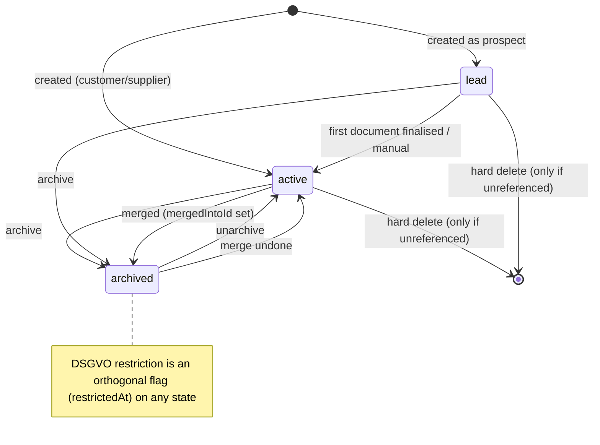

# F02 — Contacts
> **Status:** v1.0 · 2026-10-12 · **Phases:** P1 (contact core, addresses, channels, B2C/B2G flags, VAT-ID checks, §13b certificate, e-invoice preferences and PDF consent, Leitweg-ID, payment terms, DATEV accounts, tags/custom fields, timeline/notes/tasks, duplicates and merge, CSV import/export, stats, search, REST/MCP), P3 (DSGVO restriction/deletion/export tools, DATEV master-data export), P4 (CRM pipeline, SEPA mandates UI) · **sevdesk parity:** [00 §8](../../research/00-sevdesk-feature-inventory.md#8-contacts-and-crm), [09 §2, §5](../../research/09-sevdesk-contacts-products-reports.md#2-kontakte--crm), [08 §4](../../research/08-sevdesk-invoicing.md#4-invoice-editor-fields-web-ui), [02 #22, #24](../../research/02-competitor-gap-features.md) · **Compliance:** UST-03, UST-04, UST-20, UST-21, UST-22, UST-30, ER-03, ER-10, ER-20, MAIL-01, MISC-02, MISC-03, MISC-04, MISC-08, MAHN-01, MAHN-04, DATEV-02, DSGVO-01, DSGVO-02, DSGVO-03, DSGVO-04, GOBD-03, GOBD-06, GOBD-20, GOBD-21, UVA-05, UVA-07, SEC-02

## 1. Scope (in / out, and what we do better than sevdesk)

**In scope**

- Contacts of kind **organisation** or **person**; persons can belong to an organisation (`parentId`).
- Roles (Kunde, Lieferant, Partner, Interessent), status, contact number from the shared `contact` number range.
- Several **addresses** (billing, delivery, other) and **communication channels** (e-mail, phone, mobile, fax, web) with a dedicated invoice e-mail flag.
- **B2C / B2G flags** (`isConsumer`, `isPublicAuthority`) and everything that depends on them.
- **USt-IdNr validation**: format check for all EU states, **qualified BZSt eVatR** (REST) for foreign IDs, **EU VIES** for simple checks (incl. DE IDs), evidence storage (`vatIdChecks`).
- **§13b certificate** (USt 1 TG) with expiry monitoring.
- **E-invoice preferences**, **PDF consent** (MAIL-01), electronic address (BT-49), **Leitweg-ID** (ER-20) and default buyer reference (BT-10).
- Default payment terms, discount, currency, language; contact bank details.
- **DATEV debtor/creditor accounts** (auto-assignment).
- Tags, custom fields, internal notes.
- **Activity timeline**, notes, calls, meetings, tasks.
- **Duplicate detection and merge** (GoBD-safe).
- **CSV import/export**.
- **Customer statistics** (revenue, open, overdue, average days-to-pay).
- **DSGVO hooks** (restriction, deletion request, export) — data fields in P1, tools in P3.
- Search and list views.

**Out of scope (owned elsewhere)**

| Topic | Where |
|---|---|
| Tax-case derivation and VAT category per document | Invoice/document spec (uses the contact fields defined here) |
| ER-03 decision function itself | Invoice/document spec (`src/domain/einvoice`) |
| Customer-specific prices | F03 Products (`customerPrices`) |
| sevdesk API import of contacts | Import feature spec (P1). CSV import is here |
| SEPA mandates (`sepaMandates`) UI and pain.008 | Payments spec (P4); the contact page only lists mandates |
| DATEV Debitoren/Kreditoren master-data export (Formatkategorie 16) | DATEV spec (P3) |
| DSGVO request register (`dsgvoRequests`), Art. 30 record | DSGVO spec (P3) |
| CRM pipeline / deal stages | P4 |
| Serial letters ("Brief schreiben" in sevdesk) | Not planned (open question) |

**What we do better than sevdesk**

1. **VAT-ID validation built in** (qualified eVatR + VIES) with stored evidence and automatic re-checks before EU invoices. sevdesk has no VAT-ID check at all (research 00 §22).
2. **E-invoice readiness per contact**: preferred format, stored PDF consent with date and source, BT-49 address and Leitweg-ID with checksum validation, all feeding the ER-03 decision.
3. **GoBD-safe merge**: finalised documents are never re-pointed; the merged contact becomes an alias. Merge is undoable (sevdesk merges are irreversible).
4. **Customer statistics** on every contact (revenue, open items, average days-to-pay): a frequent sevdesk complaint (research 02 #22).
5. **Typed custom fields**, tags with colours, several addresses incl. department, and several invoice e-mail recipients per contact (sevdesk complaints: "too few address fields", "only one e-mail").
6. **CSV export** of everything you import (sevdesk has no documented contact export).
7. **DSGVO restriction instead of deletion** where retention applies; when retention ends the contact appears on the manual purge worklist (never purged automatically).
8. Live updates: a contact created by the website or by Claude appears instantly with an actor badge.

## 2. User stories

**As the owner**
- US-01: I create a company customer with a billing and a delivery address, add the accountant as a person with her own invoice e-mail, and invoices go to her automatically.
- US-02: When I enter a French customer's USt-IdNr, the system checks it qualified at the BZSt and shows "✓ qualifiziert bestätigt am 12.10.2026", so I can invoice reverse charge safely.
- US-03: I mark a customer as "öffentlicher Auftraggeber"; the system then requires a valid Leitweg-ID and creates XRechnung.
- US-04: I record that a customer agreed to PDF invoices by e-mail on 03.02.2026; the send dialog then allows PDF.
- US-05: I see per customer how much revenue they brought this year, what is open, and how many days they take to pay.
- US-06: I find duplicates from the sevdesk import and merge them without breaking old invoices.
- US-07: A customer asks for deletion. Data I must keep is restricted and hidden; everything else is deleted; final deletion is scheduled automatically.
- US-08: On my phone I search a customer, tap to call, and add a call note.

**As Claude via MCP**
- US-09: "Lege den Kunden Müller GmbH aus Wien mit USt-IdNr ATU12345678 an und prüfe die Nummer." I create the contact with `contact_upsert` and run `contact_check_vat_id`.
- US-10: I look up a customer's open invoices and payment behaviour before drafting a reminder.
- US-11: I suggest merging two duplicates; the owner approves the merge in the client.

**As my website via API**
- US-12: On checkout I upsert the customer by e-mail (idempotent) and get the contact ID to create the invoice.
- US-13: For B2B checkout I validate the customer's USt-IdNr via the API and only then offer a reverse-charge price.

## 3. Functional requirements

### 3.1 Core record

| ID | Requirement | Priority | Phase | Compliance refs |
|---|---|---|---|---|
| CON-001 | Contacts have `kind` `organization` or `person`. Organisations need `organizationName`; persons need `lastName` (and usually `firstName`). A person may have `parentId` pointing to an organisation (one level only; organisations cannot have a parent) | MUST | P1 | UST-03 |
| CON-002 | `displayName` is derived: organisation → `organizationName`; person → `[academicTitle] firstName lastName`. It is stored denormalised for sorting and search | MUST | P1 | — |
| CON-003 | `number` is assigned at creation from the default `contact` number range (customers and suppliers share it, sevdesk parity). A manual number is allowed if unique (case-insensitive) among all contacts incl. archived and merged | MUST | P1 | GOBD-05 |
| CON-004 | `roles` (multi): `customer`, `supplier`, `partner`, `prospect`. At least one. `status`: `lead`, `active`, `archived`. A `lead` becomes `active` automatically when the first document for it is finalised | MUST | P1 | — |
| CON-005 | Person fields: `salutation` (`herr`, `frau`, `divers`, `none`), `academicTitle`, `firstName`, `lastName`, `position`, `birthday` (optional, personal data) | MUST | P1 | — |
| CON-006 | `language` (`de`/`en`, default from company) and `currency` (ISO 4217, default EUR) are used as defaults for new documents | MUST | P1 | MISC-08 |
| CON-007 | Every write uses optimistic concurrency (`version`); stale writes return `VERSION_CONFLICT` | MUST | P1 | — |
| CON-008 | Every mutation writes an audit entry (actor, channel, diff). Personal fields in diffs follow the DSGVO rule in §5.12 | MUST | P1 | GOBD-06, SEC-02, DSGVO-02 |
| CON-009 | Persons under an organisation are listed on the organisation's "Ansprechpartner" tab. Documents can be addressed to the organisation with a person as attention line ("z. Hd. Frau Dr. Anna Müller"); the legal recipient is the organisation | MUST | P1 | UST-03 |
| CON-010 | Tags of an organisation apply to its persons for filtering (computed, not copied; sevdesk parity) | SHOULD | P1 | — |

### 3.2 Addresses

| ID | Requirement | Priority | Phase | Compliance refs |
|---|---|---|---|---|
| CON-020 | Any number of `contactAddresses` of type `billing`, `delivery`, `other`, each with `PostalAddress` (name, name2, department, street, street2, postal code, city, country, P.O. box). Exactly one default per type | MUST | P1 | UST-03 |
| CON-021 | `address.name` defaults to the contact's display name; it can differ (e.g. a branch name) | MUST | P1 | UST-03 |
| CON-022 | A billing address is mandatory before a document for this contact can be finalised (street or P.O. box, postal code, city, country) | MUST | P1 | UST-03 |
| CON-023 | Addresses are copied into the document **snapshot at finalisation**. Later changes or deletions never change issued documents (UST-03). Drafts keep a copy of the address they were created/last confirmed with; when the contact's address changes, open drafts show the banner "Die Adresse des Kontakts wurde geändert — neue Adresse übernehmen?" (Übernehmen / Bisherige behalten) (EC-111) | MUST | P1 | UST-03, GOBD-06 |
| CON-024 | Deleting an address that is referenced by any document archives it instead (hidden from pickers); drafts referencing it fall back to the default billing address with the warning "Die gewählte Adresse wurde entfernt — Standard-Rechnungsadresse verwendet." | MUST | P1 | UST-03 |
| CON-025 | Postal-code format check for DE, AT, CH, NL, FR, IT, ES, PL, GB (others free 2–10 chars). Country list from the rule tables incl. EU membership dates (GB left 2021-01-01; `XI` Northern Ireland) | MUST | P1 | UST-20, UST-21 |
| CON-026 | Address autocomplete is **not** done via an external service (DSGVO); only a local postal-code → city lookup for DE (bundled OpenGeoDB-style table) | COULD | P1 | DSGVO-04 |

### 3.3 Communication channels

| ID | Requirement | Priority | Phase | Compliance refs |
|---|---|---|---|---|
| CON-030 | `contactChannels` of type `email`, `phone`, `mobile`, `fax`, `web` with `value`, `label`, `isPrimary` (one per type), `isInvoiceEmail` (any number of e-mail channels) | MUST | P1 | — |
| CON-031 | The send dialog prefills "An" with all `isInvoiceEmail` addresses of the addressed contact; for a person under an organisation without own invoice e-mail, the organisation's invoice e-mails are used | MUST | P1 | MAIL-02 |
| CON-032 | E-mail values are normalised (trim, lowercase domain) and validated; phone numbers are stored as entered plus an E.164 form when parseable (`libphonenumber-js`, default region DE) for `tel:` links | MUST | P1 | — |
| CON-033 | When no invoice e-mail exists, finalised invoices can still be downloaded/sent by post; the send dialog shows "Keine Rechnungs-E-Mail hinterlegt" and offers to add one | MUST | P1 | — |

### 3.4 Tax data, B2C and B2G

| ID | Requirement | Priority | Phase | Compliance refs |
|---|---|---|---|---|
| CON-040 | `isConsumer` (B2C). Consequences documented on the field: gross prices on documents (MISC-03), §286 Abs. 3 BGB note (MAHN-01), B2C interest rate, no 40 € flat fee, ER-03 = `NOT_REQUIRED`, §35a labour subtotal (MISC-07), property retention note (UST-12) | MUST | P1 | MISC-03, MAHN-01, ER-03 |
| CON-041 | `isPublicAuthority` (B2G, "öffentlicher Auftraggeber"). Makes `buyerReference` a mandatory, validated Leitweg-ID (ER-20) and sets the preferred format default to XRechnung | MUST | P1 | ER-20, ER-03 |
| CON-042 | `isConsumer` and `isPublicAuthority` are mutually exclusive (`CONTACT_TYPE_CONFLICT`) | MUST | P1 | — |
| CON-043 | `vatId` (EU format incl. `XI`, §5.4) and `taxNumber` (free text, also for non-EU tax IDs such as `CHE-123.456.789 MWST` or GB VAT numbers) | MUST | P1 | UST-04, UST-20 |
| CON-044 | `defaultTaxCase` (optional override of the document tax-case derivation, e.g. `reverse_charge_13b` for a construction customer). The UI explains that the document still validates the override | MUST | P1 | UST-20..UST-23 |
| CON-046 | Derivation inputs provided by the contact: VAT ID and its check status, billing country, **default delivery address country** (goods: the tax case uses the delivery destination, not only the VAT ID — EC-042), consumer/authority flags. An EU business customer without a valid VAT ID is treated as B2C for derivation, with a warning offering a VAT-ID check (EC-043) | MUST | P1 | UST-20, UST-21, MISC-04 |
| CON-045 | The contact page shows the **derived default tax case** for a typical supply (service and goods) with the reason, e.g. "EU-B2B-Leistung (Frankreich, USt-IdNr qualifiziert geprüft)" | SHOULD | P1 | UST-20, UST-21 |

### 3.5 VAT-ID validation (MISC-04)

| ID | Requirement | Priority | Phase | Compliance refs |
|---|---|---|---|---|
| CON-050 | **Format check** on every write: country prefix + per-country pattern (§5.4); DE IDs additionally with the MOD 11,10 check digit | MUST | P1 | UST-04, MISC-04 |
| CON-051 | **Qualified check (BZSt eVatR REST)** for non-DE EU IDs: `POST https://api.evatr.vies.bzst.de/app/v1/abfrage` with `anfragendeUstid` = company `vatId`, `angefragteUstid`, `firmenname`, `ort`, `plz`, `strasse` from the default billing address. Requires a company USt-IdNr | MUST | P1 | MISC-04, UST-20, UST-21 |
| CON-052 | **Simple check (EU VIES REST)** for DE IDs and as fallback when eVatR is unavailable or the company has no USt-IdNr: `POST /check-vat-number` with requester fields (to obtain `requestIdentifier`) | MUST | P1 | MISC-04 |
| CON-053 | Every check stores an immutable `vatIdChecks` row: provider, full request and response, `valid`, per-field results (A/B/C/D mapped from eVatR, VALID/INVALID/NOT_PROCESSED mapped from VIES), provider request ID, `checkedAt`, `retentionUntil` = end of check year + 10 years | MUST | P1 | MISC-04, GOBD-06, GOBD-20 |
| CON-054 | `contacts.vatIdStatus` points to the latest check and holds `valid`, `qualified`, `checkedAt`. `qualified = true` only if eVatR returned valid and `A` for name and city (street/postal code `A` or `C`) | MUST | P1 | MISC-04 |
| CON-055 | Status shown everywhere the contact appears (badge): "✓ qualifiziert bestätigt am …", "✓ gültig (einfache Prüfung) am …", "⚠ gültig, Name/Ort weicht ab", "✗ ungültig", "? nicht geprüft", "⏳ Dienst nicht erreichbar" | MUST | P1 | MISC-04 |
| CON-056 | **Gate for EU tax cases** (enforced by the document finalisation guard; data from here): tax cases `eu_b2b_service` (AE) and `intra_community_supply` (K) require a valid check not older than 90 days; for K a **qualified** check with name `A` is required. Otherwise finalisation is blocked unless overridden with a reason (audit entry); an override because the service was unavailable creates a follow-up task "USt-IdNr-Prüfung nachholen" on the contact (EC-044). The invariant RI-16 checks every K/AE/§13b document for a check or audited override | MUST | P1 | MISC-04, UST-20, UST-21 |
| CON-057 | When a K/AE document is finalised and the last valid check is older than 90 days, an automatic re-check runs inline (timeout 10 s). If the service is unavailable, the override path of CON-056 applies | MUST | P1 | MISC-04 |
| CON-058 | Identical checks (same ID, same name/address) within 24 hours return the stored result unless "Erneut prüfen" is forced. Outbound requests are throttled to 1 per second per provider | MUST | P1 | — |
| CON-059 | Nightly job re-checks contacts that had K/AE invoices in the last 12 months and whose last valid check is older than 90 days; failures create a notification | SHOULD | P1 | MISC-04 |
| CON-060 | Changing `vatId` resets `vatIdStatus` to "nicht geprüft" and triggers a check (UI) or returns `vatIdStatus: unchecked` (API). Old checks remain as evidence | MUST | P1 | MISC-04, GOBD-06 |
| CON-061 | Evidence view on the contact: list of all checks with result details; "Nachweis als PDF" renders the stored response (date, request ID, results) for an auditor | MUST | P1 | MISC-04 |

### 3.6 §13b certificate

| ID | Requirement | Priority | Phase | Compliance refs |
|---|---|---|---|---|
| CON-070 | `reverseCharge13bCertificates[]` (history; the latest entry is current): uploaded PDF/image (≤ 10 MB, SHA-256 stored) and `validUntil` (USt 1 TG, usually 3 years) | MUST | P1 | UST-22 |
| CON-071 | When a §13b document is finalised and the certificate is missing or `validUntil` < supply date, finalisation requires either the audited confirmation "Der Kunde ist nachhaltig als Bauleistender tätig (Nachweis liegt anderweitig vor)" with a reason, or switching the document to domestic VAT (EC-047). Notification 30 days before expiry | MUST | P1 | UST-22 |
| CON-072 | Replacing a certificate keeps the previous file (history) as evidence for documents issued while it was valid | MUST | P1 | UST-22, GOBD-06 |

### 3.7 E-invoice preferences, consent, Leitweg-ID

| ID | Requirement | Priority | Phase | Compliance refs |
|---|---|---|---|---|
| CON-080 | `einvoice.preferredFormat`: `auto` (default: ER-03 + XRechnung for B2G, ZUGFeRD otherwise), `zugferd`, `xrechnung_cii`, `xrechnung_ubl`, `pdf`. The document maps `zugferd` → `zugferd_en16931`, `pdf` → `none` (only if ER-03 allows) | MUST | P1 | ER-01, ER-03 |
| CON-081 | `einvoice.pdfConsents[]` (history): `givenAt` (business date ≤ today), `source` (`email`, `contract`, `tacit`, `portal`), `note` (mandatory for `tacit`, e.g. "zahlt seit 2024 PDF-Rechnungen ohne Widerspruch"), optional evidence file. Revocation stores `revokedAt` and keeps the history | MUST | P1 | MAIL-01 |
| CON-082 | The send dialog only offers PDF-only sending when ER-03 returns `MAY_PAPER_OR_PDF`/`NOT_REQUIRED`, or `PDF_NEEDS_CONSENT` with a consent valid on the send date | MUST | P1 | MAIL-01, ER-03 |
| CON-083 | `electronicAddress` (BT-49): default scheme `EM` with the first invoice e-mail; for B2G default scheme `0204` with the Leitweg-ID. Required for XRechnung; missing → warning on the contact, blocking for XRechnung documents | MUST | P1 | ER-10 |
| CON-084 | `buyerReference` (BT-10 default). For `isPublicAuthority` it must be a valid **Leitweg-ID**: Grobadressierung 2–12 digits, optional Feinadressierung ≤ 30 alphanumerics, 2 check digits, ISO 7064 Mod 97-10 (§5.5). For other contacts it is free text ≤ 100 chars (e.g. the customer's internal reference) | MUST | P1 | ER-20, ER-10 |
| CON-085 | Several Leitweg-IDs per public customer (departments): additional IDs can be stored on delivery/other addresses as `department` + custom field; the document can override BT-10 | COULD | P1 | ER-20 |

### 3.8 Payment defaults and bank details

| ID | Requirement | Priority | Phase | Compliance refs |
|---|---|---|---|---|
| CON-090 | `paymentTerms` (due days, Skonto percent/days, optional text) override the company default for new documents | MUST | P1 | MAHN-01 |
| CON-091 | Warnings: due days > 60 for businesses, > 30 for public authorities (MAHN-04) | MUST | P1 | MAHN-04 |
| CON-092 | `defaultDiscountBp` (0–10000) is applied as a line discount on new lines (F03 PRD-034 precedence) | SHOULD | P1 | — |
| CON-093 | `iban`/`bic` (for refunds and, from P4, SEPA mandates); IBAN validated. The contact page lists `sepaMandates` read-only until P4 | MUST | P1 | MISC-02 |
| CON-094 | Default payment method (`paymentMethodId`) per contact | SHOULD | P1 | — |

### 3.9 DATEV accounts

| ID | Requirement | Priority | Phase | Compliance refs |
|---|---|---|---|---|
| CON-100 | `debtorAccount` / `creditorAccount` within the ranges derived from `companyProfile.datev.accountLength` (F01 §5.3; default 10000–69999 / 70000–99999) | MUST | P1 | DATEV-02 |
| CON-101 | Auto-assignment if empty: debtor account at the first finalised sales document, creditor account at the first booked voucher, or at DATEV export, whichever comes first. Next free number = max used + 1 within the range | MUST | P1 | DATEV-02 |
| CON-102 | Accounts are unique across contacts. After an account was included in a DATEV export, changing it requires confirmation ("Ihre Steuerberatung muss das Personenkonto ebenfalls umstellen.") and an audit reason | MUST | P1 | DATEV-02 |
| CON-103 | Option "Sammeldebitor verwenden" per contact (typically one-off consumers): the contact uses a configured collective debtor account instead of an own account | COULD | P1 | DATEV-02 |

### 3.10 Tags, custom fields, notes

| ID | Requirement | Priority | Phase | Compliance refs |
|---|---|---|---|---|
| CON-110 | `tags` (F01 SET-094) and `customFields` (definitions with entity `contact`, F01 SET-095), validated by type on every write path | MUST | P1 | GOBD-03 |
| CON-111 | Custom fields with `printOnDocuments` appear in the document info box and are frozen in the snapshot; all are available as `{{contact.custom.<key>}}` placeholders | MUST | P1 | GOBD-06 |
| CON-112 | `notes` (internal, never printed), ≤ 10,000 chars | MUST | P1 | — |

### 3.11 Activity timeline, notes, tasks

| ID | Requirement | Priority | Phase | Compliance refs |
|---|---|---|---|---|
| CON-120 | The **Verlauf** tab is the default tab (sevdesk parity). It merges, newest first: manual `contactActivities` (note, call, meeting, task) and derived events (document created/finalised/sent/accepted/cancelled, payment received, reminder sent, VAT-ID checked, consent recorded, contact merged) with actor badges | MUST | P1 | GOBD-01 |
| CON-121 | Manual activities: text (rich text, ≤ 10,000 chars), up to 10 attachments (≤ 20 MB each, hashed), optional link to a document | MUST | P1 | — |
| CON-122 | Tasks: text, `dueAt`, `doneAt`, optional document link. Open tasks appear in the dashboard To-dos and create a notification on the due date (`deadlines.notify`) | MUST | P1 | — |
| CON-123 | Manual activities can be edited and deleted (they are not Buchungsbelege). Derived events cannot | MUST | P1 | GOBD-06 |
| CON-124 | Filter the timeline by kind and period; search within notes | SHOULD | P1 | — |

### 3.12 Duplicates and merge

| ID | Requirement | Priority | Phase | Compliance refs |
|---|---|---|---|---|
| CON-130 | **Duplicate hints on create/edit** (non-blocking): same `vatId`; same invoice e-mail; same IBAN; Jaro-Winkler similarity ≥ 0.92 of normalised names (lowercase, legal-form suffix and punctuation removed) with the same postal code. Same `number` is a blocking error | MUST | P1 | — |
| CON-131 | `/kontakte/duplikate` lists candidate pairs with score and reasons; "Kein Duplikat" dismisses a pair permanently | MUST | P1 | — |
| CON-132 | **Merge** (same `kind` only): choose the winner; per field choose the value (winner by default); addresses, channels, activities, tags, custom fields, customer prices, tasks, SEPA mandates and **drafts** move to the winner. **Finalised documents, payments, vouchers, journal entries and `vatIdChecks` are not modified** (GOBD-06); they keep the loser's ID | MUST | P1 | GOBD-06, UST-03 |
| CON-133 | The loser gets `status: archived` and `mergedIntoId = winner` (it is never deleted, EC-113). References from finalised records are **resolved** to the winner through this alias rather than rewritten, because `contactId` is not a mutable field of finalised documents (03 §11). All contact queries (document lists, stats, timeline, open items, dunning, DATEV) resolve aliases so the winner shows everything. Opening the loser redirects to the winner with a banner | MUST | P1 | GOBD-01 |
| CON-134 | Merge is confirmed in a dialog listing what moves and what stays; it writes one audit entry with the full move list. **Undo** ("Zusammenführung rückgängig machen") restores the loser and moves back exactly the recorded items, as long as none of the moved drafts has been finalised since | SHOULD | P1 | GOBD-06 |
| CON-135 | DATEV: if both contacts have exported debtor/creditor accounts, the winner keeps its account; the dialog warns "Personenkonto {loserAccount} wurde bereits an DATEV übergeben — offene Posten bitte in der Buchhaltung umbuchen." | MUST | P1 | DATEV-02 |

### 3.13 Import and export

| ID | Requirement | Priority | Phase | Compliance refs |
|---|---|---|---|---|
| CON-140 | CSV import wizard (`/kontakte/import`): upload (≤ 10 MB, ≤ 20,000 rows), encoding detection (UTF-8 with/without BOM, Windows-1252, ISO-8859-15), separator detection (`;`, `,`, tab), header mapping with saved mapping presets and aliases for sevdesk's export headers, downloadable template | MUST | P1 | GOBD-03 |
| CON-141 | Preview with per-row status: **neu**, **Aktualisierung**, **Konflikt** (duplicate hints), **Fehler** (validation message per cell). Match key order: `number`, then `vatId`, then invoice e-mail. Modes: "nur neue anlegen" / "neue anlegen und vorhandene aktualisieren" | MUST | P1 | GOBD-03 |
| CON-142 | Import runs as a background job (`jobs`), validates every row with the same zod schema as the UI/API, is idempotent (`imports`/`importedRecords`, key = row number + file SHA-256) and writes an import log. Imported VAT IDs are format-checked; "VAT-IDs nach Import prüfen" queues throttled checks | MUST | P1 | GOBD-03, MISC-04 |
| CON-143 | CSV export of the current list filter: UTF-8 with BOM, `;`, all core fields, default billing address, primary e-mail/phone, invoice e-mails, tags, custom fields, VAT status, DATEV accounts. Restricted contacts (DSGVO) are excluded unless "inkl. eingeschränkter Kontakte" is chosen with a reason | MUST | P1 | DSGVO-02 |
| CON-144 | XLSX export | COULD | P1 | — |

### 3.14 Customer statistics

| ID | Requirement | Priority | Phase | Compliance refs |
|---|---|---|---|---|
| CON-150 | Stats per contact (resolving merged aliases), computed by a query over finalised documents: **Umsatz netto** this year, last year, all time (definition §5.9); **offen** and **überfällig** (Σ `openAmountCents`); **Ø Zahlungsdauer** (days from document date to full payment, gross-weighted, last 24 months); **Ø Verzug** (days after due date); number of invoices, last invoice date; quote conversion rate; number of reminders | MUST | P1 | — |
| CON-151 | Revenue by month chart (12 months) on the contact page; follows the dataviz palette rules | SHOULD | P1 | — |
| CON-152 | Supplier view (role `supplier`): spend this year/all time and open payables from vouchers (P2) | SHOULD | P2 | — |
| CON-153 | List columns "Offen" and "Umsatz (Jahr)" are sortable; a top-customers widget uses the same query | SHOULD | P1 | — |

### 3.15 DSGVO hooks

| ID | Requirement | Priority | Phase | Compliance refs |
|---|---|---|---|---|
| CON-160 | Data fields `dsgvo.restrictedAt`, `dsgvo.deletionRequestedAt`, `dsgvo.scheduledPurgeAt` exist from P1 | MUST | P1 | DSGVO-02 |
| CON-161 | **Restriction**: a restricted contact is hidden from lists, search, pickers and exports (unless explicitly included, CON-143), cannot be used on new documents (`CONTACT_RESTRICTED`), and gets no marketing/bulk e-mails. Processing required by law or for legal claims continues (open invoices, dunning, DATEV, UStVA/ZM, GDPdU) | MUST | P3 | DSGVO-02 |
| CON-162 | **Deletion request**: computes per data item whether a retention duty applies. Immediately deletes non-retained data (manual activities and their attachments, notes, birthday, channels/addresses not used on any finalised document, drafts, customer prices, unsent quotes), restricts the rest, and sets `scheduledPurgeAt` = max(`retentionUntil`) of linked records. A contact without retained records is deleted completely | MUST | P3 | DSGVO-02, GOBD-21 |
| CON-163 | At `scheduledPurgeAt` the `retention.scan` job lists the contact for the manual, logged purge (GOBD-21): anonymise the contact, keep a tombstone (ID, number, purge date) | MUST | P3 | GOBD-21 |
| CON-164 | **Export** per person (Art. 15/20): JSON of the contact, addresses, channels, activities, documents list with PDFs, VAT checks and audit entries about the contact | MUST | P3 | DSGVO-03 |
| CON-165 | DSGVO actions are owner-only (UI); REST/MCP return 403 `OWNER_ONLY` | MUST | P3 | DSGVO-02 |

### 3.16 Deletion, archiving, search, list

| ID | Requirement | Priority | Phase | Compliance refs |
|---|---|---|---|---|
| CON-170 | **Hard delete** only if the contact is not referenced by any finalised document, payment, voucher, journal entry, bank transaction match, time entry, recurring template, SEPA mandate or child person. Drafts, customer prices, addresses, channels and activities are deleted with it after confirmation. The audit entry stores a redacted record | MUST | P1 | GOBD-06 |
| CON-171 | Otherwise **archive** (`status: archived`): hidden from pickers and the default list, all history stays. Unarchive restores | MUST | P1 | GOBD-06 |
| CON-172 | Search (debounced 200 ms) over display name, organisation name 2, number, e-mails, phone numbers (digits only), VAT ID, city, tags; prefix and fuzzy; results < 150 ms for 20,000 contacts | MUST | P1 | — |
| CON-173 | List filters: role, status, tag, country, B2C/B2G, VAT status, has open invoices, has overdue invoices, created/updated period. Persisted in the URL (04-ui-ux §4.1) | MUST | P1 | — |
| CON-174 | Bulk actions: Tag hinzufügen/entfernen, archivieren, CSV export, VAT-IDs prüfen (throttled job) | MUST | P1 | — |

### 3.17 Contact data on documents (contract with the document specs)

| ID | Requirement | Priority | Phase | Compliance refs |
|---|---|---|---|---|
| CON-180 | At finalisation the document snapshot freezes: display name, organisation name(s), attention person, billing address, delivery address, `number`, `vatId`, `taxNumber`, `buyerReference`, `electronicAddress`, `isConsumer`, `isPublicAuthority`, `language`, printable custom fields, and the ID of the `vatIdChecks` row used | MUST | P1 | UST-03, MISC-04, GOBD-06 |
| CON-181 | No contact mutation (including merge, archive, restriction, VAT-ID change, flag changes) may modify a finalised document, its snapshot or artifacts. Enforced by the model layer and covered by a mutation-inventory test | MUST | P1 | GOBD-06, UST-30 |
| CON-182 | Drafts re-read non-address contact data (flags, VAT ID, Leitweg-ID, terms) on every open and at finalisation and show a banner listing what changed since the draft was created ("Kontaktdaten wurden geändert: USt-IdNr, Kundentyp"); addresses follow CON-023. Converting a quote/order into an invoice uses the **current** contact flags and re-derives the tax case with a notice (EC-080) | MUST | P1 | UST-03, MISC-03 |

## 4. Workflows and state machines

### 4.1 Contact lifecycle



### 4.2 VAT-ID check

```
owner/API/MCP: checkVatId(contactId, {force?})
  1. format check (§5.4) ─ fail → VAT_ID_FORMAT_INVALID (no external call, no evidence row)
  2. same ID + same name/address checked < 24 h and !force → return stored check
  3. country == DE                     → VIES (simple)
     country != DE and company.vatId    → eVatR qualified (name, city, postcode, street from default billing address)
     country != DE and no company.vatId → VIES (simple) + warning "qualifizierte Prüfung erfordert eigene USt-IdNr"
  4. provider error / timeout 10 s → for eVatR retry once via VIES; else result "unavailable" (stored, valid=false, response=error)
  5. insert vatIdChecks (immutable) → update contacts.vatIdStatus → timeline event → webhook contact.vat_id_checked
```

eVatR result mapping:

| eVatR `status` / fields | Our result |
|---|---|
| `evatr-0000` + `ergFirmenname=A`, `ergOrt=A` (+ `ergPlz`/`ergStrasse` A or C) | valid, qualified |
| `evatr-0000` + any of name/city `B` | valid, not qualified, "Name/Ort weicht ab" |
| `evatr-0000` + `D` (not provided by member state) | valid, not qualified, "Mitgliedstaat liefert keine Daten" |
| status meaning invalid/unknown ID | invalid |
| status meaning service/member state unavailable | unavailable |

The full status-code table is loaded from `GET /v1/info/statusmeldungen` and bundled in the rule tables (updated with releases).

### 4.3 Finalisation gate for K/AE (data provided by contacts, enforced by the document guard)

```
taxCase ∈ {eu_b2b_service, intra_community_supply}?
  └─ contact.vatId missing → BLOCK "USt-IdNr des Kunden fehlt"
  └─ vatId country == DE or not an EU state on supply date → BLOCK "Keine ausländische EU-USt-IdNr"
  └─ last valid check older than 90 days → auto re-check (CON-057)
  └─ result invalid → BLOCK
  └─ result unavailable → BLOCK, override with reason allowed (audit)
  └─ K and not qualified (name ≠ A) → BLOCK, override with reason allowed (audit)
  └─ else OK → snapshot stores the vatIdChecks ID
```

### 4.4 Merge

```
select winner W, losers L[] (same kind) → preview (moves / stays / conflicts)
  → confirm → single mutation:
     for each L: move addresses, channels, activities, tasks, customerPrices, sepaMandates, drafts → W
                 copy chosen field values → W ; union tags ; merge customFields (W wins unless chosen)
                 L.status = archived ; L.mergedIntoId = W
     audit "contact.merge" {winner, losers, moved: {table: [ids]}}
  → webhook contact.merged
undo (CON-134): reverse the recorded moves if none of the moved drafts is finalised
```

### 4.5 DSGVO deletion request (P3)

```
request → classify linked data:
   retained (finalised docs & their snapshots, payments, vouchers, journal, vatIdChecks, sent quotes/reminders) 
   not retained (notes, activities, attachments, birthday, unused addresses/channels, drafts, customer prices)
 → delete not-retained now → set restrictedAt, deletionRequestedAt, scheduledPurgeAt = max(retentionUntil)
 → nothing retained? → delete contact entirely (tombstone in audit)
 → at scheduledPurgeAt: retention.scan lists it → owner purges (GOBD-21) → anonymise + tombstone
```

## 5. Validation rules and edge cases

Errors use `{ code, message, field? }`; `message` is German and shown verbatim.

### 5.1 Core fields

| Field | Rule | Error code · message |
|---|---|---|
| `organizationName` (organisation) | 1–160 chars | `REQUIRED` · "Bitte den Firmennamen angeben." |
| `lastName` (person) | 1–80 chars | `REQUIRED` · "Bitte den Nachnamen angeben." |
| `firstName`, `academicTitle`, `position` | ≤ 80 / 30 / 80 chars | `TOO_LONG` · "Der Text ist zu lang (max. {n} Zeichen)." |
| `parentId` | must be an organisation, not archived/merged, not itself | `PARENT_INVALID` · "Ein Ansprechpartner kann nur einer Organisation zugeordnet werden." |
| `parentId` on an organisation | not allowed | `PARENT_NOT_ALLOWED` · "Organisationen können keiner anderen Organisation untergeordnet werden." |
| `number` | 1–36 chars `[A-Za-z0-9$%&*+\-/]`, unique case-insensitive | `CONTACT_NUMBER_TAKEN` · "Die Kontaktnummer {number} ist bereits vergeben." |
| `roles` | ≥ 1 | `ROLE_REQUIRED` · "Bitte mindestens eine Rolle wählen (Kunde, Lieferant, Partner, Interessent)." |
| `birthday` | valid date, not in the future | `DATE_INVALID` · "Ungültiges Datum." |
| `currency` | ISO 4217 from the supported list | `CURRENCY_INVALID` · "Die Währung wird nicht unterstützt." |
| `isConsumer` + `isPublicAuthority` | not both | `CONTACT_TYPE_CONFLICT` · "Ein Kontakt kann nicht gleichzeitig Privatkunde und öffentlicher Auftraggeber sein." |
| `isConsumer` + `vatId` | warning | "Privatkunden haben in der Regel keine USt-IdNr. Bitte prüfen, ob es sich um ein Unternehmen handelt." |
| `kind` change with children (organisation → person) | not allowed | `KIND_CHANGE_HAS_CHILDREN` · "Die Organisation hat Ansprechpartner und kann nicht in eine Person umgewandelt werden." |

### 5.2 Addresses and channels

| Rule | Error code · message |
|---|---|
| Billing address incomplete at finalisation | `CONTACT_ADDRESS_INCOMPLETE` · "Rechnungsadresse unvollständig: {fields} fehlt." |
| Postal code invalid for the country | `POSTAL_CODE_INVALID` · "Die Postleitzahl passt nicht zum Land {country}." |
| Unknown country code | `COUNTRY_INVALID` · "Bitte ein Land auswählen." |
| E-mail invalid | `EMAIL_INVALID` · "Die E-Mail-Adresse „{value}“ ist ungültig." |
| `isInvoiceEmail` on a non-e-mail channel | `INVOICE_EMAIL_TYPE` · "Nur E-Mail-Adressen können als Rechnungsempfänger markiert werden." |
| Duplicate channel value on the same contact | `CHANNEL_DUPLICATE` · "Dieser Eintrag ist bereits vorhanden." |
| URL without scheme | auto-prefixed `https://` |

### 5.3 Tax and payment fields

| Rule | Error code · message |
|---|---|
| `paymentTerms.dueDays` 0–365 | `OUT_OF_RANGE` · "Zahlungsziel muss zwischen 0 und 365 Tagen liegen." |
| `skontoDays` ≥ `dueDays` | `SKONTO_INVALID` · "Die Skontofrist muss kürzer als das Zahlungsziel sein." |
| `skontoPercentBp` 1–1000 | `OUT_OF_RANGE` · "Skonto muss zwischen 0,01 % und 10 % liegen." |
| due days > 60 and business | warning (MAHN-04) · "Zahlungsziele über 60 Tage sind im B2B-Verkehr nur eingeschränkt zulässig (§ 271a BGB)." |
| due days > 30 and public authority | warning (MAHN-04) · "Öffentliche Auftraggeber dürfen höchstens 30 Tage Zahlungsziel vereinbaren (§ 271a Abs. 2 BGB)." |
| `defaultDiscountBp` > 10000 | `OUT_OF_RANGE` · "Rabatt kann höchstens 100 % betragen." (warning above 50 %) |
| `iban` invalid | `IBAN_INVALID` · "Die IBAN ist ungültig." |
| `debtorAccount` outside range | `DEBTOR_ACCOUNT_RANGE` · "Debitorenkonten liegen zwischen {min} und {max}." |
| `creditorAccount` outside range | `CREDITOR_ACCOUNT_RANGE` · "Kreditorenkonten liegen zwischen {min} und {max}." |
| DATEV account already used | `DATEV_ACCOUNT_TAKEN` · "Das Personenkonto {account} ist bereits {contact} zugeordnet." |
| `defaultTaxCase = kleinunternehmer` | `TAX_CASE_NOT_ALLOWED` · "Die Kleinunternehmerregelung ist eine Einstellung Ihres Unternehmens, nicht des Kunden." |
| `defaultTaxCase = reverse_charge_13b` and `isConsumer` | `TAX_CASE_CONFLICT` · "§ 13b gilt nur für unternehmerische Leistungsempfänger." |
| `defaultTaxCase ∈ {eu_b2b_service, intra_community_supply}` without foreign EU `vatId` | warning · "Für diesen Steuerfall wird eine ausländische EU-USt-IdNr benötigt." |

### 5.4 USt-IdNr formats

Normalisation: uppercase, remove spaces, dots, hyphens. Greece uses prefix `EL` (input `GR…` is converted with a hint). The country of the ID must be an EU member state (or `XI`) on the check date.

| Prefix | Pattern after prefix | Prefix | Pattern after prefix |
|---|---|---|---|
| AT | `U\d{8}` | IE | `\d{7}[A-W][A-IW]?` or `\d[A-Z+*]\d{5}[A-W]` |
| BE | `[01]\d{9}` | IT | `\d{11}` |
| BG | `\d{9,10}` | LT | `\d{9}` or `\d{12}` |
| CY | `\d{8}[A-Z]` | LU | `\d{8}` |
| CZ | `\d{8,10}` | LV | `\d{11}` |
| DE | `\d{9}` + MOD 11,10 | MT | `\d{8}` |
| DK | `\d{8}` | NL | `\d{9}B\d{2}` |
| EE | `\d{9}` | PL | `\d{10}` |
| EL | `\d{9}` | PT | `\d{9}` |
| ES | `[A-Z0-9]\d{7}[A-Z0-9]` | RO | `\d{2,10}` |
| FI | `\d{8}` | SE | `\d{10}01` |
| FR | `[A-HJ-NP-Z0-9]{2}\d{9}` | SI | `\d{8}` |
| HR | `\d{11}` | SK | `\d{10}` |
| HU | `\d{8}` | XI | `\d{9}`, `\d{12}`, `GD\d{3}`, `HA\d{3}` |

| Rule | Error code · message |
|---|---|
| Pattern mismatch | `VAT_ID_FORMAT_INVALID` · "Die USt-IdNr hat nicht das Format für {country}." |
| DE check digit wrong | `VAT_ID_CHECKSUM` · "Die USt-IdNr ist ungültig (Prüfziffer stimmt nicht)." |
| Non-EU prefix (`GB`, `CH`, `NO` …) | `VAT_ID_NOT_EU` · "Nur EU-USt-IdNrs können hier eingetragen werden. Ausländische Steuernummern bitte im Feld „Steuernummer“ erfassen." |
| ID equals the company's own USt-IdNr | `VAT_ID_OWN` · "Das ist Ihre eigene USt-IdNr." |
| Check result invalid | status "✗ ungültig" · "Die USt-IdNr {vatId} ist laut {provider} am {date} ungültig." |
| Service unavailable | status "⏳" · "Der Prüfdienst ({provider}) ist derzeit nicht erreichbar. Bitte später erneut prüfen." |
| eVatR without own USt-IdNr | warning · "Eine qualifizierte Bestätigung beim BZSt ist nur mit eigener USt-IdNr möglich; es wurde einfach über VIES geprüft." |
| Override without reason | `REASON_REQUIRED` · "Bitte begründen, warum ohne gültige Prüfung fortgefahren wird (wird protokolliert)." |

### 5.5 Leitweg-ID (ER-20)

Format `^(\d{2,12})(-[A-Za-z0-9]{1,30})?-(\d{2})$`. Check: remove hyphens, convert letters A=10 … Z=35, the resulting number mod 97 must equal 1 (ISO 7064 Mod 97-10). Check digits for a new ID: 98 − ((number of Grob+Fein with "00" appended) mod 97).

| Example | Result |
|---|---|
| `04011000-1234512345-06` | valid (KoSIT example) |
| `991-33333TEST-33` | valid (federal test ID) |
| `991-01234-38` | valid |
| `991-01234-44` | invalid (correct check digits are `38`) |

| Rule | Error code · message |
|---|---|
| B2G without `buyerReference` | `LEITWEG_ID_REQUIRED` · "Für öffentliche Auftraggeber ist die Leitweg-ID Pflicht." |
| Format wrong | `LEITWEG_ID_FORMAT` · "Die Leitweg-ID hat nicht das Format Grobadressierung-Feinadressierung-Prüfziffer (z. B. 04011000-1234512345-06)." |
| Checksum wrong | `LEITWEG_ID_CHECKSUM` · "Die Prüfziffer der Leitweg-ID stimmt nicht." |
| Lower-case letters in Feinadressierung | normalised to upper case |
| `buyerReference` > 100 chars (non-B2G) | `TOO_LONG` · "Die Käuferreferenz ist zu lang (max. 100 Zeichen)." |
| Electronic address scheme `0204` with value ≠ a valid Leitweg-ID | `ELECTRONIC_ADDRESS_INVALID` · "Für das Schema 0204 muss eine gültige Leitweg-ID angegeben werden." |
| Electronic address scheme `EM` with invalid e-mail | `ELECTRONIC_ADDRESS_INVALID` · "Die elektronische Adresse muss eine gültige E-Mail-Adresse sein." |
| Scheme `9930` with value not a valid DE USt-IdNr | `ELECTRONIC_ADDRESS_INVALID` · "Für das Schema 9930 wird eine deutsche USt-IdNr erwartet." |

### 5.6 PDF consent, §13b certificate

| Rule | Error code · message |
|---|---|
| `givenAt` in the future | `DATE_IN_FUTURE` · "Das Datum der Zustimmung darf nicht in der Zukunft liegen." |
| `source = tacit` without note | `CONSENT_NOTE_REQUIRED` · "Bitte beschreiben, woraus sich die stillschweigende Zustimmung ergibt." |
| `preferredFormat = pdf` without consent for a business customer | warning · "Ohne Zustimmung dürfen Rechnungen an Unternehmen nicht als reines PDF versendet werden (ab 2027/2028 E-Rechnungspflicht)." |
| `preferredFormat = pdf` for B2G | `FORMAT_NOT_ALLOWED` · "Öffentliche Auftraggeber erhalten Rechnungen als XRechnung." |
| Certificate file type/size | `FILE_INVALID` · "Bitte PDF, JPG oder PNG bis 10 MB hochladen." |
| `validUntil` already past at upload | warning · "Die Bescheinigung ist bereits abgelaufen." |

### 5.7 Import

| Rule | Message |
|---|---|
| File > 10 MB or > 20,000 rows | `IMPORT_TOO_LARGE` · "Die Datei ist zu groß (max. 10 MB bzw. 20.000 Zeilen)." |
| Encoding not detectable | `IMPORT_ENCODING` · "Die Zeichenkodierung konnte nicht erkannt werden. Bitte als UTF-8 speichern." |
| No mapped name column | `IMPORT_MAPPING` · "Bitte mindestens „Firma“ oder „Nachname“ zuordnen." |
| Row errors | per cell, same messages as §5.1–5.6, prefixed "Zeile {n}: " |
| Duplicate keys inside the file | `IMPORT_DUPLICATE_ROW` · "Zeile {n} hat dieselbe {key} wie Zeile {m}." |
| Number collides with an existing contact in mode "nur neue" | row status Konflikt · "Kontaktnummer {number} existiert bereits." |

### 5.8 Merge, delete, archive

| Rule | Error code · message |
|---|---|
| Different `kind` | `MERGE_KIND_MISMATCH` · "Nur Kontakte desselben Typs (Organisation/Person) können zusammengeführt werden." |
| Winner archived/merged/restricted | `MERGE_WINNER_INVALID` · "Der Zielkontakt ist archiviert oder eingeschränkt." |
| Organisations with persons merged | allowed; persons get the winner as `parentId` |
| Different non-empty `vatId` | `MERGE_VAT_CONFLICT` (confirmation required) · "Die Kontakte haben unterschiedliche USt-IdNrs. Bitte die richtige auswählen — die Prüfnachweise beider bleiben erhalten." |
| Undo after a moved draft was finalised | `MERGE_UNDO_IMPOSSIBLE` · "Rückgängig nicht mehr möglich: {n} übernommene Entwürfe wurden inzwischen fertiggestellt." |
| Delete a referenced contact | `CONTACT_IN_USE` · "Der Kontakt wird in {n} fertiggestellten Dokumenten/Buchungen verwendet und kann nur archiviert werden." |
| Delete an organisation with persons | `CONTACT_HAS_CHILDREN` · "Bitte zuerst die Ansprechpartner löschen oder einer anderen Organisation zuordnen." |
| Use an archived contact on a new document | warning · "Der Kontakt ist archiviert." (allowed, shows "Reaktivieren") |
| Use a restricted contact on a new document | `CONTACT_RESTRICTED` · "Dieser Kontakt ist nach DSGVO eingeschränkt und kann nicht für neue Vorgänge verwendet werden." |

### 5.9 Statistics definitions

- **Revenue (Umsatz netto)** = Σ over finalised invoice-type documents of the contact (and its merged aliases) in the period by document date: `invoice` + `partial_invoice` net; `advance_invoice` net; `final_invoice` net minus the net of deducted advances; `cancellation` and `correction` with their (negative) net. Foreign currency in EUR via the document's `fxRateToEur`. Quotes, order confirmations and delivery notes do not count.
- **Open / overdue** = Σ `openAmountCents` (EUR) of invoices with `paymentStatus` `open` or `partially_paid` / of those only the overdue ones (`dueDate < today`; overdue is derived, never stored — 02 §6).
- **Average days-to-pay** = Σ(grossCents × (date of the payment that settled the invoice − documentDate)) / Σ grossCents over invoices fully paid in the last 24 months; invoices settled by Storno are excluded. Shown as "Ø 18 Tage (12 Rechnungen)". Fewer than 3 invoices → "zu wenig Daten".
- **Average delay** = same, using `dueDate` instead of `documentDate`, negatives counted as 0.
- Stats exclude drafts and never include restricted-data processing beyond what the owner sees.

### 5.10 Regulatory edge cases (exhaustive)

Common principle (UST-03, GOBD-06): contacts are master data; documents freeze contact data at finalisation (CON-180). Every edge case has an acceptance test in §8. Local IDs `CON-Enn` map to the global catalog in [10-edge-cases.md](../10-edge-cases.md) (EC-*/RI-*), cited in the compliance column and in the tests.

| ID | Situation | Required behaviour | Compliance · 10-edge-cases | Test |
|---|---|---|---|---|
| CON-E01 | **Customer address changes** after invoices were issued | Issued documents keep the snapshot address (PDF, XML, hash unchanged). Open drafts keep their address copy and ask "Neue Adresse übernehmen?" (CON-023). A Storno or Rechnungskorrektur of an old invoice uses the **original invoice's buyer snapshot** (same recipient as the corrected invoice); a new invoice uses the new address | UST-03, UST-30, GOBD-06 · EC-111 | T-CON-001 |
| CON-E02 | **Address deleted** while used by drafts or finalised documents | Archived instead (CON-024); drafts fall back to the default billing address with a warning; finalised documents unaffected | UST-03 · EC-111 | T-CON-002 |
| CON-E03 | **Customer name changes** (Umfirmierung) | Same as CON-E01; the timeline shows "Name geändert von … in …". Reminders for old invoices use the current name and address (new Geschäftsbrief), but reference the original invoice number and date | UST-03, MAHN-05 · EC-111 | T-CON-003 |
| CON-E04 | **VAT ID edited after EU invoices** were issued | Issued K/AE invoices keep the old ID and the `vatIdChecks` ID in their snapshot; ZM (P3) reports each invoice with the ID from its snapshot. The new ID starts as "nicht geprüft"; the next K/AE finalisation requires a fresh valid check (CON-056/060). Old checks stay as evidence | MISC-04, UST-20, UST-21, UVA-05 · RI-16 | T-CON-004 |
| CON-E05 | **VAT ID removed** while K/AE drafts exist | Drafts become blocked ("USt-IdNr des Kunden fehlt") and the editor suggests re-deriving the tax case (domestic VAT or not taxable); issued invoices unchanged | UST-20, UST-21 · RI-16 | T-CON-005 |
| CON-E06 | **VAT check returns invalid** for a customer with issued reverse-charge invoices | Notification "USt-IdNr von {contact} ist seit {date} ungültig"; issued invoices unchanged (good faith applied when the earlier valid check exists, the evidence row is linked); new K/AE invoices blocked | MISC-04 · RI-16 | T-CON-006 |
| CON-E07 | **VAT check service unavailable** at finalisation of a K/AE invoice | Blocked with override: reason mandatory, audit entry `vat_check.override`, the document's compliance panel and snapshot record "ohne Prüfung fortgesetzt: {reason}". A later successful check is linked to the contact, not retroactively to the document | MISC-04, GOBD-06 · EC-044, RI-16 | T-CON-007 |
| CON-E08 | **Qualified check: name `B`** for an intra-Community supply | K blocked unless override with reason (CON-056); AE (service) allowed with warning because the ID itself is valid | MISC-04, UST-21 · EC-045 | T-CON-008 |
| CON-E09 | **Last valid check older than 90 days** | Automatic inline re-check at finalisation; on success the new check ID goes into the snapshot | MISC-04 · RI-16 | T-CON-009 |
| CON-E10 | **Northern Ireland `XI` ID** | Valid for goods (K, intra-Community supply) only; an EU B2B service to an `XI` ID is treated as a non-EU service (tax case `not_taxable_domestic`, category O). The derivation shows this reason | UST-20, UST-21, UST-23 · (new case, proposed for 10) | T-CON-010 |
| CON-E11 | **VAT ID country differs from address country** (e.g. Austrian ID, German address) | Warning on the contact; tax-case derivation uses the VAT ID country for EU B2B services only after the owner confirms the place of establishment ("Leistungsempfänger ansässig in …") | UST-20 · EC-042 | T-CON-011 |
| CON-E12 | **Country leaves the EU** (rule table, e.g. GB from 2021-01-01) | IDs of that country are no longer accepted for new checks; existing contacts get a warning; derivation by supply date uses membership on that date | UST-20, UST-23 · (new case, proposed for 10) | T-CON-012 |
| CON-E13 | **`isConsumer` switched** after documents were issued | Issued documents keep their snapshot flags (net/gross display, §286 note, interest rate on later reminders derives from the **invoice snapshot**, not the current flag). Drafts re-derive: gross display (MISC-03), ER-03, §35a | MISC-03, MAHN-01, MAHN-02, ER-03 · EC-080, RI-24 | T-CON-013 |
| CON-E14 | **`isPublicAuthority` switched on** with existing drafts | Drafts now require a valid Leitweg-ID and XRechnung; payment terms > 30 days get the MAHN-04 warning; issued invoices unchanged | ER-20, MAHN-04 · EC-092, RI-25 | T-CON-014 |
| CON-E15 | **Leitweg-ID changed** after XRechnungen were issued | Issued XRechnungen keep BT-10 from the snapshot; corrections/Storno of those invoices use the snapshot BT-10 unless the authority requests otherwise (document override) | ER-20, UST-30 · RI-25 | T-CON-015 |
| CON-E16 | **PDF consent revoked** | From `revokedAt` the send dialog no longer offers PDF-only for `PDF_NEEDS_CONSENT` cases; documents sent earlier remain valid; consent history is kept | MAIL-01, ER-03 · EC-091 | T-CON-016 |
| CON-E17 | **Consent recorded with a past `givenAt`** | Applies to sends from `givenAt`; sends before that are not re-evaluated | MAIL-01 · EC-091 | T-CON-016 |
| CON-E18 | **§13b certificate expires** between quote and invoice | Finalising the §13b invoice whose supply date is after `validUntil` requires the audited construction-business confirmation or a switch to domestic VAT (CON-071) | UST-22 · EC-047 | T-CON-017 |
| CON-E19 | **Contact with documents deleted** | Refused (`CONTACT_IN_USE`); archive offered | GOBD-06 · EC-112 | T-CON-018 |
| CON-E20 | **Merge of contacts that both have finalised documents** | Finalised documents keep their `contactId` and snapshots (no re-pointing); the winner shows them via alias; stats and dunning include them; DATEV warning if both accounts were exported | GOBD-06, DATEV-02 · EC-113 | T-CON-019 |
| CON-E21 | **Merge with open dunning cases / recurring templates on the loser** | Dunning cases keep their invoice link and continue; recurring templates (drafts) move to the winner and future invoices use the winner's current data | MAHN-05, GOBD-06 · EC-113 | T-CON-020 |
| CON-E22 | **Contact number changed** after documents were issued | Allowed if unique; issued documents keep the old number in the snapshot; warning "Die Kundennummer erscheint auf {n} fertiggestellten Dokumenten mit dem alten Wert." | UST-03, GOBD-06 · (new case, proposed for 10) | T-CON-021 |
| CON-E23 | **Person moved to another organisation** (`parentId` change) | Issued documents addressed "z. Hd." the person keep the old organisation; drafts re-derive the recipient | UST-03 · EC-111 | T-CON-022 |
| CON-E24 | **Organisation archived** with active persons | Dialog: archive persons too (default) or keep them active as standalone persons | — · (new case, proposed for 10) | T-CON-023 |
| CON-E25 | **DATEV account changed** after export | Confirmation and reason required; audit entry; earlier exports and journal entries keep the old account | DATEV-02, GOBD-06 · (new case, proposed for 10) | T-CON-024 |
| CON-E26 | **Consumer with a USt-IdNr** or **business without any tax ID** | Warning only; tax-case derivation treats a contact with a valid USt-IdNr as a business for §3a (B2B place of supply) regardless of the flag, and shows the conflict | UST-20, MISC-03 · EC-043 | T-CON-025 |
| CON-E27 | **DSGVO restriction** with open invoices | Dunning and payment matching continue (Art. 18 Abs. 2 DSGVO: legal claims); new documents blocked; DATEV/UStVA/GDPdU exports include the contact | DSGVO-02 · EC-180 | T-CON-026 |
| CON-E28 | **DSGVO deletion request** for a customer with 2024 invoices | Non-retained data deleted now; contact restricted; `scheduledPurgeAt` = 2033-01-01 (8-year retention ends 31.12.2032) unless 10-year records exist (journal → 2035-01-01) | DSGVO-02, GOBD-20, GOBD-21 · EC-180, RI-20 | T-CON-027 |
| CON-E29 | **DSGVO deletion vs. audit log** | The hash-chained audit log cannot be altered. Personal values of contact diffs are therefore stored encrypted per contact (crypto-shredding, §5.12); the purge destroys the key so the values become unreadable while the chain still verifies | DSGVO-02, GOBD-06, SEC-04 · EC-180, RI-14 | T-CON-028 |
| CON-E30 | **Foreign-currency customer** | Contact currency is only a draft default; the document stores the rate (MISC-08); stats convert with the document rate | MISC-08 · (new case, proposed for 10) | T-CON-029 |
| CON-E31 | **B2C customer in another EU state** | Contact derivation flags "EU-B2C"; documents are subject to the OSS threshold block (UVA-07, document spec); the contact page shows the current EU-B2C total vs 10,000 € | UVA-07 · EC-057 | T-CON-030 |
| CON-E32 | **Restricted contact imported again via CSV** | Import row status Konflikt "Kontakt ist nach DSGVO eingeschränkt" — no silent re-activation | DSGVO-02 · EC-180 | T-CON-031 |
| CON-E33 | **EU VAT ID, but goods delivered to a German address** | Not an intra-Community supply (goods do not leave Germany): derivation uses the delivery address country → domestic VAT, with a notice (CON-046) | UST-21 · EC-042 | T-CON-067 |
| CON-E34 | **EU business customer without (valid) VAT ID** buys a service | Treated as B2C (German VAT, or OSS block), warning offers a VAT-ID check (CON-046) | UST-20, MISC-04 · EC-043 | T-CON-068 |
| CON-E35 | **B2G customer without Leitweg-ID** at finalisation | Blocked (`LEITWEG_ID_REQUIRED`) — also when the flag was set after the draft was created | ER-20 · EC-092, RI-25 | T-CON-069 |
| CON-E36 | **B2B customer without buyer reference** (BT-10) | No block; BT-10 falls back to the order reference, then the customer number, then "nicht angegeben" (document spec) | ER-10 · EC-093 | T-CON-070 |

### 5.11 Other edge cases

- Concurrent edits from UI and MCP: optimistic concurrency (CON-007); the UI shows "Von Claude (MCP) geändert — neu laden?".
- Website upsert race: two parallel `POST /contacts?match=email` with the same e-mail and the same `Idempotency-Key` return the same contact; with different keys, the second sees the first via the unique match and updates it (the match runs inside the Convex mutation).
- Very large organisations (> 500 persons): persons tab paginated (cursor).
- Names with diacritics/non-Latin scripts are stored as entered; search folds diacritics (`Müller` = `Muller` = `Mueller`).

### 5.12 Personal data in the audit log

Contact audit diffs store business identifiers (number, organisation name, VAT ID, tax number) in clear text, but natural-person fields (first/last name of persons, birthday, private addresses of consumers, phone, e-mail, note texts) are encrypted with a per-contact data key (AES-GCM, key in `contactKeys`, wrapped with `APP_ENCRYPTION_KEY`). The hash chain covers the ciphertext. Purge (CON-163) destroys the key. This requires a data-model delta (§9).

## 6. UI (screens, fields, desktop vs mobile specifics)

Patterns per 04-ui-ux §4.1 (list), §4.2 (detail), §1 (principles).

### 6.1 Routes

| Route | Content |
|---|---|
| `/kontakte` | List: status chips (Alle · Kunden · Lieferanten · Interessenten · Archiviert), search, filters, bulk actions |
| `/kontakte/neu` | Create form (also as a drawer from the document editor's "Neuer Kontakt") |
| `/kontakte/[id]` | Detail with tabs: **Verlauf** (default) · Stammdaten · Dokumente · Adressen & Kommunikation · Steuer & E-Rechnung · Preise (F03) · Ansprechpartner (organisations) · Dateien |
| `/kontakte/duplikate` | Duplicate pairs and merge |
| `/kontakte/import` | CSV import wizard |

### 6.2 List

- Desktop columns: Nr. · Name (with person/organisation icon, parent org for persons) · Rollen · Ort · E-Mail · Telefon · USt-IdNr status icon · Offen · Umsatz (Jahr) · Tags. Configurable; totals row for Offen/Umsatz.
- Mobile cards: name + number, city, open amount badge, tap actions (call, mail).

### 6.3 Detail header

```
Müller GmbH · 10042                       Kunde · Lieferant      ● aktiv
[Rechnung erstellen] [Angebot] [⋯ Notiz, Aufgabe, Zusammenführen, Archivieren, Export (DSGVO)]
Offen 2.380,00 € (davon überfällig 1.190,00 €) · Umsatz 2026 18.400,00 € · Ø Zahlung 18 Tage
USt-IdNr ATU12345678 ✓ qualifiziert bestätigt 12.10.2026 · E-Rechnung: ZUGFeRD · PDF-Zustimmung seit 03.02.2026
```

On mobile the KPI line becomes a horizontally scrollable chip row; the primary action "Rechnung erstellen" sits in the bottom action bar; a FAB "Notiz" opens a bottom drawer.

### 6.4 Form sections (create and Stammdaten tab)

1. **Typ**: Organisation / Person segmented control; for persons "gehört zu" (organisation combobox).
2. **Name**: organisation name, name 2 · or salutation, title, first name, last name, position.
3. **Rollen und Status**, Kontaktnummer (prefilled preview "wird automatisch vergeben", editable).
4. **Kundentyp**: radio "Unternehmen" / "Privatkunde (B2C)" / "Öffentlicher Auftraggeber (B2G)" with consequence hints (CON-040/041).
5. **Rechnungsadresse** (inline) + "Weitere Adresse".
6. **Kommunikation**: e-mail (with "Rechnungs-E-Mail" checkbox, default on for the first e-mail), phone, mobile, web.
7. **Steuer**: USt-IdNr with live format check and "Prüfen" button; Steuernummer; Standard-Steuerfall (advanced, collapsed).
8. **E-Rechnung**: preferred format, PDF consent (date, source, note, file), electronic address, Käuferreferenz / Leitweg-ID (with live checksum ✓/✗).
9. **Zahlung**: Zahlungsziel, Skonto, Rabatt, Zahlungsart, Währung, Sprache, IBAN/BIC.
10. **Buchhaltung**: Debitoren-/Kreditorenkonto (preview of the next free number), Sammeldebitor.
11. **Tags, eigene Felder, interne Notiz**.

Duplicate hints appear inline under the name/VAT/e-mail field: "Möglicherweise doppelt: Müller GmbH (10017) — Öffnen · Ignorieren".

### 6.5 Steuer & E-Rechnung tab

- VAT check card: current status, "Erneut prüfen", history table (date, provider, result, name/street/postcode/city codes A/B/C/D with German legends), "Nachweis als PDF".
- §13b certificate card: file preview, valid until, expiry badge.
- E-invoice card: format, BT-49 address, consent history (given/revoked rows), ER-03 preview for "Rechnung heute an diesen Kunden: E-Rechnung Pflicht / PDF erlaubt (Zustimmung) / …".

### 6.6 Verlauf tab

- Composer at the top: tabs Notiz · Anruf · Termin · Aufgabe; rich text, attachments, due date for tasks.
- Timeline items with icons and actor badges (Du · API "website" · Claude (MCP) · System). Derived document events link to the document. Filter chips by kind.

### 6.7 Merge dialog

- Two (or more) columns side by side with radio buttons per conflicting field; a summary "Wird übernommen: 3 Adressen, 2 Entwürfe, 14 Notizen · Bleibt unverändert: 12 fertiggestellte Rechnungen (werden beim Zielkontakt angezeigt)". Confirm button text "Endgültig zusammenführen" with the note that undo is possible until a moved draft is finalised. Mobile: stacked cards per field.

### 6.8 Import wizard

Steps: Datei → Zuordnung (table: CSV header → field select, sample values) → Vorschau (status chips with counts, row-level errors, filter "nur Fehler") → Import (progress toast, result summary, link to log).

## 7. API and MCP exposure

### 7.1 REST (`/api/v1`, scopes `contacts:read`, `contacts:write`)

| Method & path | Scope | Notes |
|---|---|---|
| `GET /contacts?q=&role=&status=&tag=&country=&is_consumer=&is_public_authority=&vat_status=&has_open=&updated_since=&parent_id=&email=&vat_id=&number=&limit=&cursor=` | contacts:read | Merged contacts excluded unless `include_merged=true`; restricted contacts excluded |
| `POST /contacts` | contacts:write | Creates; `Idempotency-Key` supported; returns duplicate hints in `meta.duplicates` |
| `POST /contacts?match=email\|vat_id\|number` | contacts:write | Upsert (05 §4.1): `match` may list several keys in order (`?match=vat_id,email`). Creates or updates the first match; ambiguous match (> 1) → 409 `UPSERT_AMBIGUOUS` |
| `GET /contacts/{id}` | contacts:read | `?expand=addresses,channels,persons,stats,vat_status` (05 §3); merged ID → 301-style body `{ mergedInto: "con_…" }` with HTTP 200 and `Location` header |
| `PATCH /contacts/{id}` | contacts:write | Requires `version` |
| `DELETE /contacts/{id}` | contacts:write | Only if unreferenced (409 `CONTACT_IN_USE`) |
| `POST /contacts/{id}/archive`, `POST /contacts/{id}/unarchive` | contacts:write | |
| `GET/POST /contacts/{id}/addresses`, `PATCH/DELETE /contacts/{id}/addresses/{addressId}` | read/write | IDs `adr_…` |
| `GET/POST /contacts/{id}/channels`, `PATCH/DELETE /contacts/{id}/channels/{channelId}` | read/write | IDs `chn_…` |
| `GET /contacts/{id}/persons` | contacts:read | |
| `POST /contacts/{id}/vat-id-checks` | contacts:write | Body `{ force? }`; runs eVatR/VIES and returns the stored check (IDs `vck_…`, 05 §4.1) |
| `POST /vat-id-checks` | contacts:write | Ad-hoc check without a contact (website checkout); stores evidence without `contactId` |
| `GET /contacts/{id}/vat-id-checks` | contacts:read | Evidence list |
| `PUT /contacts/{id}/reverse-charge-certificate` | contacts:write | multipart (file + `validUntil`) |
| `POST /contacts/{id}/pdf-consent`, `POST /contacts/{id}/pdf-consent/revoke` | contacts:write | |
| `GET/POST /contacts/{id}/activities`, `PATCH/DELETE /contacts/{id}/activities/{activityId}` | read/write | IDs `act_…`; derived events read-only in `GET` |
| `GET /contacts/{id}/stats?year=` | contacts:read | §5.9 |
| `GET /contacts/duplicates` | contacts:read | Pairs with score and reasons |
| `POST /contacts/{id}/merge` | contacts:write | Body `{ loserIds, fieldChoices }`; returns the move list; `POST /contacts/{id}/merge/undo` |
| `POST /contacts/import` | contacts:write | multipart + mapping + `dryRun`; returns a job ID |
| `POST /exports/contacts` | contacts:read | Job → CSV download URL |
| `GET /contacts/next-number` | contacts:read | Preview only |
| DSGVO endpoints | — | Owner-only (403 `OWNER_ONLY`, CON-165) |

Webhook events: `contact.created`, `contact.updated`, `contact.archived`, `contact.unarchived`, `contact.merged`, `contact.deleted`, `contact.vat_id_checked`. Payloads contain IDs and changed field names, not personal values (consumers fetch the contact with their key).

### 7.2 MCP tools

| Tool | Hints | Scope | Behaviour |
|---|---|---|---|
| `contact_search` | readOnlyHint | contacts:read | Query + filters; returns compact rows (ID, number, name, city, VAT status, open amount) |
| `contact_get` | readOnlyHint | contacts:read | Full record incl. addresses, channels, VAT status, e-invoice settings, stats summary |
| `contact_upsert` | — | contacts:write | Create or update (match by ID, number, e-mail, VAT ID); returns duplicate hints so Claude can ask instead of creating twins |
| `contact_add_address` | — | contacts:write | |
| `contact_add_channel` | — | contacts:write | |
| `contact_check_vat_id` | openWorldHint | contacts:write | Runs CON-051/052; returns status and field results |
| `contact_add_note` | — | contacts:write | Note, call, meeting or task |
| `contact_list_activities` | readOnlyHint | contacts:read | Timeline incl. derived events |
| `contact_get_stats` | readOnlyHint | contacts:read | §5.9 |
| `contact_find_duplicates` | readOnlyHint | contacts:read | |
| `contact_merge` | destructiveHint, `requiresUserInteraction`, `confirm_token` from `preview_action` (06 §2.3) | contacts:write | The preview returns the move list shown in the approval prompt |
| `contact_archive` | — | contacts:write | Reversible |
| `contact_set_pdf_consent` | `requiresUserInteraction` | contacts:write | Consent is a legal record; the owner confirms date and source |

No MCP tool deletes contacts or performs DSGVO actions. Restricted contacts are invisible to MCP.

## 8. Acceptance tests

| Test ID | Given / When / Then | Type | Covers req IDs |
|---|---|---|---|
| T-CON-001 | UST-03/UST-30 (CON-E01; EC-111): invoice finalised for "Hauptstr. 1, Berlin"; address changed to "Ring 5, Köln" / Then the invoice snapshot, PDF hash and XML BG-8 are unchanged; an open draft still shows Berlin with the "Neue Adresse übernehmen?" banner and shows Köln after "Übernehmen"; a Storno of the old invoice prints Berlin | C,G | CON-023, CON-180, CON-182 |
| T-CON-002 | UST-03 (CON-E02; EC-111): deleting an address used by a finalised invoice archives it; a draft using it falls back to the default with the warning | C | CON-024 |
| T-CON-003 | UST-03/MAHN-05 (CON-E03; EC-111): customer renamed after invoice; a new reminder prints the new name and the original invoice number/date; the invoice snapshot keeps the old name | C,G | CON-180 |
| T-CON-004 | MISC-04/UVA-05 (CON-E04; RI-16): AE invoice issued with `FR12345678901`; VAT ID changed / Then the snapshot keeps the old ID and check ID; `vatIdStatus` = unchecked; the next AE finalisation without a new check is blocked | C | CON-060, CON-056, CON-180 |
| T-CON-005 | UST-21 (CON-E05; RI-16): VAT ID removed while a K draft exists → draft blocked with "USt-IdNr des Kunden fehlt" | C | CON-056 |
| T-CON-006 | MISC-04 (CON-E06; RI-16): nightly re-check returns invalid → notification created, issued invoices unchanged, new K draft blocked | C | CON-059 |
| T-CON-007 | MISC-04 (CON-E07; EC-044, RI-16): eVatR and VIES mocked as unavailable (MSW) → K finalisation blocked; override without reason → `REASON_REQUIRED`; with reason → finalised, audit entry `vat_check.override`, snapshot carries the reason | C | CON-056, CON-057 |
| T-CON-008 | MISC-04 (CON-E08; EC-045): eVatR mock returns `ergFirmenname=B` → status "Name/Ort weicht ab"; K blocked without override; AE allowed with warning | C | CON-054, CON-056 |
| T-CON-009 | MISC-04 (CON-E09; RI-16): last valid check 91 days old → finalisation triggers one eVatR call and stores the new check ID in the snapshot | C | CON-057 |
| T-CON-010 | UST-20/UST-21 (CON-E10): contact with `XI123456789` → derivation for goods = intra-Community supply, for services = not taxable (O) | U | CON-043, CON-045 |
| T-CON-011 | UST-20 (CON-E11; EC-042): Austrian VAT ID with German address shows the country-mismatch warning | U | CON-050 |
| T-CON-012 | UST-23 (CON-E12): `GB123456789` → `VAT_ID_NOT_EU`; supply-date-based EU membership from the rule table | U | CON-050 |
| T-CON-013 | MISC-03/MAHN-02 (CON-E13; EC-080, RI-24): B2B invoice issued; contact switched to consumer / Then a reminder for that invoice uses B2B interest (+9 pts) from the invoice snapshot; a new draft shows gross prices | C | CON-040, CON-180 |
| T-CON-014 | ER-20/MAHN-04 (CON-E14; EC-092, RI-25): contact switched to public authority → draft without Leitweg-ID blocked; terms 45 days → warning | U,C | CON-041, CON-091 |
| T-CON-015 | ER-20 (CON-E15; RI-25): Leitweg-ID changed after an XRechnung; correction of that invoice uses the snapshot BT-10 by default | C | CON-180 |
| T-CON-016 | MAIL-01 (CON-E16/17; EC-091): consent given 2026-02-03, revoked 2026-09-01 → a 2026-08-15 send offered PDF; a 2026-09-02 send (`PDF_NEEDS_CONSENT`) does not; consent history has both rows | U,E | CON-081, CON-082 |
| T-CON-017 | UST-22 (CON-E18; EC-047): certificate valid until 2026-09-30, §13b invoice with supply 2026-10-05 → finalisation blocked until the audited construction-business confirmation (reason) is given or the document is switched to domestic VAT; notification 30 days before expiry | C | CON-070, CON-071 |
| T-CON-018 | GOBD-06 (CON-E19; EC-112): delete a contact with one finalised invoice → 409 `CONTACT_IN_USE`; an unreferenced contact with a draft is deleted together with the draft | C | CON-170, CON-171 |
| T-CON-019 | GOBD-06/DATEV-02 (CON-E20; EC-113): merge two contacts with finalised invoices → no `salesDocuments` row changed (mutation inventory), winner lists both invoices, stats include both, DATEV warning shown | C,E | CON-132, CON-133, CON-135 |
| T-CON-020 | MAHN-05 (CON-E21; EC-113): loser with an open dunning case and a recurring template → dunning case continues; template moved; next generated invoice uses the winner's address | C | CON-132 |
| T-CON-021 | GOBD-06 (CON-E22): contact number changed → issued documents keep the old number; warning lists the count | C | CON-003, CON-180 |
| T-CON-022 | UST-03 (CON-E23; EC-111): person moved to another organisation → issued "z. Hd." invoice unchanged; draft recipient re-derived | C | CON-009, CON-182 |
| T-CON-023 | CON-E24: archiving an organisation with persons offers to archive them; choosing "behalten" makes them standalone | E | CON-171 |
| T-CON-024 | DATEV-02 (CON-E25): exported debtor account changed → reason required, audit entry; journal entries keep the old account | C | CON-102 |
| T-CON-025 | UST-20 (CON-E26; EC-043): consumer flag + valid USt-IdNr → warning; derivation treats the contact as a business for §3a and shows the conflict | U | CON-040, CON-045 |
| T-CON-026 | DSGVO-02 (CON-E27; EC-180): restricted contact with an open invoice → dunning run still creates the reminder; new invoice → `CONTACT_RESTRICTED`; contact absent from list/search/MCP | C | CON-161 |
| T-CON-027 | DSGVO-02/GOBD-20 (CON-E28; EC-180, RI-20): deletion request for a customer with 2024 invoices → notes and drafts deleted, contact restricted, `scheduledPurgeAt` = 2033-01-01 (2035-01-01 if journal entries exist) | C | CON-162 |
| T-CON-028 | DSGVO-02/SEC-04 (CON-E29; EC-180, RI-14): after purge, the contact's audit diffs are unreadable and `integrity.verify` still passes | C | CON-008, CON-163 |
| T-CON-029 | MISC-08 (CON-E30): USD invoice with rate stored → stats revenue in EUR uses the document rate | U | CON-150 |
| T-CON-030 | UVA-07 (CON-E31; EC-057): Austrian consumer → contact shows EU-B2C total; derivation flags EU-B2C | U | CON-045 |
| T-CON-031 | DSGVO-02 (CON-E32; EC-180): CSV row matching a restricted contact → status Konflikt, not reactivated | C | CON-141, CON-161 |
| T-CON-032 | UST-03: finalising a document for a contact without billing address → `CONTACT_ADDRESS_INCOMPLETE` naming the missing fields | C | CON-022 |
| T-CON-033 | MISC-04: format table — one valid and one invalid sample per country prefix of §5.4; `DE123456788` valid, `DE123456789` → `VAT_ID_CHECKSUM` | U | CON-050 |
| T-CON-034 | MISC-04: eVatR request body contains our DE ID, the foreign ID, name, city, postcode, street from the default billing address (MSW assertion) | C | CON-051 |
| T-CON-035 | MISC-04: DE customer ID → VIES called with requester fields; `requestIdentifier` stored | C | CON-052 |
| T-CON-036 | MISC-04/GOBD-06: `vatIdChecks` row cannot be patched or deleted (model layer throws); `retentionUntil` = end of year + 10 | C | CON-053 |
| T-CON-037 | MISC-04: second identical check within 24 h makes no external call; `force` does | C | CON-058 |
| T-CON-038 | MISC-04: company without own USt-IdNr → foreign ID checked via VIES with the warning | C | CON-051, CON-052 |
| T-CON-039 | ER-20: `04011000-1234512345-06`, `991-33333TEST-33`, `991-01234-38` valid; `991-01234-44` → `LEITWEG_ID_CHECKSUM`; `ABC-12` → `LEITWEG_ID_FORMAT` | U | CON-084 |
| T-CON-040 | ER-20: B2G contact without Leitweg-ID → `LEITWEG_ID_REQUIRED`; `preferredFormat = pdf` → `FORMAT_NOT_ALLOWED` | U | CON-041, CON-084 |
| T-CON-041 | ER-10: BT-49 default for a B2B contact = `EM` + first invoice e-mail; for B2G = `0204` + Leitweg-ID; XRechnung document without BT-49 blocked | U,C | CON-083 |
| T-CON-042 | MAIL-01: `tacit` consent without note → `CONSENT_NOTE_REQUIRED`; future `givenAt` → `DATE_IN_FUTURE` | U | CON-081 |
| T-CON-043 | ER-03: consumer contact → ER-03 `NOT_REQUIRED`; send dialog offers PDF without consent | U | CON-040, CON-082 |
| T-CON-044 | UST-22: replacing the certificate keeps the previous file and hash in history | C | CON-072 |
| T-CON-045 | `isConsumer` + `isPublicAuthority` → `CONTACT_TYPE_CONFLICT` | U | CON-042 |
| T-CON-046 | MAHN-04: business due days 61 → warning; public authority 31 → warning | U | CON-091 |
| T-CON-047 | DATEV-02: first finalised invoice for a contact without debtor account assigns max+1 in 10000–69999; parallel first invoices for two contacts get distinct accounts | C | CON-100, CON-101 |
| T-CON-048 | DATEV-02: account 70001 as debtor → `DEBTOR_ACCOUNT_RANGE`; duplicate → `DATEV_ACCOUNT_TAKEN` | U,C | CON-100, CON-102 |
| T-CON-049 | Invoice e-mails: org with two invoice e-mails → send dialog prefills both; person without own e-mail inherits the org's | E | CON-031 |
| T-CON-050 | Duplicate hints: "Müller GmbH" vs "Mueller GmbH", same postal code → hint; same number → `CONTACT_NUMBER_TAKEN` | U | CON-130 |
| T-CON-051 | GOBD-06: merge undo restores the loser and moves back drafts; after finalising a moved draft → `MERGE_UNDO_IMPOSSIBLE` | C | CON-134 |
| T-CON-052 | Merge of an organisation and a person → `MERGE_KIND_MISMATCH` | U | CON-132 |
| T-CON-053 | GOBD-03: CSV (Windows-1252, `;`) with umlauts imports correctly; row with invalid IBAN shows "Zeile 7: Die IBAN ist ungültig."; dry run writes nothing | C | CON-140, CON-141, CON-142 |
| T-CON-054 | Import re-run with the same file creates no duplicates (idempotent) | C | CON-142 |
| T-CON-055 | DSGVO-02: export excludes restricted contacts unless included with a reason; CSV has BOM and `;` | C | CON-143 |
| T-CON-056 | Stats: golden dataset (invoice 1,000 €, advance 500 € + final 1,500 € deducting it, Storno −200 €) → revenue 2,300 €; days-to-pay weighted mean matches the fixture | U | CON-150 |
| T-CON-057 | Search: "mueller" finds "Müller GmbH"; phone search "030 1234" finds "+49 30 1234…"; 20,000 contacts < 150 ms | C,E | CON-172 |
| T-CON-058 | Tasks: due task creates a notification at 08:00 and appears in dashboard To-dos | C | CON-122 |
| T-CON-059 | Timeline shows a finalised invoice event with actor "Claude (MCP)" after an MCP finalisation | E | CON-120 |
| T-CON-060 | `POST /contacts?match=email` twice with the same e-mail and `Idempotency-Key` → same ID; two different contacts matching → 409 `UPSERT_AMBIGUOUS` | C | CON-003 |
| T-CON-061 | GOBD-06/UST-30: mutation inventory — every contact mutation (update, merge, archive, restrict, delete) leaves all finalised `salesDocuments`, `documentSnapshots`, `documentArtifacts` unchanged | C | CON-181 |
| T-CON-062 | MCP `contact_merge` and `contact_set_pdf_consent` carry `requiresUserInteraction`; no delete tool exists; restricted contacts not returned by `contact_search` | C | CON-165 |
| T-CON-063 | DSGVO-03: per-person export contains contact, addresses, document list with PDFs, VAT checks and audit entries | C | CON-164 |
| T-CON-064 | MISC-10: axe clean on list, detail tabs, merge dialog, import wizard (desktop + mobile); visual baseline Kontakt-Detail | E | CON-120 |
| T-CON-065 | SEC-02: contact created via website API key is attributed `api-key:<keyId>` (key „website“) in the audit log and timeline | C | CON-008 |
| T-CON-066 | GOBD-21: purge at `scheduledPurgeAt` anonymises the contact and keeps a tombstone (ID, number, date) | C | CON-163 |
| T-CON-067 | UST-21 (CON-E33; EC-042): French VAT ID, goods, delivery address in Munich → derived tax case domestic 19 % with the notice | U | CON-046 |
| T-CON-068 | UST-20/MISC-04 (CON-E34; EC-043): Belgian business without VAT ID, service → treated as B2C (19 %), warning with "USt-IdNr prüfen" | U | CON-046 |
| T-CON-069 | ER-20 (CON-E35; EC-092, RI-25): draft created for a business; contact later flagged public authority without Leitweg-ID → finalisation blocked with `LEITWEG_ID_REQUIRED`; nightly invariant RI-25 finds no B2G invoice without valid BT-10 | C | CON-041, CON-084 |
| T-CON-070 | ER-10 (CON-E36; EC-093): B2B contact without buyer reference → XRechnung BT-10 = order reference, else customer number; KoSIT valid | V | CON-084 |
| T-CON-071 | MISC-04 (EC-044, RI-16): override because VIES is unavailable creates the follow-up task "USt-IdNr-Prüfung nachholen"; RI-16 accepts the document because of the audited override | C | CON-056 |
| T-CON-072 | GOBD-06 (EC-113): after a merge the loser is archived (not deleted), finalised documents keep their snapshots and `contactId`, and every list resolves them to the winner | C | CON-133 |
| T-CON-073 | MISC-03 (EC-080): quote to a consumer converted to an invoice after the contact became a business → tax case re-derived from the current flags, notice shown, net display | U | CON-182 |

## 9. Open questions

1. **B2G direct orders ≤ 1,000 € net** are exempt from the federal XRechnung duty (§3 Abs. 3 ERechV). Do we keep the Leitweg-ID mandatory for all public customers (simpler, current spec) or allow an exemption flag per document?
2. **eVatR status codes**: the exact codes for "invalid" vs "unavailable" must be taken from `GET /v1/info/statusmeldungen` in P1 (research marks endpoint details UNSURE).
3. **Good-faith protection** (§6a Abs. 4 UStG) when a qualified check fails after earlier valid checks: confirm with the Steuerberater that linking the earlier evidence is sufficient documentation.
4. **Serial letters / "Brief schreiben"** (sevdesk feature): build later or not at all?
5. **Retention class for consent records and §13b certificates**: we keep them as long as any linked invoice is retained. Confirm.
6. **Merge re-pointing (EC-113 vs 03 §11):** 10-edge-cases says references are re-pointed to the winner; 03's immutability matrix does not allow changing `contactId` on finalised documents. This spec resolves via alias (`mergedIntoId`), which satisfies both "documents keep their snapshots" and immutability. *Resolved:* EC-113 and 03 (`contactMerges`, alias) now say the same.
7. **Crypto-shredding of audit diffs** (§5.12) adds complexity to the audit layer; alternative: store only field names (no values) for personal fields. *Resolved:* crypto-shredding adopted (03 `contactKeys.shreddedAt`); the field-names-only alternative is rejected.

**Required data-model deltas (lead to merge into 03):**

| Table / field | Change | Reason |
|---|---|---|
| `contacts.displayName`, `contacts.searchText` | add (denormalised) | 03 declares a search index on "displayName + number + email" but these fields do not exist; Convex search needs one search field |
| `contacts.mergedIntoId` | add `Id<"contacts">` | GoBD-safe merge (CON-133) |
| `contacts.einvoice.pdfConsent` | becomes a history: `pdfConsents: { givenAt; source; note?; storageId?; revokedAt? }[]` | revocation (CON-081) |
| `contacts.einvoice.preferredFormat` | document the mapping to `salesDocuments.einvoice.format` (`zugferd` → `zugferd_en16931`, `pdf` → `none`) or align the enums | naming mismatch |
| `contacts.reverseCharge13bCertificate` | becomes a history list with `sha256` | CON-072 |
| `contacts.paymentMethodId`, `contacts.useCollectiveDebtor` | add | CON-094, CON-103 |
| `contacts.status` vs `roles: "prospect"` | clarify: `lead` status is a lifecycle state, `prospect` a role (both kept) | redundancy |
| `contactAddresses.archivedAt` | add | CON-024 |
| `salesDocuments.billingAddress` | add a `PostalAddress` copy on drafts (besides `billingAddressId`) | EC-111: drafts keep the previous address until the owner confirms the update (CON-023) |
| `contactActivities` | add `editedAt?`; derived events are not stored here | CON-120/123 |
| `contactKeys` | new table `{ contactId; wrappedKey; shreddedAt? }` (03 name) | crypto-shredding of audit diffs (§5.12) |
| `vatIdChecks.result` | `status: "valid" \| "invalid" \| "unavailable"` replaces `valid: boolean` (done in 03) | CON-055 |
| `dismissedDuplicates` | new table `{ a: Id<"contacts">; b: Id<"contacts">; at }` | CON-131 |
| `auditLog.diff` | personal fields encrypted (see above) — 03 currently stores plain JSON diffs | DSGVO-02 vs GOBD-06 conflict |
