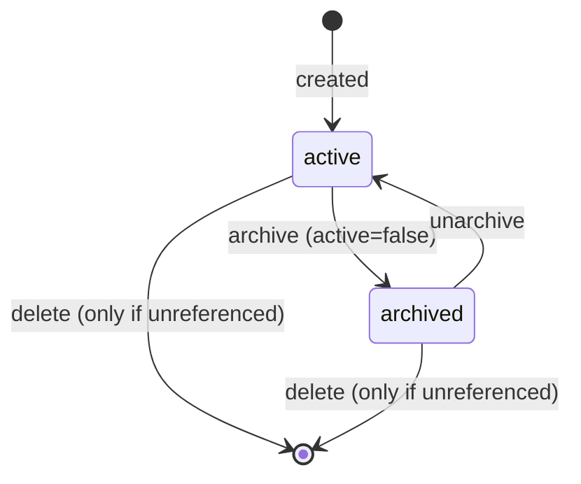

# F03 — Products and Services
> **Status:** v1.0 · 2026-10-12 · **Phases:** P1 (products/services, units and extra units, net/gross entry, 4-decimal prices, VAT rate keys, revenue account override, §35a labour share, categories, customer-specific prices, purchase price and margin, CSV import/export, archive, REST/MCP), P4 (stock via delivery notes, low-stock alerts, OSS destination rates) · **sevdesk parity:** [00 §9](../../research/00-sevdesk-feature-inventory.md#9-products-and-stock-artikel-inventar-add-on), [09 §3](../../research/09-sevdesk-contacts-products-reports.md#3-produkte--artikel-and-the-inventar-add-on), [08 §4](../../research/08-sevdesk-invoicing.md#4-invoice-editor-fields-web-ui), [02 #23, #35](../../research/02-competitor-gap-features.md) · **Compliance:** UST-07, UST-08, UST-10, UST-15, UST-21, UST-20, UST-23, UST-41, KU-02, KU-03, MISC-03, MISC-07, MISC-08, MISC-09, ER-10, DATEV-02, UVA-07, GOBD-03, GOBD-06, AO-04

## 1. Scope (in / out, and what we do better than sevdesk)

**In scope**

- Product master data (`products`) for **goods** and **services**: number, name, description, type, unit, extra units, price (net or gross entry, 4 decimals), purchase price, VAT rate key, exemption reason, revenue account override, §35a labour share, category, tags, custom fields, active flag.
- **Price resolution** (`resolvePrice`) shared by the document editor, the API and MCP: customer price → base price, extra units, net/gross conversion by the VAT rate valid on the supply date, foreign currency.
- **VAT rate keys** resolved by **supply date** from the date-effective rate table (UST-15).
- **Product categories** (`productCategories`, up to 3 levels).
- **Customer-specific prices** (`customerPrices`, with validity dates).
- **Purchase price and margin** (internal only).
- **Stock** (P4): `stock` on the product, `stockMovements` from delivery notes and manual adjustments, reorder level.
- **CSV import/export**, archive and delete rules.

**Out of scope (owned elsewhere)**

| Topic | Where |
|---|---|
| Document line editing, totals, EN 16931 rounding, tax-case derivation per document | Document/invoice spec (uses `resolvePrice` and the rate keys) |
| Units list and custom units | F01 Settings (`units`, SET-090) |
| Time-tracking services with hourly rates | P4 projects/time spec (`timeEntries.productId`) |
| Variants (size/colour SKUs), tiered/volume prices, price lists per customer group | Not in v1 (open question) |
| Warehouses, purchase orders, inventory valuation for the balance sheet | Not planned (AO-07: balance sheet is handed over via DATEV) |
| OSS destination-country rates per product | P4 (UVA-07); v1 blocks EU B2C over the threshold |
| PAngV Grundpreis (price per kg/l for consumer shops) | Not planned (shop topic, not invoicing) |
| sevdesk API import of products | Import feature spec (P1) |

**What we do better than sevdesk**

1. **Date-effective VAT**: products carry a rate *key*, not a fixed percentage. The rate is resolved by the supply date, so the 2026 restaurant-food change or any future rate change needs no product edits (UST-15, MISC-09). sevdesk stores a percentage per product.
2. **4-decimal prices and 3-decimal quantities** everywhere (sevdesk complaint: too few decimals).
3. **Customer prices, categories (nested) and stock included**, no paid Inventar add-on.
4. **§35a labour share** per product, so B2C invoices print the labour subtotal automatically (MISC-07).
5. **Revenue account override** validated against the chart and the tax rate, so DATEV exports stay consistent.
6. **Margin visible while editing a document** (internal only, never printed).
7. **CSV export** of everything and an import with preview; archived products stay reproducible on old documents.

## 2. User stories

**As the owner**
- US-01: I create "Webdesign Stunde" as a service at 95,00 € net per hour (`HUR`) and "Kabel Cat7" as goods at 1,2345 € per metre with an extra unit "Rolle (100 m)".
- US-02: I sell to consumers in my shop and enter prices gross (119,00 €); the system derives the net price with the rate valid on the supply date.
- US-03: I agree a special price of 85,00 € per hour with one customer from 1 January; invoices for that customer use it automatically.
- US-04: As a craftsman I set 60 % labour share on "Badsanierung Pauschale"; B2C invoices show the §35a labour subtotal.
- US-05: I see purchase price and margin per product and per document line.
- US-06: I archive old products; they disappear from the pickers but old invoices still show them.
- US-07 (P4): Delivery notes reduce my stock, and I get a notification when a product falls below its reorder level.

**As Claude via MCP**
- US-08: "Erstelle ein Angebot über 10 Stunden Beratung für Müller GmbH": I look up the product with `product_search`, get the customer's price with `product_resolve_price` and draft the quote.
- US-09: I create a new product from a supplier price list the owner pasted, with the right unit code and rate key.

**As my website via API**
- US-10: My shop syncs its catalogue from `/api/v1/products` (active products, prices, units, rate keys) and asks `/products/{id}/price` for the customer-specific gross price at checkout.

## 3. Functional requirements

### 3.1 Product master data

| ID | Requirement | Priority | Phase | Compliance refs |
|---|---|---|---|---|
| PRD-001 | `products` fields: `number`, `name`, `description` (rich text, printed), `internalNote` (never printed), `type` (`service` / `good`), `unitCode`, `extraUnits`, `priceMode`, `unitPriceMicros`, `purchasePriceMicros`, `vatRateKey`, `exemptionReasonCode`, `revenueAccountOverride`, `laborCostShareBp`, `categoryId`, `tags`, `customFields`, `active`, `version` | MUST | P1 | UST-07 |
| PRD-002 | `number` (Art.-Nr., BT-155) is assigned at creation from the default `product` number range (F01). A manual number is allowed: 1–50 printable characters, unique case-insensitive among all products incl. archived | MUST | P1 | ER-10 |
| PRD-003 | `name` (BT-153) is mandatory, 1–200 chars. `description` (BT-154) ≤ 5,000 chars of sanitised rich text (bold, italic, lists). Placeholders are allowed in name/description (F01 SET-083) | MUST | P1 | UST-07 |
| PRD-004 | A generic-only name ("Diverses", "Leistung", "Pauschale", "Sonstiges", "Artikel", "Ware", "Dienstleistung", case-insensitive, also with trailing punctuation) produces the UST-07 warning on the product and again on every document line using it | MUST | P1 | UST-07 |
| PRD-005 | `type` drives the default unit (`good` → `C62`, `service` → `HUR`) and the per-line tax-case derivation in documents (intra-Community supply only for goods; EU B2B service only for services) | MUST | P1 | UST-20, UST-21 |
| PRD-006 | `unitCode` must be an active unit from `units` (UN/ECE Rec 20/21, F01 §5.7) | MUST | P1 | UST-07, ER-10 |
| PRD-007 | Edits use optimistic concurrency (`version`) and write an audit entry with the diff | MUST | P1 | GOBD-06 |
| PRD-008 | GTIN (BT-157) with GS1 check digit | COULD | P1 | ER-10 |
| PRD-009 | Services carry `placeOfSupplyRule` (03 `PlaceOfSupplyRule`; absent = `general`: §3a Abs. 2 UStG for businesses, §3a Abs. 1 for consumers). Other values: `property` (§3a Abs. 3 Nr. 1, place of the property; also sets the §14b note for consumers), `event_admission` (§3a Abs. 3 Nr. 5), `restaurant` (§3a Abs. 3 Nr. 3b), `short_term_vehicle_rental` (§3a Abs. 3 Nr. 2), `passenger_transport` (§3b Abs. 1), `catalogue_3a4` (§3a Abs. 4 catalogue services to non-EU consumers), `electronic` (§3a Abs. 5). The value is copied to `documentLines.placeOfSupplyRule` at insertion and frozen at finalisation. The document tax-case derivation uses it, e.g. a seminar admission in Germany for a Swiss business stays taxable in Germany. Ambiguous combinations require an explicit choice on the document (EC-046) | MUST | P1 | UST-20, UST-23 |

### 3.2 Prices

| ID | Requirement | Priority | Phase | Compliance refs |
|---|---|---|---|---|
| PRD-009a | **§13b reverse-charge type** `reverseCharge13b?: Rc13bType` (03; absent = no §13b). Values come from the date-effective rule table `rc13bTypes` (v1 rows as in F04 App. C: `construction` Bauleistungen §13b Abs. 2 Nr. 4, `cleaning` Gebäudereinigung Nr. 8, `metals` Nr. 11, `scrap` Nr. 7, `electronics` Mobilfunkgeräte/Tablets/Konsolen/integrierte Schaltkreise Nr. 10), each with the §13b Abs. 2 paragraph, the note text and the Kz 60 mapping. When the product is sold to a **business in Germany** whose status qualifies (e.g. a valid USt 1 TG certificate for construction, F02 CON-070), `deriveTaxCase()` proposes domestic §13b (category AE, „Steuerschuldnerschaft des Leistungsempfängers“, UST-22) for that line; mixed documents keep the categories per line (EC-049). For consumers and foreign customers the flag has no effect. Copied to `documentLines.reverseCharge13b` at insertion. The product form shows the field for both goods and services (metals/mobile devices are goods) | MUST | P1 | UST-22, UST-10 |
| PRD-010 | Prices are integers in micros (1/10,000 €), input with up to **4 decimals** in German or international notation (04-ui-ux §8). Input with more than 4 decimals is rejected, never silently rounded | MUST | P1 | GOBD-03 |
| PRD-011 | `priceMode` `net` or `gross`: the price is stored in the mode it was entered; the other value is **derived** and never stored | MUST | P1 | MISC-03 |
| PRD-012 | Derivation uses the rate resolved for a reference date (the form shows today's rate; documents use the supply date): gross = round_half_up(net × (10000 + rateBp) / 10000) at 4 decimals; net = round_half_up(gross × 10000 / (10000 + rateBp)) at 4 decimals. Implemented once in `src/domain/money/priceConversion.ts` and property-tested (round-trip error ≤ 1 micro) | MUST | P1 | UST-15, GOBD-03 |
| PRD-013 | The form shows both values side by side ("VK netto" / "VK brutto"); editing either sets `priceMode` to that side (sevdesk parity) | MUST | P1 | MISC-03 |
| PRD-014 | Range: −99,999,999.9999 € … 99,999,999.9999 €. Zero prices are allowed with a warning; negative prices are allowed with a warning (e.g. Pfandrückgabe) | MUST | P1 | — |
| PRD-015 | Product prices are in EUR. In a foreign-currency document the line price is converted with the document's exchange rate at insertion (4 decimals) and stays editable; the conversion source is the document's `fxRateToEur` | MUST | P1 | MISC-08 |

### 3.3 VAT rate keys

| ID | Requirement | Priority | Phase | Compliance refs |
|---|---|---|---|---|
| PRD-020 | `vatRateKey` values come from the rule table `vatRateKeys` (data, not code). v1 ships: `standard` (S 19 %), `reduced` (S 7 %), `restaurant_food` (S 19 % until 2025-12-31, 7 % from 2026-01-01), `zero` (Z 0 %, PV §12 Abs. 3), `exempt` (E, requires `exemptionReasonCode`) | MUST | P1 | UST-15, UST-10, MISC-09 |
| PRD-021 | The rate for a document line is resolved by the **supply date** (UST-08): single date → that date; month or period → the rate valid throughout. If a rate change for the line's key (or a KU switch) falls **inside** the line's period, finalisation is **blocked** and the line must be split by sub-period (EC-024, EC-025): "Im Leistungszeitraum ändert sich der Steuersatz für „{key}“ am {date}. Bitte die Position in zwei Zeiträume aufteilen." The editor offers "Position aufteilen" (splits quantity pro rata by days, editable) | MUST | P1 | UST-15, UST-08 |
| PRD-022 | Document lines store the `vatRateKey` they came from, so the rate re-resolves when the draft's supply date changes, and freeze the resolved category/rate and rule row ID at finalisation | MUST | P1 | UST-15, GOBD-06 |
| PRD-023 | The product key only applies when the document tax case is `domestic` (or `exempt_4`). For other tax cases the document's category wins (K, AE, G, O, KU) and the editor shows "Produktsteuersatz wird wegen Steuerfall {case} nicht angewendet." | MUST | P1 | UST-10, UST-20..UST-23, KU-02, KU-03 |
| PRD-024 | `exempt` requires `exemptionReasonCode` (VATEX) and maps to a German §4 UStG legal text from the rule table (§5.4). The text is printed automatically on documents (UST-10) | MUST | P1 | UST-10 |
| PRD-025 | `zero` (PV) lines require the PV confirmation on the document (≤ 30 kWp, operator, private/public-benefit building — document spec). The product form explains the conditions | MUST | P1 | UST-15 |
| PRD-026 | Products keyed `restaurant_food` show a hint that drinks must be separate products (`standard`) | SHOULD | P1 | UST-15 |
| PRD-027 | When a rate change is added to the rule tables (release or F01 override), the products list shows a banner: "Ab {date} ändert sich der Steuersatz für {key}. {n} Produkte mit Bruttopreis behalten den Bruttopreis (Nettopreis sinkt/steigt); {m} Produkte mit Nettopreis behalten den Nettopreis." with a link to a filtered list and a bulk "Preise anpassen ab {date}" (creates new prices via an effective-dated price update, PRD-031) | SHOULD | P1 | MISC-09, UST-15 |

### 3.4 Customer prices, extra units, margin

| ID | Requirement | Priority | Phase | Compliance refs |
|---|---|---|---|---|
| PRD-030 | `customerPrices` per (product, contact, `validFrom?`) with `unitPriceMicros` and `priceMode`. Several rows per pair form a history; the row with the latest `validFrom` ≤ reference date applies; a row without `validFrom` applies from the beginning | MUST | P1 | — |
| PRD-031 | Scheduled base-price change: "Neuer Preis ab {date}" stores a pending price that becomes the product price at 00:00 Europe/Berlin on that date (cron), with audit entry. Until then documents with supply date ≥ that date already use the pending price | SHOULD | P1 | MISC-09 |
| PRD-032 | **Price resolution** `resolvePrice(product, { contactId?, referenceDate, unitCode?, quantityMilli?, documentPriceMode, documentCurrency, fxRate? })` (pure domain) returns `{ unitPriceMicros, priceMode, source: "customer" \| "parent_customer" \| "base", vatRateKey, rateBp, category, discountBp?, warnings[] }`. Order: customer price of the contact → customer price of its parent organisation → base price; then extra-unit factor; then net/gross conversion to the document mode; then currency | MUST | P1 | UST-15, MISC-03, MISC-08 |
| PRD-033 | Persons under an organisation inherit the organisation's customer prices (source `parent_customer`) unless they have their own | MUST | P1 | — |
| PRD-034 | `contacts.defaultDiscountBp` is returned as `discountBp` and applied as a line discount on top of the **base** price only; on top of a customer price only if the company setting "Kundenrabatt auch auf Kundenpreise" is on (default off) | SHOULD | P1 | — |
| PRD-035 | `extraUnits` (max 10): `unitCode` (≠ base unit, unique) and `factorMilli` (base units per extra unit, > 0, 3 decimals). The extra-unit price = round_half_up(base price × factor / 1000) at 4 decimals; customer prices apply to the base unit and are scaled the same way | MUST | P1 | UST-07 |
| PRD-036 | `purchasePriceMicros` is a **net** purchase price (EUR). Margin % = (net sales − purchase) / net sales; markup % = (net sales − purchase) / purchase. For a Kleinunternehmer company (no input-tax deduction) the effective purchase cost is shown gross (purchase × (1 + standard rate)) with the label "inkl. nicht abziehbarer Vorsteuer" | MUST | P1 | KU-02 |
| PRD-037 | Margin and purchase price are internal: never printed, never in the snapshot's render model, never in XML; visible in the product list, product detail and the document editor (per line and total) | MUST | P1 | — |
| PRD-038 | Warning when the sales price is below the purchase price ("Verkaufspreis liegt unter dem Einkaufspreis.") | SHOULD | P1 | — |

### 3.5 §35a labour share

| ID | Requirement | Priority | Phase | Compliance refs |
|---|---|---|---|---|
| PRD-040 | `laborCostShareBp` 0–10000 (optional). 10000 → lines are labour (`isLaborCost = true`); 0 → material | MUST | P1 | MISC-07 |
| PRD-041 | On a **B2C** document, inserting a product with 0 < share < 10000 splits it into two lines: "{name} – Arbeitskosten" (`isLaborCost`, price = round_half_up(price × share)) and "{name} – Material" (price = price − labour price), same quantity and unit, so the sum is exact. On B2B documents the product stays one line (no §35a relevance) | MUST | P1 | MISC-07 |
| PRD-042 | The labour subtotal (incl. VAT) on B2C invoices is computed by the document spec from `isLaborCost` lines | MUST | P1 | MISC-07 |

### 3.6 Revenue account override

| ID | Requirement | Priority | Phase | Compliance refs |
|---|---|---|---|---|
| PRD-050 | `revenueAccountOverride` must be an active `ledgerAccounts` row of type `revenue` in the company chart | MUST | P1 | DATEV-02 |
| PRD-051 | The override applies only to domestic lines (S, Z, E). For K, AE, G, O and KU lines the default mapping (DATEV-02 table) is used; the editor shows this | MUST | P1 | DATEV-02 |
| PRD-052 | If the override account is an automatic VAT account (`automaticVatAccount`) whose rate differs from the rate the product's key resolves to (today or at any known future validity), saving is refused (`REVENUE_ACCOUNT_RATE_MISMATCH`). At finalisation the check is repeated for the line's actual rate | MUST | P1 | DATEV-02 |
| PRD-053 | The line copies the override into `documentLines.revenueAccount` at insertion; it can be changed per line in drafts | MUST | P1 | DATEV-02 |

### 3.7 Categories, tags, custom fields

| ID | Requirement | Priority | Phase | Compliance refs |
|---|---|---|---|---|
| PRD-060 | `productCategories` with `parentId`, max depth 3, name 1–60 chars unique among siblings. Seeded: "Dienstleistungen", "Waren" | MUST | P1 | — |
| PRD-061 | Deleting a category with products or children asks to move them to the parent (or none); never orphans | MUST | P1 | — |
| PRD-062 | Tags (F01 SET-094) and custom fields (entity `product`, F01 SET-095); custom fields with `printOnDocuments` are copied to the line description at insertion and frozen at finalisation | MUST | P1 | GOBD-06 |

### 3.8 Archive, delete, product changes vs documents

| ID | Requirement | Priority | Phase | Compliance refs |
|---|---|---|---|---|
| PRD-070 | Inserting a product into a document **copies** name, description, unit, price, key, labour flag, revenue account and item number into the line. Finalised documents never change when the product changes (snapshot) | MUST | P1 | GOBD-06, UST-07 |
| PRD-071 | Draft lines keep their copied name, description, unit and price when the product changes; the editor marks such lines "Produkt geändert" and offers "Übernehmen" (per line or all). **Exception — tax:** if the product's `vatRateKey` changed, draft lines take the new key on the next edit of the draft and show the notice "Steuersatz geändert: {old} → {new}" (EC-041); the rate always re-resolves from the key and the supply date (PRD-022). Converting a quote/order into an invoice re-resolves rates by the new supply date with the same notice (EC-040) | MUST | P1 | UST-15 |
| PRD-072 | **Archive** (`active = false`): hidden from pickers, search defaults and the shop API (`active=true` filter); still readable; drafts and recurring templates using it get a warning; recurring generation continues with the copied line data and notifies the owner once | MUST | P1 | — |
| PRD-073 | **Delete** only if the product is referenced by no document line (any status), recurring template, time entry, stock movement; customer prices are deleted with it. Otherwise `PRODUCT_IN_USE` and archive is offered | MUST | P1 | GOBD-06 |
| PRD-074 | Product usage tab: documents containing the product (by `documentLines.productId`), units sold and revenue this year/last year from finalised invoice lines | SHOULD | P1 | — |

### 3.9 Import and export

| ID | Requirement | Priority | Phase | Compliance refs |
|---|---|---|---|---|
| PRD-080 | CSV import wizard (`/produkte/import`) with the same mechanics as contacts (F02 CON-140..142): ≤ 10 MB, ≤ 20,000 rows, encoding and separator detection, mapping presets incl. sevdesk export header aliases, preview with neu/Aktualisierung/Konflikt/Fehler, idempotent job. Match key: `number` | MUST | P1 | GOBD-03 |
| PRD-081 | Unit mapping: Rec 20 code or a known German/English label alias (`Stk`, `Stück` → `C62`; `Std`, `Stunde`, `h` → `HUR`; `Tag` → `DAY`; `pauschal`, `Pauschale` → `LS`; `km` → `KMT`; `m` → `MTR`; `m²`, `qm` → `MTK`; `kg` → `KGM`; `l` → `LTR`; `Monat` → `MON`). Unknown → row error | MUST | P1 | UST-07 |
| PRD-082 | VAT mapping: a key column (`standard`, `reduced`, …) or a percentage: `19` → `standard`, `7` → `reduced`; `0` → row error unless the row specifies `zero` (PV) or `exempt` + reason code. Restaurant food must be given as key | MUST | P1 | UST-15 |
| PRD-083 | Price columns: net or gross (one of them per row); German and international decimal notation; > 4 decimals → row error | MUST | P1 | GOBD-03 |
| PRD-084 | Category path column ("Waren > Kabel") creates missing categories (max depth 3) | SHOULD | P1 | — |
| PRD-085 | CSV export (UTF-8 with BOM, `;`) of the filtered list: all fields, net and gross price at today's rate, rate key and current rate, purchase price, margin, category path, tags, custom fields, extra units (JSON column), stock (P4) | MUST | P1 | — |

### 3.10 Stock (P4)

| ID | Requirement | Priority | Phase | Compliance refs |
|---|---|---|---|---|
| PRD-090 | `stock.enabled` only for `type = good`. `stock.quantityMilli` is a cached sum of `stockMovements` (recomputed in the same transaction as each movement) | MUST | P4 | — |
| PRD-091 | Finalising a **delivery note** creates one negative movement per stock-enabled line (`reason: delivery_note`, `documentId`), quantity converted from extra units to base units | MUST | P4 | — |
| PRD-092 | Cancelling a finalised delivery note creates the reversing positive movements (`reason: correction`); movements are never edited or deleted | MUST | P4 | GOBD-06 |
| PRD-093 | Invoices and their Stornos do not move stock (stock follows delivery notes, sevdesk parity). Company option "Bestand bei Rechnung ohne Lieferschein abbuchen" | COULD | P4 | — |
| PRD-094 | Manual "Zugang" / "Abgang" / "Korrektur" with quantity and mandatory text | MUST | P4 | — |
| PRD-095 | Negative stock is allowed with a warning by default; option "Negativen Bestand verhindern" blocks finalising a delivery note that would go below zero | SHOULD | P4 | — |
| PRD-096 | Reorder level `reorderLevelMilli`: crossing below creates one notification (and e-mail if enabled) until stock rises above it again | MUST | P4 | — |
| PRD-097 | Stock history tab ("Buchungsverlauf") with running balance and links to documents | MUST | P4 | — |

## 4. Workflows and state machines

### 4.1 Product lifecycle



### 4.2 Inserting a product into a document line

```
editor/API/MCP: addProductLine(documentId, productId, {quantityMilli, unitCode?})
  1. load product (active or archived-with-warning), document (contact, tax case, supply date, price mode, currency)
  2. resolvePrice(...)                                  (PRD-032)
  3. category/rate:
       taxCase domestic/exempt_4 → key → rate table at supply date (or today if none yet)
       else → document tax case category (K/AE/G/O/KU), product key ignored  (PRD-023)
  4. B2C and 0 < laborCostShareBp < 10000 → split into labour + material lines (PRD-041)
  5. copy name, description (+ printable custom fields), unitCode, itemNumber=product.number,
     revenueAccount=override (domestic only), vatRateKey, isLaborCost
  6. return line(s) + warnings (generic name, archived, price below purchase, zero price, PV confirmation needed)
supply date changed on the draft → re-resolve rate for every line with a vatRateKey (PRD-022);
   gross-mode lines keep gross, net-mode lines keep net (§5.6)
finalisation → freeze category, rate, rule row ID, prices in documentLines + snapshot
```

### 4.3 Rate resolution example (restaurant food, UST-15)

| Supply date | Key | Resolved |
|---|---|---|
| 2025-12-31 | `restaurant_food` | S 19 % (rule row `restaurant_food@2007-01-01`) |
| 2026-01-01 | `restaurant_food` | S 7 % (rule row `restaurant_food@2026-01-01`) |
| 2026-01-01 | `standard` (drinks) | S 19 % |
| month 2025-12 | `restaurant_food` | 19 % (valid throughout December 2025) |
| period 2025-12-15..2026-01-15 | `restaurant_food` | **blocked** — split into 2025-12-15..2025-12-31 (19 %) and 2026-01-01..2026-01-15 (7 %) (EC-024) |

### 4.4 Stock movement (P4)

```
delivery note finalised → for each line with productId and product.stock.enabled:
   q = quantityMilli × (extra unit factor or 1000) / 1000 → insert stockMovements(−q, "delivery_note")
   → stock.quantityMilli −= q → if crossed below reorder level → notification
delivery note cancelled → insert +q ("correction") for each original movement
```

## 5. Validation rules and edge cases

Errors use `{ code, message, field? }`; `message` is German and shown verbatim.

### 5.1 Fields

| Field | Rule | Error code · message |
|---|---|---|
| `name` | 1–200 chars | `REQUIRED` · "Bitte einen Produktnamen angeben." |
| `name` generic | warning | "„{name}“ ist zu allgemein. Rechnungen brauchen eine handelsübliche Bezeichnung (§ 14 Abs. 4 Nr. 5 UStG)." |
| `number` | 1–50 printable chars, unique | `PRODUCT_NUMBER_TAKEN` · "Die Artikelnummer {number} ist bereits vergeben." |
| `description` | ≤ 5,000 chars after sanitising | `TOO_LONG` · "Die Beschreibung ist zu lang (max. 5.000 Zeichen)." |
| `unitCode` | active unit | `UNIT_INVALID` · "Bitte eine gültige Einheit auswählen." |
| `unitPriceMicros` input | ≤ 4 decimals | `PRICE_PRECISION` · "Preise können höchstens 4 Nachkommastellen haben." |
| `unitPriceMicros` | within PRD-014 range | `PRICE_OUT_OF_RANGE` · "Der Preis liegt außerhalb des zulässigen Bereichs." |
| price 0 | warning | "Der Preis ist 0,00 €." |
| price < 0 | warning | "Negativer Preis: Bitte die steuerliche Behandlung prüfen (z. B. Gutscheine, Pfand)." |
| `purchasePriceMicros` | ≥ 0, ≤ 4 decimals | `PRICE_PRECISION` / `PRICE_OUT_OF_RANGE` |
| `vatRateKey` | from `vatRateKeys` | `VAT_KEY_INVALID` · "Unbekannter Steuersatz-Schlüssel." |
| `exempt` without reason | | `EXEMPTION_REASON_REQUIRED` · "Für steuerfreie Produkte ist ein Befreiungsgrund (§ 4 UStG) erforderlich." |
| reason code with non-exempt key | | `EXEMPTION_REASON_NOT_ALLOWED` · "Ein Befreiungsgrund ist nur bei steuerfreien Produkten möglich." |
| `laborCostShareBp` | 0–10000 | `OUT_OF_RANGE` · "Der Arbeitskostenanteil muss zwischen 0 und 100 % liegen." |
| `laborCostShareBp` on `good` | warning | "Arbeitskosten bei Waren: Ist das Produkt eine Handwerkerleistung?" |
| `revenueAccountOverride` | revenue account in chart | `REVENUE_ACCOUNT_INVALID` · "Das Konto {account} ist kein Erlöskonto im {chart}." |
| override rate mismatch | | `REVENUE_ACCOUNT_RATE_MISMATCH` · "Das Erlöskonto {account} ist ein Automatikkonto für {accountRate} %, das Produkt hat {rate} %." |
| `extraUnits[i].unitCode` = base or duplicate | | `EXTRA_UNIT_DUPLICATE` · "Jede Zusatzeinheit darf nur einmal vorkommen und nicht der Basiseinheit entsprechen." |
| `extraUnits[i].factorMilli` ≤ 0 | | `EXTRA_UNIT_FACTOR` · "Der Umrechnungsfaktor muss größer als 0 sein." |
| > 10 extra units | | `EXTRA_UNIT_LIMIT` · "Höchstens 10 Zusatzeinheiten." |
| `categoryId` depth > 3 | | `CATEGORY_DEPTH` · "Kategorien können höchstens 3 Ebenen tief sein." |
| `stock.enabled` on a service | | `STOCK_SERVICE` · "Bestandsführung ist nur für Waren möglich." |

### 5.2 Customer prices

| Rule | Error code · message |
|---|---|
| Duplicate (product, contact, validFrom) | `CUSTOMER_PRICE_DUPLICATE` · "Für diesen Kunden existiert ab {date} bereits ein Preis." |
| Contact archived/merged/restricted | `CUSTOMER_PRICE_CONTACT_INVALID` · "Der Kontakt ist archiviert, zusammengeführt oder eingeschränkt." |
| Contact without role customer | warning · "Der Kontakt ist nicht als Kunde markiert." |
| Price precision/range | as §5.1 |

### 5.3 Categories and delete

| Rule | Error code · message |
|---|---|
| Sibling name duplicate | `CATEGORY_DUPLICATE` · "Diese Kategorie existiert auf dieser Ebene bereits." |
| Delete product in use | `PRODUCT_IN_USE` · "Das Produkt wird in {n} Dokumenten verwendet und kann nur archiviert werden." |
| Delete category with content without target | `CATEGORY_NOT_EMPTY` · "Bitte wählen, wohin Produkte und Unterkategorien verschoben werden." |

### 5.4 Exemption reasons (rule table, confirm with Steuerberater)

| §4 UStG | Short text printed | VATEX |
|---|---|---|
| Nr. 8 (Finanzumsätze) | "Steuerfreie Leistung gemäß § 4 Nr. 8 UStG" | `VATEX-EU-135-1B` … `-1F` (by sub-letter) |
| Nr. 10 (Versicherung) | "… gemäß § 4 Nr. 10 UStG" | `VATEX-EU-135-1A` |
| Nr. 12 (Vermietung von Grundstücken) | "… gemäß § 4 Nr. 12 UStG" | `VATEX-EU-135-1L` |
| Nr. 14 (Heilbehandlung) | "… gemäß § 4 Nr. 14 UStG" | `VATEX-EU-132-1C` |
| Nr. 21 (Unterricht) | "… gemäß § 4 Nr. 21 UStG" | `VATEX-EU-132-1I` |
| other | owner-selected code + text from the full VATEX list | |

`exempt` products used by a company whose UStVA mapping marks the exemption "ohne Vorsteuerabzug" (Kz 48) are flagged on the product ("Umsätze ohne Vorsteuerabzug — Vorsteueraufteilung beachten").

### 5.5 Import

| Rule | Message |
|---|---|
| Rate `0` without `zero`/`exempt` | "Zeile {n}: 0 % ist mehrdeutig — bitte „zero“ (PV-Nullsatz) oder „exempt“ mit Befreiungsgrund angeben." |
| Unknown unit | "Zeile {n}: Einheit „{value}“ unbekannt." |
| Both net and gross given and inconsistent at today's rate (> 1 micro difference) | "Zeile {n}: Netto- und Bruttopreis passen nicht zusammen ({rate} %). Bitte nur eine Spalte angeben." |
| Price with > 4 decimals | "Zeile {n}: Preise können höchstens 4 Nachkommastellen haben." |

### 5.6 Regulatory edge cases (exhaustive)

Common principle (GOBD-06): products are master data. Inserting a product copies its data into the line; finalisation freezes the line. The only values that follow the product in drafts are the VAT rate key and rate, which are matters of law (EC-041, RI-22). Every edge case has an acceptance test in §8. Local IDs `PRD-Enn` map to the global catalog in [10-edge-cases.md](../10-edge-cases.md) (EC-*/RI-*), cited in the compliance column and in the tests.

| ID | Situation | Required behaviour | Compliance · 10-edge-cases | Test |
|---|---|---|---|---|
| PRD-E01 | **Product price changes** while drafts and issued documents contain it | Issued documents unchanged (snapshot, PDF/XML hash). Draft lines keep the copied price, marked "Produkt geändert" with "Übernehmen". Recurring templates keep their line prices (recurring spec option "Preise aus Produkt übernehmen") | GOBD-06 · EC-041 | T-PRD-001 |
| PRD-E02 | **Product's rate key changes** (e.g. `standard` → `reduced` after a classification error) | Issued documents unchanged; correcting them is a Rechnungsberichtigung (document spec). Draft lines take the new key on the next edit and show "Steuersatz geändert" (PRD-071) | GOBD-06, UST-15, UST-30 · EC-041 | T-PRD-002 |
| PRD-E03 | **Statutory rate change** (rule table) between drafting and finalisation | Draft lines re-resolve by the supply date at every change and at finalisation (PRD-022). Issued documents keep their frozen rate and rule row ID. Stichtag simulation covers all document types | UST-15, MISC-09, GOBD-06 · RI-22 | T-PRD-003 |
| PRD-E04 | **Restaurant food** across 2025/2026 | `restaurant_food`: supply 2025-12-31 → 19 %, 2026-01-01 → 7 %; drinks (`standard`) 19 % on both dates | UST-15 · EC-040, RI-22 | T-PRD-004 |
| PRD-E05 | **Gross-entered product across a rate change** | Gross stays constant, net is derived at the new rate (consumer price stability); net-entered products keep net, gross changes. PRD-027 banner lists both groups before the change date | UST-15, MISC-03 · (new case, proposed for 10) | T-PRD-005 |
| PRD-E06 | **Supply period spanning a rate change** | Finalisation blocked until the line is split by sub-period (PRD-021); "Position aufteilen" helps | UST-15, UST-08 · EC-024 | T-PRD-006 |
| PRD-E07 | **Rate override** added in F01 for a key | Lines resolve with the override for supply dates in its validity; the line stores the override row ID; issued documents unchanged | MISC-09, UST-15 · EC-117, RI-22 | T-PRD-007 |
| PRD-E08 | **Kleinunternehmer company** uses products with rate keys | Keys ignored, category KU, no VAT on documents (KU-02/03). If the KU status ends on a date, lines with supply date ≥ that date resolve their keys normally | KU-02, KU-03, KU-01 · RI-17 | T-PRD-008 |
| PRD-E09 | **Exempt product** in a K/AE/export document or for a KU company | Document tax case wins (PRD-023); the exemption text of the product is not printed; editor info shown | UST-10, UST-21, UST-23 · EC-048 | T-PRD-009 |
| PRD-E10 | **PV `zero` product** | Category Z (not E), rate 0; finalisation needs the PV confirmation on the document; for EU/export tax cases the tax case wins | UST-15, UST-10 · EC-050 | T-PRD-010 |
| PRD-E11 | **Product type changed** (good ↔ service) | Issued documents unchanged; draft lines keep the copied type information but per-line derivation is re-run and differences flagged (e.g. a former "service" line in an EU B2B document becomes intra-Community supply → requires a qualified VAT check, F02 CON-056) | UST-20, UST-21, GOBD-06 · EC-042 | T-PRD-011 |
| PRD-E12 | **Mixed goods and services** to an EU business | Per line: goods → K (intra-Community supply), services → AE (reverse charge); both legal notes printed; both feed ZM separately | UST-20, UST-21, UVA-05 · EC-049 | T-PRD-012 |
| PRD-E13 | **Base unit changed** on a product with extra units | Confirmation required; extra units are cleared (their factors refer to the old base); draft lines keep their copied unit; issued documents unchanged | UST-07, GOBD-06 · (new case, proposed for 10) | T-PRD-013 |
| PRD-E14 | **Product number changed** | Issued documents keep the old item number (BT-155) in the snapshot; uniqueness enforced incl. archived products | ER-10, GOBD-06 · RI-01 | T-PRD-014 |
| PRD-E15 | **Product archived** while used in drafts or active recurring templates | Warning in the draft; recurring generation continues with copied data and notifies once; archived product not offered in pickers | — · (new case, proposed for 10) | T-PRD-015 |
| PRD-E16 | **Product deleted** with references | `PRODUCT_IN_USE`, archive offered; unreferenced product deleted with its customer prices; audit entry | GOBD-06 · EC-112 | T-PRD-016 |
| PRD-E17 | **Revenue account override** incompatible with the resolved rate | Refused on save (PRD-052); if a rate change later makes it incompatible, finalisation of the affected line is blocked with `REVENUE_ACCOUNT_RATE_MISMATCH` and the owner fixes the line or product | DATEV-02 · (new case, proposed for 10) | T-PRD-017 |
| PRD-E18 | **Override account archived** in the chart | Product form shows an error; finalisation of lines with that account blocked ("Erlöskonto {account} ist archiviert.") | DATEV-02 · (new case, proposed for 10) | T-PRD-018 |
| PRD-E19 | **§35a share changed** after documents exist | Issued documents keep their labour/material lines; draft split lines keep their amounts and are flagged "Produkt geändert" | MISC-07, GOBD-06 · (new case, proposed for 10) | T-PRD-019 |
| PRD-E20 | **Labour share product on B2B** document | Single line, no split; if the document later switches to a consumer contact, the editor offers "In Arbeits-/Materialanteil aufteilen" | MISC-07 · EC-080 | T-PRD-020 |
| PRD-E21 | **Net-entered product on a B2C document** | Converted to gross at the supply-date rate for display (MISC-03); EN 16931 XML stays net-based (document spec) | MISC-03 · EC-053 | T-PRD-021 |
| PRD-E22 | **Customer price with a future `validFrom`** | Applies only to documents whose supply date (or today, if unset) ≥ `validFrom`; changing the draft's supply date re-resolves the price only for lines not edited manually | — · (new case, proposed for 10) | T-PRD-022 |
| PRD-E23 | **Customer price for a merged or restricted contact** | Merged: prices moved to the winner (F02 CON-132); restricted: prices hidden and not applied; deletion request deletes them (F02 CON-162) | DSGVO-02 · EC-113, EC-180 | T-PRD-023 |
| PRD-E24 | **Foreign-currency document** | EUR product price converted with the document rate at insertion (4 decimals); VAT shown in EUR per MISC-08 (document spec) | MISC-08 · (new case, proposed for 10) | T-PRD-024 |
| PRD-E25 | **Advance invoice with product A, final invoice after a rate change** | The advance keeps its frozen rate; the final invoice resolves product lines at the final supply date and deducts advances at their original rate (UST-41, document spec) | UST-41, UST-15 · EC-073 | T-PRD-025 |
| PRD-E26 | **Generic product name** used in a document | UST-07 warning on the product and on the line; not blocking | UST-07 · (new case, proposed for 10) | T-PRD-026 |
| PRD-E27 | **EU B2C sale** of a product | v1: OSS threshold block per UVA-07 (document spec); product rate keys apply the German rate below the threshold; destination rates P4 | UVA-07 · EC-057 | T-PRD-027 |
| PRD-E28 | **Kleinunternehmer margin** | Purchase price treated as gross cost for margin (PRD-036) | KU-02 · (new case, proposed for 10) | T-PRD-028 |
| PRD-E29 | **Stock: delivery note cancelled** after finalisation (P4) | Reversing movements; no edit/delete of movements; Storno of an invoice does not move stock | GOBD-06 · GOBD-06 (new case, proposed for 10) | T-PRD-029 |
| PRD-E30 | **Stock for an invoice without delivery note** (P4) | No movement unless the company option is on; documented in the help text | AO-04 · (new case, proposed for 10) | T-PRD-030 |
| PRD-E31 | **Service with a non-general place of supply** (e.g. seminar admission in Germany sold to a Swiss business) | `placeOfSupplyRule = event_admission` keeps German VAT instead of "not taxable" (PRD-009) | UST-23 · EC-046 | T-PRD-051 |
| PRD-E32 | **Quote from 2025 converted into a 2026 invoice** (restaurant food) | Rates re-resolve by the new supply date; notice "Steuersatz geändert" (PRD-071) | UST-15 · EC-040 | T-PRD-052 |
| PRD-E33 | **Gross-mode document whose line nets don't reproduce the entered gross** | Handled by the document spec's residual-cent algorithm; the product supplies 4-decimal prices only | MISC-03, UST-10 · EC-053 | T-PRD-021 |
| PRD-E34 | **§13b product sold to a German business** (e.g. Bauleistung with `reverseCharge13b = construction`) | Line category AE with the §13b note and Kz 60 when the customer qualifies (valid USt 1 TG certificate); expired/missing certificate → warning and audited confirmation or domestic VAT (EC-047); consumer or foreign customer → flag ignored | UST-22 · EC-047, EC-049 | T-PRD-054, T-PRD-055 |

### 5.7 Other edge cases

- Rounding in extra units: base 1.2345 € × factor 100.000 → 123.4500 €; base 0.3333 € × factor 3.000 → 0.9999 € (not 1.00).
- Conversion stability: net 100.0000 € at 19 % → gross 119.0000 €; gross 99.9900 € at 19 % → net 84.0252 €; converting back gives 99.9900 €.
- A product inserted with quantity in an extra unit keeps the extra unit's code on the line (e.g. `XRO`), so the XML unit is the extra unit (BT-130) and the price is per extra unit.
- Concurrent edits (UI and MCP): `VERSION_CONFLICT`.
- Search folds diacritics and matches number prefixes ("ART-12" finds "ART-12345").

## 6. UI (screens, fields, desktop vs mobile specifics)

Patterns per 04-ui-ux §4.1 and §4.2.

### 6.1 Routes

| Route | Content |
|---|---|
| `/produkte` | List with status chips (Aktiv · Archiviert), category tree filter, search, bulk actions (Tag, Kategorie, archivieren, Export, Preise anpassen) |
| `/produkte/neu` | Create form (also a drawer from the document editor "+ Produkt erstellen") |
| `/produkte/[id]` | Tabs: Stammdaten · Preise (Kundenpreise, Zusatzeinheiten, geplante Preisänderung) · Verwendung · Bestand (P4) · Verlauf |
| `/produkte/kategorien` | Category tree editor (drag and drop, max 3 levels) |
| `/produkte/import` | CSV import wizard |

### 6.2 List

- Desktop columns: Nr. · Name · Typ · Kategorie · Einheit · VK netto · VK brutto · USt (key + current %) · EK · Marge · Bestand (P4) · Tags. Tabular numbers, 4 decimals shown only when non-zero.
- Mobile cards: name + number, price in the company's default price mode, unit, stock badge (P4).
- Rate-change banner (PRD-027) above the list when a change is within 60 days.

### 6.3 Form

1. **Grunddaten**: Typ (Dienstleistung/Ware), Name, Artikelnummer (preview "wird automatisch vergeben"), Kategorie, Beschreibung (rich text, printed), interne Notiz.
2. **Preis**: Einheit (combobox with Rec 20 code hint), VK netto ⇄ VK brutto (both inputs; the edited one is marked "eingegeben"), Steuersatz (select showing "Standard (19 %)", "Ermäßigt (7 %)", "Speisen in der Gastronomie (7 % ab 01.01.2026)", "PV-Nullsatz (0 %)", "Steuerfrei (§ 4 UStG)"), Befreiungsgrund (only for exempt), EK netto, live margin/markup.
3. **Buchhaltung**: Erlöskonto (optional override, combobox over revenue accounts with automatic-rate hint).
4. **Handwerkerleistung**: Arbeitskostenanteil in % with an explanation of §35a.
5. **Zusatzeinheiten** (repeatable rows: unit, factor, computed price).
6. **Bestand** (P4): enable, reorder level.
7. **Tags, eigene Felder**.

Mobile: single column, sticky bottom bar `[Abbrechen] [Speichern]`, numeric inputs with `inputmode="decimal"`.

### 6.4 Preise tab

- Customer prices table: Kunde · Preis (net/gross) · gültig ab · Quelle · actions; "+ Kundenpreis" with contact combobox. Also reachable from the contact's "Preise" tab (F02).
- Planned price change card (PRD-031).

### 6.5 Document editor integration (cross-reference)

- Product autocomplete shows name, number, unit, resolved price (with "Kundenpreis" badge) and margin on hover.
- Lines from products show a small link icon; "Produkt geändert" chip when the product changed after insertion.

## 7. API and MCP exposure

### 7.1 REST (`/api/v1`, scopes `products:read`, `products:write`)

| Method & path | Scope | Notes |
|---|---|---|
| `GET /products?q=&active=&type=&categoryId=&tag=&updatedSince=&limit=&cursor=` | products:read | Each item includes `price: { mode, unitPriceMicros, netMicrosToday, grossMicrosToday, rateBpToday }` |
| `POST /products` | products:write | `Idempotency-Key` supported |
| `GET /products/{id}`, `PATCH /products/{id}` | read / write | PATCH requires `version` |
| `DELETE /products/{id}` | products:write | 409 `PRODUCT_IN_USE` if referenced |
| `POST /products/{id}/archive`, `POST /products/{id}/unarchive` | products:write | |
| `GET /products/{id}/price?contactId=&date=&unitCode=&quantity=&priceMode=&currency=` | products:read | `resolvePrice` result (PRD-032) |
| `GET/POST /products/{id}/customer-prices`, `PATCH/DELETE /products/{id}/customer-prices/{priceId}` | read / write | IDs `cpr_…` |
| `POST /products/{id}/scheduled-price` | products:write | PRD-031 |
| `GET/POST /product-categories`, `PATCH/DELETE /product-categories/{id}` | read / write | IDs `pcat_…` |
| `GET /settings/vat-rate-keys?date=` | products:read | Keys with resolved category/rate on the date |
| `POST /products/import` | products:write | multipart, mapping, `dryRun` → job |
| `POST /exports/products` | products:read | Job → CSV |
| `GET /products/{id}/stock-movements`, `POST /products/{id}/stock-adjustments` | products:read / products:write | P4; IDs `stm_…` |

Prices in API payloads are integers (`unitPriceMicros`) plus a formatted string for convenience (`"95.0000"`); rates in basis points. Webhook events: `product.created`, `product.updated`, `product.archived`, `product.deleted`, `product.price_scheduled`, `product.stock_low` (P4).

### 7.2 MCP tools

| Tool | Hints | Scope | Behaviour |
|---|---|---|---|
| `product_search` | readOnlyHint | products:read | Query, filters; returns ID, number, name, unit, price today, key |
| `product_get` | readOnlyHint | products:read | Full record incl. customer prices and extra units |
| `product_upsert` | — | products:write | Create or update by ID or number; validates unit code and key; returns warnings (generic name, zero price) |
| `product_resolve_price` | readOnlyHint | products:read | `resolvePrice` for a contact, date, unit, quantity |
| `product_set_customer_price` | — | products:write | |
| `product_archive` | — | products:write | Reversible; no delete tool |
| `product_list_categories` | readOnlyHint | products:read | |
| `product_adjust_stock` | — | products:write | P4; manual movement with text |

## 8. Acceptance tests

| Test ID | Given / When / Then | Type | Covers req IDs |
|---|---|---|---|
| T-PRD-001 | GOBD-06 (PRD-E01; EC-041): product at 95.00 € in a finalised invoice and a draft; price changed to 99.00 € / Then the invoice snapshot/PDF hash is unchanged; the draft line keeps 95.00 € with "Produkt geändert"; "Übernehmen" sets 99.00 € | C | PRD-070, PRD-071 |
| T-PRD-002 | UST-15/GOBD-06 (PRD-E02; EC-041): key changed `standard` → `reduced`; on the next edit the draft line takes `reduced` (7 %) with the notice "Steuersatz geändert"; the issued invoice is unchanged | C | PRD-071, PRD-022 |
| T-PRD-003 | MISC-09 (PRD-E03; RI-22): Stichtag simulation — inject `standard` 2000 bp from 2027-07-01; draft with supply 2027-06-30 → 19 %; supply changed to 2027-07-01 → 20 %; a document finalised before keeps 19 % and its rule row ID | U,C | PRD-021, PRD-022 |
| T-PRD-004 | UST-15 (PRD-E04; EC-040, RI-22): `restaurant_food` 2025-12-31 → 1900 bp, 2026-01-01 → 700 bp; `standard` on both → 1900 bp; month `2025-12` → 1900 bp | U | PRD-020, PRD-021 |
| T-PRD-005 | UST-15/MISC-03 (PRD-E05; proposed for 10)): gross product 11.9000 € at 19 % → after a hypothetical change to 7 %, gross 11.9000 €, net 11.1215 €; net product 10.0000 € → gross 10.7000 € | U | PRD-011, PRD-012 |
| T-PRD-006 | UST-08/UST-15 (PRD-E06; EC-024): line with period 2025-12-15..2026-01-15 and `restaurant_food` → finalisation blocked with the split message; "Position aufteilen" creates two lines (17 and 15 days pro rata) at 19 % and 7 %; finalisation then succeeds | U,C | PRD-021 |
| T-PRD-007 | MISC-09 (PRD-E07; EC-117, RI-22): F01 override for `reduced` from 2027-01-01 → lines with supply ≥ that date use it and store the override row ID | C | PRD-022 |
| T-PRD-008 | KU-02/KU-03 (PRD-E08; RI-17): KU company inserts a `standard` product → category KU, no VAT; after KU ends 2026-08-15, a line with supply 2026-08-20 → 19 % | U | PRD-023 |
| T-PRD-009 | UST-21/UST-23 (PRD-E09; EC-048): `exempt` product in an export document → category G with export text; no §4 text printed | U,G | PRD-023, PRD-024 |
| T-PRD-010 | UST-15 (PRD-E10; EC-050): `zero` product → category Z, rate 0; finalisation without PV confirmation blocked; XML category Z | C,G | PRD-025 |
| T-PRD-011 | UST-21 (PRD-E11; EC-042): product changed service → good; a draft EU B2B line is flagged and re-derived to intra-Community supply, requiring a qualified VAT check | C | PRD-005, PRD-071 |
| T-PRD-012 | UST-20/UST-21 (PRD-E12; EC-049): one goods line + one service line to a French business → K + AE categories, both notes; XML validates (KoSIT) | G,V | PRD-005, PRD-023 |
| T-PRD-013 | UST-07 (PRD-E13; proposed for 10)): base unit changed `C62` → `MTR` with extra units → confirmation, extra units cleared; draft lines keep `C62` | C | PRD-035 |
| T-PRD-014 | ER-10 (PRD-E14; RI-01): product number changed → issued invoice XML keeps the old BT-155; duplicate number (incl. archived) → `PRODUCT_NUMBER_TAKEN` | C,G | PRD-002, PRD-070 |
| T-PRD-015 | PRD-E15: archived product in an active recurring template → generation produces the invoice with copied data and one notification; product absent from pickers | C | PRD-072 |
| T-PRD-016 | GOBD-06 (PRD-E16; EC-112): delete product used in a draft → `PRODUCT_IN_USE`; unreferenced product with 2 customer prices → deleted with them, audit entry | C | PRD-073 |
| T-PRD-017 | DATEV-02 (PRD-E17; proposed for 10)): override 8300 (7 % automatic, SKR03) on a `standard` product → `REVENUE_ACCOUNT_RATE_MISMATCH`; on a `reduced` product → saved; applied only to domestic lines, AE line uses 8336 | U,C | PRD-050..PRD-053 |
| T-PRD-018 | DATEV-02 (PRD-E18; proposed for 10)): override account archived → product shows error; finalising a line with it blocked | C | PRD-050 |
| T-PRD-019 | MISC-07 (PRD-E19; proposed for 10)): labour share changed 60 % → 50 % → issued invoice keeps its split lines; draft split lines flagged | C | PRD-041, PRD-071 |
| T-PRD-020 | MISC-07 (PRD-E20; EC-080): 60 % product (1,000.00 €) on a B2C draft → lines 600.00 € labour + 400.00 € material; on B2B → one line; switching the draft to a consumer offers the split | U,E | PRD-040, PRD-041 |
| T-PRD-021 | MISC-03 (PRD-E21; EC-053): net product 100.0000 € on a B2C document → gross 119.0000 € displayed | U | PRD-012, PRD-032 |
| T-PRD-022 | PRD-E22: customer price 85 € from 2027-01-01; draft supply 2026-12-31 → base 95 €; changed to 2027-01-02 → 85 € (line not manually edited); manually edited line stays | U,C | PRD-030, PRD-032 |
| T-PRD-023 | DSGVO-02 (PRD-E23; EC-113, EC-180): restricted contact's customer price is not applied and not listed; after merge, the loser's prices belong to the winner | C | PRD-030 |
| T-PRD-024 | MISC-08 (PRD-E24; proposed for 10)): USD document with rate 1.0850 USD/EUR → 95.0000 € becomes 103.0750 USD on the line | U | PRD-015 |
| T-PRD-025 | UST-41 (PRD-E25; EC-073): advance invoiced at 19 % before a change to 20 %; final invoice line resolves 20 %, advance deducted at 19 % (golden from research §2.6) | U,G | PRD-022 |
| T-PRD-026 | UST-07 (PRD-E26; proposed for 10)): product "Pauschale." → warning on save and on the document line; finalisation not blocked | U | PRD-004 |
| T-PRD-027 | UVA-07 (PRD-E27; EC-057): Austrian consumer, threshold exceeded → document blocked (document spec) while the product resolves 19 % below the threshold | C | PRD-023 |
| T-PRD-028 | KU-02 (PRD-E28; proposed for 10)): KU company, purchase 10.0000 € net, sale 15.0000 € → margin uses 11.9000 € cost (20.67 %) | U | PRD-036 |
| T-PRD-029 | GOBD-06 (PRD-E29; proposed for 10)): delivery note with 5 × stock product finalised → −5; cancelled → +5 correction; movements immutable; invoice Storno → no movement | C | PRD-091, PRD-092, PRD-093 |
| T-PRD-030 | AO-04 (PRD-E30; proposed for 10)): invoice without delivery note and option off → no movement | C | PRD-093 |
| T-PRD-031 | GOBD-03: price input "1.234,56789" → `PRICE_PRECISION`; "1.234,5678" → 12345678 micros; "1234.5" → 12345000 micros | U | PRD-010 |
| T-PRD-032 | GOBD-03: property test — net→gross→net round trip error ≤ 1 micro for all rates in the table (fast-check) | U | PRD-012 |
| T-PRD-033 | Price resolution order: person with own price → own; person without → parent org price (`parent_customer`); none → base | U | PRD-032, PRD-033 |
| T-PRD-034 | Customer discount 10 %: applied on base price; not on customer price unless the company option is on | U | PRD-034 |
| T-PRD-035 | Extra unit `XRO` factor 100.000 with base 1.2345 € → 123.4500 €; base 0.3333 € × 3.000 → 0.9999 € | U | PRD-035 |
| T-PRD-036 | UST-10: `exempt` without reason → `EXEMPTION_REASON_REQUIRED`; with `VATEX-EU-132-1C` → document prints "Steuerfreie Leistung gemäß § 4 Nr. 14 UStG" and XML BT-121 | U,G | PRD-024 |
| T-PRD-037 | Margin and purchase price never appear in the snapshot JSON, PDF text or XML (scan of golden artifacts) | G | PRD-037 |
| T-PRD-038 | UST-15: rate-change banner lists gross- and net-mode products within 60 days of a rule change | E | PRD-027 |
| T-PRD-039 | Scheduled price change from 2027-01-01 becomes the product price at 00:00 Berlin (cron), audit entry; documents with supply ≥ that date already used it | C | PRD-031 |
| T-PRD-040 | UST-15/UST-07: CSV import with `0` rate → row error; `Stk` → `C62`; `qm` → `MTK`; unknown unit → error; dry run writes nothing; re-run idempotent | C | PRD-080..PRD-083 |
| T-PRD-041 | Category path "Waren > Kabel > Cat7 > Extra" → depth error; "Waren > Kabel" creates missing categories | C | PRD-084, PRD-060 |
| T-PRD-042 | Export CSV contains net and gross at today's rate, key and current rate, BOM and `;` | C | PRD-085 |
| T-PRD-043 | Category delete with products → must choose target; products moved, none orphaned | C | PRD-061 |
| T-PRD-044 | Stock (P4): extra unit `XRO` × 2 on a delivery note with factor 100 → −200 base units; reorder level crossing creates exactly one notification | C | PRD-091, PRD-096 |
| T-PRD-045 | Stock (P4): option "Negativen Bestand verhindern" blocks a delivery note that would go below zero | C | PRD-095 |
| T-PRD-046 | `stock.enabled` on a service → `STOCK_SERVICE` | U | PRD-090 |
| T-PRD-047 | REST `GET /products/{id}/price?contactId=…&date=2027-01-02&priceMode=gross` returns source `customer` and gross micros | C | PRD-032 |
| T-PRD-048 | MCP `product_upsert` with unit "Stück" maps to `C62`; with unknown key → `VAT_KEY_INVALID`; no delete tool exposed | C | PRD-006, PRD-020 |
| T-PRD-049 | SEC-02: product created via MCP is attributed `mcp:<keyId>` in the audit log | C | PRD-007 |
| T-PRD-050 | MISC-10: axe clean on list, form, Preise tab, import wizard (desktop + mobile); visual baseline Produktliste | E | PRD-001 |
| T-PRD-051 | UST-23 (PRD-E31; EC-046): service with `placeOfSupplyRule = event_admission`, Swiss business customer, event in Berlin → domestic 19 %; with `general` → not taxable (O); with `property` (property in Munich) → domestic 19 % and, for a consumer, the §14b note | U | PRD-009 |
| T-PRD-052 | UST-15 (PRD-E32; EC-040): quote with supply 2025-12-20 and `restaurant_food` at 19 % converted to an invoice with supply 2026-01-10 → 7 % and the notice | U | PRD-071, PRD-022 |
| T-PRD-053 | UST-15 · RI-22: nightly invariant recomputes the rate of every finalised line from its key and supply date and finds no deviation; a manually tampered rate is reported as ERROR | C | PRD-022 |
| T-PRD-054 | UST-22 (PRD-E34; EC-047, EC-049): product with `reverseCharge13b = construction` on a draft for a German construction business with a valid certificate → line category AE, §13b note, no VAT, Kz 60 mapping; the same product plus a `standard` goods line → two VAT groups (AE + S) with both texts; consumer customer → 19 % | U,G | PRD-009a |
| T-PRD-055 | UST-22 · RI-22: `rc13bTypes` is date-effective data — an unknown type on a product → `RC13B_TYPE_UNKNOWN`; a rule-table override adding a type from 2027-01-01 applies only to lines with supply ≥ that date; the finalised line stores the frozen `reverseCharge13b` and rule row ID | U,C | PRD-009a |

## 9. Open questions

1. **Variants and tiered prices**: needed for the website shop? If yes, add `productVariants` and quantity tiers in P4.
2. **Restaurant food key**: confirm with the Steuerberater that `restaurant_food` (19 % → 7 % on 2026-01-01) is the right modelling, and whether further category keys are needed (e.g. books/e-books, food vs. beverages in retail).
3. **Supply period spanning a rate change**: we block and require a split (EC-024). Confirm with the Steuerberater for continuous services without agreed Teilleistungen (where the law would apply the rate at completion).
4. **VATEX mapping** of §4 UStG exemptions (§5.4) must be confirmed against the current CEF VATEX list.
5. **Foreign-currency price lists**: v1 converts EUR prices. Are per-currency prices needed (e.g. fixed USD price for US customers)?
6. **Stock valuation** for Bilanz companies is out of scope (AO-07). Confirm that the Steuerberater does the inventory valuation.

**Required data-model deltas (lead to merge into 03):**

| Table / field | Change | Reason |
|---|---|---|
| `products.vatRateKey` | string validated against the `vatRateKeys` rule table (v1: `standard`, `reduced`, `restaurant_food`, `zero`, `exempt`) — **done in 03** | UST-15 (2026 change is category-specific; the 4 fixed keys cannot express it) |
| `documentLines.vatRateKey` | add | rate re-resolution when the draft supply date changes (PRD-022); today the line only stores category and rate |
| `documentLines.productSyncedVersion` | add (product `version` at insertion) | "Produkt geändert" detection (PRD-071) |
| `products.placeOfSupplyRule` | add (absent = `general`; services only; enum per 03 §3) — **done in 03** | EC-046, PRD-009 |
| `products.reverseCharge13b` | add `Rc13bType` (rule table `rc13bTypes`), copied to `documentLines` — **done in 03** | UST-22, EC-046/047/049, PRD-009a |
| `products.internalNote` | add | sevdesk "Interne Bemerkung" (PRD-001) |
| `products.gtin` | add (optional) | BT-157 (PRD-008) |
| `products.scheduledPrice` | add `{ validFrom; priceMode; unitPriceMicros }` | PRD-031 |
| `products.number` | document the product-number charset (1–50 printable) — differs from the invoice-number charset of UST-06 | PRD-002 |
| `customerPrices` | add a unique index by (productId, contactId, validFrom) | PRD-030 |
| `stockMovements.text` | add (mandatory for manual movements) | PRD-094 |
| `companyProfile.defaults` | add `discountOnCustomerPrices: boolean`, `stockOnInvoiceWithoutDeliveryNote: boolean`, `preventNegativeStock: boolean` | PRD-034, PRD-093, PRD-095 |
